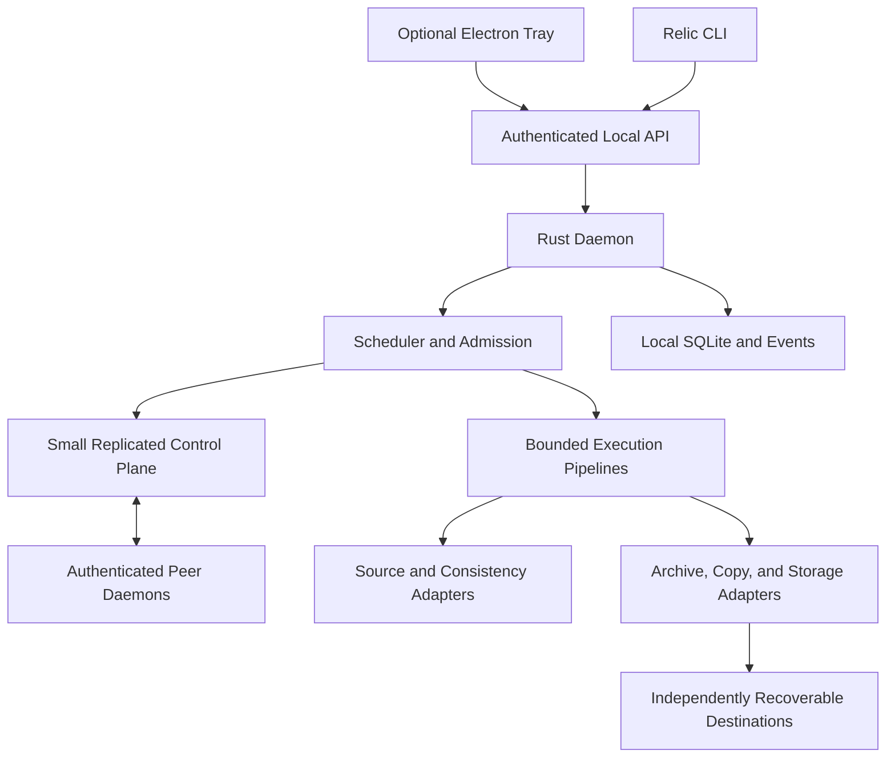

## 1. Abstract

*Relic* is a backup, synchronization, replication, verification, and recovery system with a standalone Rust daemon, a headless command-line interface (CLI), and an optional Electron desktop application. Relic operates on Linux, macOS, and Windows. A node operates independently or joins an authenticated peer cluster. Peers exchange data directly, while a small consensus group coordinates shared configuration and conflicting work without requiring a separately operated controller.

Relic separates recoverable historical backups from direct copies, mirrors, and bidirectional synchronization. Each destination has an independent commit, verification record, retention policy, and recovery outcome. Portable encrypted archives remain recoverable without the original node, desktop application, cluster, or local metadata database. The preferred archive adapter uses an existing restic-compatible engine rather than a new cryptographic repository format.

This specification defines the target contracts for data models, execution, consistency, identity, scheduling, distribution, storage, recovery, security, management, and resource consumption. Streaming, incremental reconciliation, compact metadata, bounded concurrency, and measured adaptive execution support aggressive optimization without weakening recovery guarantees. The specification follows the structural form of the MIRA and MONA technical specifications; Relic has no runtime dependency on either package.

## 2. Keywords

These keywords define normative requirements:

| Keyword | Classification | Meaning |
|---|---|---|
| `MUST` | Obligation | A requirement. |
| `MUST NOT` | Prohibition | A prohibition. |
| `SHOULD` | Encouragement | Encouraged, unless a justified exception exists. |
| `SHOULD NOT` | Discouragement | Discouraged, unless a justified exception exists. |
| `MAY` | Permission | Optional; permitted but not required. |

Only uppercase forms are normative. Normative text MUST use these keywords consistently without weaker or less precise substitutes. Informative text SHOULD avoid them. Keywords MUST NOT be capitalized for emphasis.

## 3. Status and Authority

| Field | Value |
|---|---|
| Status | Draft technical specification |
| Version | `0.1.0-draft.3` |
| Date | 2026-11-10 |
| Project | `relic` |
| Repository | [mayazrakib/relic](https://github.com/mayazrakib/relic) |
| Primary branch | `master` |
| Audience | Daemon, storage, recovery, distributed-systems, desktop, and release implementers |
| Primary purpose | Informational technical specification with normative requirements |
| Implementation state | Partial Rust foundations and local management service; profile acceptance recorded separately in `docs/conformance.md` |
| Product baseline | Rust daemon and CLI, optional Electron client, standalone and peer-cluster operation |
| Archive baseline | Restic-compatible encrypted repositories through a replaceable engine adapter |

This document governs Relic behavior. External repository specifications govern their archive bytes, cryptography, indexes, and maintenance rules. External operating-system contracts govern native snapshot and durability capabilities. An adapter MUST satisfy both Relic requirements and its external format contract. An incompatible combination MUST fail preflight rather than silently reinterpret either contract.

Document revision, application release, configuration schema, database schema, local API, peer protocol, archive format, and recovery-bundle format have separate versions. A distribution MUST identify its specification revision and supported feature profiles. A version match alone MUST NOT establish conformance.

This specification is a target contract. Its publication establishes no implemented backup engine, consensus group, recovery tool, desktop application, security audit, platform support, or measured performance. Implementations MUST support capability discovery and report acceptance evidence by platform, adapter, and profile.

### 3.1. Scope and Profiles

The base profile comprises standalone daemon operation, revisioned jobs, encrypted file archives, local and S3-compatible destinations, scheduling, independent target outcomes, verification, recovery, and headless management. The copy profile adds direct copy and safe mirroring. The cluster profile adds enrollment, peer transfer, replicated definitions, claims, and fenced publication. Desktop, committed-snapshot replication, synchronization, native snapshots, database backup, and imaging are separately declared profiles.

An implementation claiming a profile MUST satisfy every applicable `MUST` and `MUST NOT`. A profile MAY strengthen base requirements. A profile MUST NOT weaken base integrity, authorization, or truthful-reporting requirements. Unsupported optional methods MUST return `UNSUPPORTED_CAPABILITY` before effects.

Bare-metal recovery, generic conflict merging, continuous filesystem mounts, arbitrary remote commands, public relays, and a distributed filesystem are outside the base profile. Imaging support alone does not establish bootability or bare-metal recovery.

### 3.2. Source Baseline and Licensing

The content baseline is the supplied Unified Backup System guide and its [full architecture draft](https://chatgpt.com/space/page_1f2ee5e5ccf0819195d69b14f2877e3f). Relic resolves the guide's temporary project name. This document replaces informal proposals with explicit defaults, capability gates, and release decisions. Relic-owned code and documentation are licensed under the [MIT License](LICENSE), selected by the project owner. Distributions MUST include that license and preserve applicable third-party obligations.

## 4. Terminology

| Term | Definition |
|---|---|
| *Node* | One daemon identity with its own device key, local state, resource budgets, and authorized endpoints. |
| *Cluster* | An enrolled set of nodes sharing a cluster identity and a committed membership configuration. |
| *Voter* | A node participating in the metadata consensus quorum. |
| *Job* | A durable, revisioned definition of selected sources, destinations, method, schedule, and policies. |
| *Occurrence* | One durable execution of a trigger or an explicitly linked recapture, bound to one capture generation and stable across retries and owner changes. |
| *Attempt* | One physical execution effort for an occurrence, with its own immutable terminal outcome. |
| *Run* | The durable record of one attempt and its per-destination efforts. |
| *Destination run* | One attempt's independently checkpointed effort for one occurrence and destination. |
| *Capture generation* | One occurrence's immutable capture identity, source-view binding, and logical selected-content description. |
| *Consistency view* | The source state presented to a capture generation, with an explicitly achieved consistency level. |
| *Snapshot* | A committed historical recovery point in an archive repository. |
| *Repository* | A backup archive with its own format, identity, encryption keys, and maintenance contract. |
| *Endpoint* | An authorized source or destination binding to a path, repository, peer export, or object prefix. |
| *Fence* | A monotonically ordered authority generation enforced at the destination's mutation boundary. |
| *Publication* | Making a staged result authoritative and discoverable under its destination's commit contract. |
| *Receipt* | A durable, queryable destination record binding a logical commit key to its published result. |
| *Recovery set* | The exact manifests, content, metadata, keys, and adapter information needed for a restore. |
| *Reconciliation* | Comparing authoritative state with observations to repair missed events or uncertain effects. |
| *Verification coverage* | The explicitly identified objects, bytes, metadata, and checks included in a verification result. |
| *Resource reservation* | Admission-controlled ownership of bounded memory, storage, concurrency, or rate capacity. |

A job's enabled state, an attempt's execution state, a destination's publication state, and a snapshot's verification level are distinct. Implementations MUST preserve these distinctions in storage and user interfaces.

## 5. Architecture

### 5.1. Responsibility Boundaries

Relic MUST execute scheduled work without Electron, a renderer, or Node.js. Closing, upgrading, or crashing the desktop client MUST NOT stop the daemon or alter a run's outcome. The daemon MUST own scheduling, policies, state transitions, authorization, engine invocation, and recovery.

| Component | Responsibility |
|---|---|
| Domain core | Typed identities, validated definitions, policies, capability contracts, and errors |
| Daemon supervisor | Lifecycle, single-instance ownership, admission, shutdown, and crash reconciliation |
| Scheduler | Calendar projection, occurrences, missed-run policy, and local admission |
| Coordinator | Consensus, membership, claims, fencing generations, and shared definition revisions |
| Executor | Bounded pipelines, checkpoints, destination orchestration, and cancellation |
| Source adapters | Enumeration, consistency views, metadata, streams, and source identity |
| Method adapters | Archive, copy, mirror, synchronization, database, and image semantics |
| Storage adapters | Local, network-mounted, peer, and object-store access and durability |
| Recovery service | Snapshot inspection, restore plans, extraction, verification, and recovery exports |
| State service | Node-local transactions, durable events, indexes, and reconciliation records |
| Local API and CLI | Authenticated management, machine output, and event subscriptions |
| Desktop client | Tray, presentation, user input, notifications, and narrow API access |

The following diagram is informative; the responsibility table and later contracts are normative:


### 5.2. Standalone and Cluster Operation

A standalone installation MUST remain useful without network discovery or cluster membership. Standalone authority MUST serialize conflicting local work through durable state and endpoint ownership. Cluster authority MUST use a mature embedded consensus implementation rather than a new consensus algorithm.

The control plane MUST contain only bounded metadata. File bytes, content chunks, full directory listings, raw progress, credentials, and repository indexes MUST NOT enter the consensus log. The data plane MUST transfer source and destination data directly between authorized endpoints without routing payloads through the metadata leader.

Equal peer capability does not imply that every peer is a voter or currently eligible to execute every job. An elected metadata leader is a temporary coordination role. Source access and destination credentials remain independently scoped.

### 5.3. Process and Privilege Model

The daemon SHOULD be one native executable with optional narrowly scoped helpers. A helper MUST accept typed operations on authorized resources. A helper MUST NOT expose an arbitrary shell or general privileged filesystem API.

Linux SHOULD use a user service where compatible with required access. macOS SHOULD use a `launchd` user agent for interactive-user operation. Windows MUST keep the tray process in the interactive session; a Windows service MUST NOT render that session's UI. A system-service installation MUST explicitly provision service identity, endpoint permissions, and secrets available while logged out.

The daemon MUST reject concurrent owners of the same local state directory. A readiness result MUST distinguish database readiness, secret-store availability, endpoint availability, and cluster quorum. A process responding to a liveness check does not establish backup readiness.

## 6. Abstract Data Model

### 6.1. Record Domain

Records MUST use explicit schema versions, bounded field sizes, and typed identifiers. An absent optional field means the documented default or no configured value; it MUST NOT mean unknown, unlimited, or successful unless explicitly defined. Unknown runtime observations MUST be represented separately from zero and false. Durations MUST carry declared units. Byte counters MUST distinguish logical source bytes, bytes read, stored bytes, and transmitted bytes.

Portable records MUST NOT contain live process state, raw pointers, OS handles, unlocked secrets, or an implicit dependency on a node's directory layout.

### 6.2. Job Definition

| Field | Type and meaning |
|---|---|
| `schema_version` | Supported configuration schema integer |
| `job_id`, `revision` | Opaque identity and positive monotonically increasing definition revision |
| `name`, `description`, `enabled` | Bounded presentation strings and independent enable flag |
| `scope` | `local` or `cluster` |
| `owner_node`, `candidate_nodes` | Preferred source owner and explicitly eligible execution nodes |
| `sources` | Nonempty ordered source definitions with endpoint aliases, selectors, and exclusions |
| `destinations` | Nonempty destination definitions with stable IDs and independent policies |
| `method`, `mode` | Validated method and method-specific options |
| `consistency` | Requested consistency policy and explicit fallback policy |
| `schedule` | Versioned triggers, timezone, transition policies, and catch-up limits |
| `retention`, `verification` | Recovery-point lifetime and verification obligations |
| `resources` | Memory, spool, worker, endpoint, CPU, network, and power constraints |
| `retry`, `overlap` | Retry classification, bounded delays, and concurrency policy |
| `security` | Node-local secret references and required endpoint grants |
| `tags`, `created_at`, `updated_at` | Bounded labels and informational UTC audit timestamps |

Job creation MUST validate required capabilities, source/destination cycles, endpoint ownership, and policy compatibility. An edit MUST supply the expected revision. A mismatch MUST return `REVISION_CONFLICT` without changing the definition. A run MUST retain an immutable copy or durable reference to its exact definition revision.

Disabling a job MUST stop future admissions. Disabling MUST NOT silently cancel an active attempt. Deleting a job MUST preserve its historical run records and recovery points until separately authorized retention removes them.

### 6.3. Execution Records

An occurrence MUST bind job identity, definition revision, trigger identity, schedule revision, intended scheduled instant or event sequence, and a deterministic occurrence identity. It MUST record its exact destination scope, aggregate state, capture generation identity, and optional predecessor occurrence identity. Ordinary scheduled occurrences MUST scope all configured destinations. A linked recapture occurrence MAY scope only destinations without successful receipts in its predecessor; that reduced scope MUST be explicit in records and presentation.

A capture generation MUST bind to the first acquired source view before source reads are admitted. For replication, the source view MUST be the pinned committed source snapshot and its logical recovery manifest rather than a live filesystem capture. Its view identity, source selection, and achieved consistency MUST remain immutable for that occurrence. The selected-content manifest MAY become known incrementally. One occurrence-wide logical manifest MUST be durably frozen before any destination publication is admitted. Every destination payload and receipt MUST bind that same manifest identity, even when native archive IDs, compression, and encryption differ. A destination missing or changing any selected bytes or required metadata MUST fail or require a successor occurrence; it MUST NOT publish a different logical manifest under the original capture. A best-effort view identifies one capture process; it MUST NOT imply an atomic or immutable filesystem view. A capture identity MUST NOT be mistaken for proof that independent reads return identical bytes.

An attempt MUST bind occurrence identity, attempt identity, executor node, capture identity, authority generation, resource reservation, and start/end observations. Each attempt MUST record its selected destination subset and its own terminal outcome. A destination run MUST bind destination identity, logical commit key, staging identity, checkpoint version, achieved consistency, verification coverage, receipt, and error outcome. A snapshot reference MUST include repository identity and engine-native snapshot identity. Identical native snapshot strings from different repositories MUST NOT compare as one snapshot.

An audit event MUST identify actor, operation, affected identity, revision precondition, outcome, correlation identity, and UTC recording time. A notification MUST reference an event rather than replace its audit meaning.

### 6.4. Node-Local Persistence

SQLite MUST reside on a supported local filesystem. The database MUST NOT be placed on SMB, NFS, or a cloud-synchronized directory as a coordination mechanism. WAL mode, foreign keys, bounded transactions, and an explicit busy policy SHOULD be used where supported. The authoritative operational database MUST use durable commit settings, including `synchronous=FULL` in WAL mode. Lossy progress batching MUST NOT weaken authoritative intent, receipt, or completion durability. [SQLite documents the WAL durability and filesystem constraints](https://www.sqlite.org/wal.html).

| Relation | Required identity or constraint |
|---|---|
| `nodes`, `clusters` | Stable identities, trust status, and committed membership epoch |
| `jobs`, `schedules` | Exact revision ownership and validated definitions |
| `occurrences` | Unique logical occurrence key and durable terminal outcome |
| `runs`, `destination_runs` | Attempt identity and per-attempt destination identity, with a shared logical commit-key reference across retries |
| `repositories`, `endpoints` | Repository identity, capability version, and node-local bindings |
| `snapshot_observations` | Repository/native ID pair and verification provenance |
| `transfer_checkpoints` | Versioned transfer identity, integrity binding, and expiry |
| `commit_intents`, `commit_receipts` | Unique logical commit key, payload identity, fence, and reconciliation state |
| `events`, `notifications`, `audit` | Local sequence, origin identity, projection state, and redacted detail |

Cluster-authoritative records MUST be applied from committed consensus state. Local materialization MUST NOT grant cluster authority. Archive manifests MUST remain authoritative for repository history even when local indexes are lost.

Database queries MUST use bounded pages and indexes for job, run, repository, event sequence, and due-time lookup. Writers MUST avoid holding transactions across network calls or engine work. Checkpoint policy MUST bound WAL growth and detect long-lived readers. When state storage is exhausted, the daemon MUST stop admitting effects that cannot be durably recorded.

## 7. Identity and References

### 7.1. Identity Domains

Node, cluster, job, endpoint, repository, occurrence, attempt, event, and commit identities MUST use distinct types. A display name, mount path, IP address, certificate display field, or wall-clock timestamp MUST NOT establish identity. Relic-generated opaque IDs SHOULD use a standard 128-bit identifier representation. Ordering MUST use committed revisions or sequences rather than assume IDs establish causal order.

A device key rotation MUST preserve node identity through an authorized binding change. A restored machine MUST NOT run concurrently using a cloned device identity. A recovery workflow MUST issue a new identity or explicitly fence and replace the old node.

### 7.2. Occurrence and Commit Identity

A calendar occurrence identity MUST derive from the exact tuple `(job_id, schedule_revision, trigger_id, intended_local_time, intended_utc_instant, fold_ordinal)`. A manual occurrence MUST use a durably recorded request identity. An event occurrence MUST use a durable coalescing generation. Retries MUST retain the occurrence identity and allocate a new attempt identity.

The logical destination commit key MUST be `(cluster_or_local_authority_id, job_id, occurrence_id, destination_id)`. Attempt identity MUST NOT be part of that key. Different attempts for the same logical destination result MUST converge on one receipt or an explicit conflict. The first durable publication intent MUST atomically bind the key to the destination-specific payload identity, capture generation, and selected-content manifest identity. Reuse of a bound key with a different binding MUST return `IDEMPOTENCY_CONFLICT` even if the earlier request failed before acknowledgement.

A retry under the same occurrence MUST use the same capture generation and a matching bound payload for each destination with a publication intent. A retry MAY reconstruct content through retained staging or the same immutable view. A reread from a best-effort live view MUST be checked against the persisted selected-content manifest before publication; it MUST NOT assume identical bytes from matching metadata. If exact reconstruction cannot be established, the retry MUST stop before publication.

If a new source view or changed selected content is required, the executor MUST NOT change the original occurrence's capture or publication bindings. It MUST reconcile any uncertain effects and finalize the original occurrence with its actual receipts and failures. It MAY then create a new linked recapture occurrence with a new durable occurrence identity and new destination commit keys. A linked recapture MUST name its predecessor, reason, new capture generation, and destination scope. It MUST NOT alter the scheduled occurrence's historical result or count a predecessor receipt as a receipt for the new capture.

A linked recapture selecting only missing destinations MUST display its reduced scope. It MUST NOT claim that all configured destinations hold the same new recovery point. Unresolved publication outcomes MUST block a conflicting recapture at the same destination until reconciliation establishes safety.

### 7.3. Content and Endpoint Identity

Archive adapters MUST preserve engine-native content identities and repository identifiers. Relic MUST NOT replace a repository's hash or encryption scheme to obtain a local optimization. Auxiliary hashes MUST be domain-separated from repository identities and identify their algorithm and input domain.

A removable destination MUST bind a stable device or volume identity in addition to its path. A peer export MUST bind the peer identity and authorized export identity. An object endpoint MUST bind normalized service endpoint, account scope, bucket, prefix, and repository identity without embedding credentials. A changed binding MUST invalidate stale resume checkpoints and require preflight.

### 7.4. Maintenance Operation Identity

Destructive maintenance MUST use an operation key distinct from a publication commit key. The maintenance key MUST be the tagged tuple `("maintenance", authority_id, resource_id, operation_id)`, where the authority durably issues an opaque `operation_id` when the exact immutable plan is approved. The publication key MUST use a `"publication"` wrapper tag when serialized within the same operation-key union; that wrapper MUST NOT add a field to the four-field publication `commit_key` object used by payload hashing. Resource identity, approved plan digest, policy revision, and actor grant MUST bind to the maintenance key before admission.

Retries MUST reuse the same maintenance key and normalized payload. A changed deletion set, repair action, repository generation, or policy revision MUST require a new plan and new operation identity. Multi-step maintenance MUST record bounded, deterministically ordered suboperations and per-step reconciliation so a partially applied plan cannot be restarted as if no deletions occurred. Uncertain destructive effects MUST block conflicting maintenance until reconciled. Publication and maintenance keys MUST have disjoint serialized domains even when their string fields coincide.

## 8. Methods, Types, and Capabilities

### 8.1. Method Vocabulary

| Method | Required semantics |
|---|---|
| `archive` | Encrypted historical recovery points in an independently recoverable repository |
| `replicate` | Copy one committed historical recovery point and its complete recovery set into a distinct destination repository |
| `copy` | One-way ordinary-file transfer; extra destination files retained by default |
| `mirror` | One-way convergence within an explicit ownership boundary; deletions separately authorized |
| `sync` | Two-way reconciliation with durable common baselines and preserved conflicts |
| `database` | Engine-specific consistent export or physical backup with a tested restore procedure |
| `image` | Explicit volume, partition, or system-image capture with a declared restore capability |

Event-driven execution is a trigger, not a separate recovery guarantee. A full archive means a complete logical recovery point. Incremental storage means reusing existing content while publishing a new complete recovery point. A differential mode MUST identify its baseline and restore dependency set. An implementation MUST NOT relabel ordinary deduplicated snapshots as a tested differential method.

### 8.2. Archive Adapter

The initial archive implementation SHOULD use `rustic_core` behind an internal adapter. The library [reads and writes the restic repository format](https://github.com/rustic-rs/rustic_core). The release MUST select and test exact engine and repository-format versions. A compatible executable adapter MAY be offered where embedding lacks a required capability; its process memory, subprocess count, secrets, cancellation, and exit interpretation remain within Relic's contracts.

Archives MUST be encrypted through the selected engine. Cleartext local copies MUST use the copy method and disclose their protection level. Chunking, pack layout, hashing, compression framing, encryption, and repository locking MUST follow the selected [restic repository design](https://github.com/restic/restic/blob/master/doc/design.rst). Relic MUST NOT introduce a second incompatible archive layer around engine objects.

An adapter MUST expose preflight, enumerate, backup, checkpoint or restart semantics, snapshot lookup, restore, verify, maintenance planning, and maintenance execution. It MUST report cancellation granularity and any operation that cannot be safely resumed. An adapter unable to enforce a requested budget MUST reject that profile before execution or select an explicitly higher approved resource class.

### 8.3. Copy and Mirror

Copy MUST retain destination extras unless a separate authorized policy changes that behavior. File replacement SHOULD write a temporary sibling, verify its contents, synchronize it as required, and atomically replace the target where supported. The run MUST report weaker replacement or durability guarantees on unsupported filesystems.

Mirror MUST operate only within a validated owned root. Deletion MUST default to disabled. When enabled, deletion MUST use a preview bound to source view, destination identity, expected destination generation, and policy revision. The default deletion guard MUST stop a plan exceeding either 100 entries or 10% of eligible destination entries; a nonempty plan against an empty or unavailable source MUST require explicit review. An override MUST authorize that exact plan or an explicitly configured recurring policy.

Mirror SHOULD quarantine deletions for seven days where supported and within the configured quota. Quarantine exhaustion MUST stop deletion rather than silently bypass preservation. Source read failures MUST NOT be interpreted as source deletions. A mirror MUST NOT claim whole-tree atomicity merely because individual file replacements are atomic.

### 8.4. Bidirectional Synchronization

Synchronization MUST maintain per-endpoint generations, common baselines, content identity, and tombstones. Concurrent independent changes MUST preserve both variants and produce `SYNC_CONFLICT`. Modification times alone MUST NOT select a winner. Conflict filenames MUST be valid on the target filesystem and collision-resistant.

Deletion propagation MUST default to disabled. When enabled, tombstones MUST persist for at least the configured offline horizon, default 90 days. An endpoint returning beyond that horizon MUST perform full reconciliation before destructive propagation. Rename inference MUST be treated as an optimization requiring validated identity; uncertain renames MUST preserve data as separate changes.

Synchronization MUST NOT be described as historical backup unless a separate versioned recovery destination exists. Resolution MUST create a new baseline only after all required endpoint changes are reconciled and durably acknowledged.

### 8.5. Database and Image Profiles

A database adapter MUST identify supported database versions, capture method, transaction boundary, consistency level, required privileges, log dependencies, and executable restore postconditions. SQLite live capture MUST use its backup API or another verified consistent mechanism; copying a live main database file alone MUST NOT claim a complete backup. The [SQLite Online Backup API](https://www.sqlite.org/backup.html) provides the baseline reference. PostgreSQL and MySQL/MariaDB SHOULD be prioritized after the base profile.

An image adapter MUST distinguish allocated-block capture, volume image, partition image, system-image set, and bootable recovery. It MUST record partition layout, sector assumptions, required boot metadata, encryption dependencies, source consistency, and restore-device checks. Raw device writes MUST require a separately authorized target identity and exact destructive plan. Sparse or changed-block optimization MUST preserve the complete logical recovery set.

### 8.6. Capability Contract

Adapters MUST advertise versioned capabilities for reading, writing, listing, streaming, range reads, multipart, resume, conditional mutation, atomic replacement, locking, snapshot consistency, metadata preservation, server-side copy, and privilege requirements. Capability claims MUST identify backend conditions and tested limits.

A plan MUST reject an unsupported combination before effects. Generic object `get` and `put` do not imply filesystem semantics, bidirectional synchronization, or safe shared publication. Capability negotiation MUST NOT silently downgrade required consistency, encryption, metadata, or fencing.

### 8.7. Committed Snapshot Replication

Replication reads a committed archive snapshot and publishes a distinct, independently recoverable destination snapshot. It does not capture live source paths and is separate from the fan-out of one backup attempt. A replication job MUST bind `source_repository_id`, `source_snapshot_id`, `destination_id`, and `destination_repository_id` before admission. The source and destination repository identities MUST differ. A selector for the latest snapshot MAY resolve dynamically, but its exact source identity MUST be durably frozen before the replication occurrence starts.

The replication profile MUST default effective publication verification to `data_verified`. An explicitly weaker verification policy MUST fail preflight. The effective job policy, publication payload, and receipt MUST bind the strengthened level.

The replication plan MUST identify the source snapshot's repository identity, native snapshot identity, source capture time, achieved consistency, logical root and metadata, engine and format compatibility, required recovery closure, target repository identity, encryption context, endpoint credentials, and verification policy. The plan MUST record the complete set of required source objects or an engine-supported closure reference that can be enumerated and validated under the selected resource budget. The source snapshot and its reachable closure MUST be protected from conflicting retention and maintenance until destination reconciliation completes. If that protection or a trustworthy immutable source view cannot be obtained, the adapter MUST reject the plan before transfer.

The adapter MUST use the supported source and destination engine operations, authenticate source content when read, and produce a destination-native snapshot that preserves the source's logical content, path identities, and all source-represented metadata. It MUST decrypt and re-encrypt through the destination repository's engine context where independent repository keys require it. Ciphertext, content-addressed IDs, pack layout, compression, and deduplication indexes MUST NOT be assumed portable across repositories. A server-side or native repository-copy fast path MUST be used only when its documented format and key compatibility is proven and the same logical recovery and verification obligations are met.

The replica's lineage record MUST bind the source repository and native snapshot identities to the destination repository and native snapshot identities, original capture time, logical recovery-set identity, verification coverage, and destination receipt. The source capture time MUST remain distinct from replication completion time. A replica MUST NOT be represented as a new live capture. A changed source selection or source snapshot MUST use a new occurrence and logical destination commit key.

The destination MUST validate every reachable object required for the replica and confirm that the native snapshot is independently discoverable and restorable before issuing its replication receipt. The replication profile MUST strengthen the base metadata-verification policy to full authenticated destination-data verification. Destination verification MUST read and authenticate the complete destination recovery closure, including reused objects, from the destination during that replication operation. Local plaintext caches, source-only checks, and earlier verification receipts MUST NOT substitute for those reads. Sampling MUST NOT establish a complete replica. A source-only check or successful upload MUST NOT establish destination recoverability.

Once the destination receipt is durable, the source retention pin MAY be released in accordance with the source repository's separate retention policy. A replication MUST retain the pin while a safe retry remains or any publication outcome is uncertain. The pin MAY be released after a reconciled final failure with no remaining retry, or a reconciled cancellation with no unresolved effect, while preserving the exact failed outcome and audit history. A source repository or source snapshot MUST NOT be pruned merely because transfer began. Each replica has independent destination retention and integrity history. A replica's retention MUST NOT delete the source or another destination's snapshot.

The replication profile MUST test selective and complete restore from the destination after removing access to the source repository, source credentials, and source engine state. Failed reads, missing keys, altered metadata, interrupted transfer, unsupported re-encryption, or a destination closure verification failure MUST produce a failed or unresolved result without a success receipt. A profile MUST reject unsupported metadata preservation instead of silently creating a partial replica.

## 9. Execution and Scheduling Semantics

### 9.1. Job, Occurrence, Attempt, and Destination States

Job definition states MUST be `draft`, `enabled`, `disabled`, or `deleted`. An occurrence, each attempt, and each destination run MUST have separate durable state. The executor MUST reject a transition absent from the applicable table. `waiting`, `paused`, and `recovering` MUST record a reason and the resumable prior phase. Terminal outcomes MUST be immutable; later correction MUST append an audited reconciliation record rather than overwrite history.

An occurrence aggregates destination receipts across attempts for its declared scope. Its transitions are:

| Source | Trigger and precondition | Target and required effect |
|---|---|---|
| `pending` | Due occurrence or authorized request is recorded | `ready`; persist immutable revision and scope |
| `ready` | An attempt is admitted | `active`; bind capture generation before source reads |
| `active` | Every scoped destination has a reconciled successful receipt and no selected effect is uncertain | `completed`; persist aggregate result |
| `active` | An attempt ends and a safe retry remains | `retry_wait`; persist retry budget and next eligibility |
| `retry_wait` | Retry delay and authority/resource gates pass | `active`; create a new attempt targeting unresolved destinations |
| `active` or `retry_wait` | No retry remains, every publication effect is reconciled, and at least one but fewer than all scoped destinations have successful receipts | `partially_completed`; persist successes and terminal failed or canceled targets |
| `active` or `retry_wait` | No retry remains, every publication effect is reconciled, and no scoped destination has a successful receipt | `failed`; persist failure for each scoped target |
| `pending`, `ready`, `active`, or `retry_wait` | Cancellation is reconciled and no publication outcome remains uncertain | `canceled`; preserve any successful receipts and canceled targets |
| `active` or `retry_wait` | A publication may have occurred and cannot yet be reconciled | `recovering`; block conflicting publication and terminal classification |
| `recovering` | Every uncertain effect is classified | `active`, `retry_wait`, `completed`, `partially_completed`, `failed`, or `canceled` according to the applicable guards above |

A job's enabled state MUST NOT be inferred from its occurrence state. A reduced-scope recapture occurrence MUST NOT report full-job capture coverage. A successfully completed occurrence MUST have a successful reconciled receipt for every destination in its declared scope from the same capture generation. Receipt records from an earlier attempt of that occurrence count toward this aggregate. Failed attempt results remain visible after later success.

An attempt begins in `preparing`, may advance through `transferring`, `verifying`, and `committing`, and terminates separately from its occurrence. After preparation, its phase is an aggregate high-water summary, not a barrier between destination pipelines. Each destination MUST advance independently once its own prerequisites and the common manifest binding hold. An attempt in `committing` MAY still have another destination transferring or verifying. A blocked target MUST NOT prevent an eligible target from publishing. The attempt MUST remain nonterminal until all selected destination effects are reconciled:

| Source | Trigger and precondition | Target and required effect |
|---|---|---|
| `preparing` | Required authority, resources, source view, and selected-target preflights succeed | `transferring`; persist capture and reservations |
| `transferring` | At least one selected target finishes required streaming | `verifying`; persist its staged identity while other target pipelines continue |
| `verifying` | At least one eligible target passes prepublication verification | `committing`; persist its publication intent while other target pipelines continue |
| `committing` | All selected target outcomes are reconciled | `completed` if all selected targets succeeded, `partially_completed` if some succeeded, or `failed` if none succeeded |
| Any nonterminal state | Transient external prerequisite is unavailable | `waiting`; persist prior phase and reason |
| Any nonterminal state | User pause or resource pressure reaches a safe boundary | `paused`; persist checkpoint or restart requirement |
| `waiting` or `paused` | Prerequisite returns or authorized resume occurs | Recorded prior phase after revalidation |
| Any nonterminal state | Irrecoverable failure is classified with no uncertain effect | `partially_completed` if at least one selected target has a receipt; otherwise `failed` |
| Any nonterminal state | Cancellation is reconciled with no uncertain effect | `canceled`; retain the selected targets' outcomes |
| Any nonterminal state | Crash or uncertain publication is discovered | `recovering`; reconcile before terminal outcome |
| `recovering` | Every uncertain effect is classified and phase remains safe | Recorded prior phase or applicable terminal state |

An attempt MUST NOT be reused for a retry. The occurrence enters `retry_wait` after a terminal attempt when retry policy permits. An attempt's `completed` means every destination selected for that attempt succeeded; it MUST NOT imply that the occurrence is complete unless the occurrence aggregate guard also holds. Cancellation MUST NOT be classified as terminal while an accepted publication is unresolved.

A destination run MUST use the following phase transitions independently of other destinations:

| Source | Trigger and precondition | Target and required effect |
|---|---|---|
| `pending` | Attempt selects the destination and reserves required authority/capacity | `preparing`; bind endpoint and capture |
| `preparing` | Source and destination preflight succeed | `transferring`; begin bounded staging |
| `transferring` | Required staged recovery content is available | `verifying`; validate prepublication integrity and the common manifest |
| `verifying` | Prepublication checks pass and publication intent is durable | `committing`; admit the protected publication |
| `committing` | Publication outcome is known and required verification remains | `post_verifying`; verify the published native result without issuing success receipt |
| `committing` | Publication and every required verification obligation are already reconciled | `completed`; persist successful receipt |
| `post_verifying` | Destination verification passes completely | `completed`; persist successful receipt and release eligible pins |
| `post_verifying` | Required verification fails with known publication effect | `failed`; retain the native result as published-unverified and block dependent success/retention |
| Any active phase | External effect outcome is uncertain | `recovering`; reconcile before failure, cancellation, or conflicting retry |

A known published-unverified result MUST retain its commit-key binding and a durable effect record. A retry MAY verify that same result; it MUST NOT publish a duplicate result under that key. A successful receipt MUST be issued only after required verification passes. A terminal failed destination run MUST remain failed even if a later verification attempt obtains the logical key's successful receipt. The occurrence MAY aggregate that later receipt through a new attempt. Independent target progress MUST still satisfy the occurrence-wide manifest and per-resource serialization rules.

Any nonterminal destination run MAY enter `waiting`, `paused`, or `recovering` with a recorded prior phase and reason. It MUST return to that phase only after preconditions are revalidated. A classified no-publication failure MUST transition to `failed`; reconciled cancellation MUST transition to `canceled`. A publication with unknown outcome MUST remain `recovering` until classified. A destination run's terminal state MUST NOT be changed by another attempt; a retry creates a new destination run under the same logical destination commit key.

A destination receipt MUST be recorded once per logical commit key. The occurrence aggregate MUST use that receipt across attempts without rerunning the successful destination. No target whose prior publication is uncertain may be retried or declared failed until its outcome is reconciled. A UI MUST show per-attempt outcomes, aggregate occurrence status, capture generation, and any reduced recapture scope.

### 9.2. Execution Order and Success

An archive attempt MUST perform preflight, authority acquisition, consistency-view acquisition, enumeration, engine processing, transfer, required prepublication verification, protected publication, any required post-publication destination verification, receipt reconciliation, and durable completion recording. The commit contract MUST distinguish a known native publication from a successful verified receipt. Replication MUST enter post-publication verification unless its adapter already completed the full destination-read obligation before native publication. Conflicting mutation and retention MUST remain blocked while required post-publication verification or publication reconciliation is unresolved. Cleanup and optional maintenance MUST have separate outcomes. A retention failure after a valid backup MUST NOT erase that backup's successful receipt.

A destination MUST report success only after requested source consistency is achieved or explicitly permitted fallback is recorded, required data and metadata are durable under the backend contract, publication is discoverable, and required verification passes. Transport completion alone MUST NOT establish success.

The supervisor MUST durably record effect intent before publication or destructive mutation. It MUST record reconciled completion before displaying success. An uncertain operation MUST remain `OUTCOME_UNKNOWN` until reconciled; timeout MUST NOT be treated as proof of failure or as permission to duplicate effects.

### 9.3. Time and Calendar Rules

Persisted instants MUST use UTC. Calendar schedules MUST include an IANA timezone and the timezone-database version used for projection. Wall-aligned intervals MUST define their alignment; hourly means local hour boundaries unless UTC alignment is explicitly selected. Elapsed durations, retry delays, and heartbeat intervals MUST use monotonic clocks.

The initial cron profile MUST use five fields: minute, hour, day of month, month, and day of week. Sunday MUST be `0`; ranges, lists, and steps MUST be validated. When both day fields are restricted, matching either MUST satisfy the day condition. Seconds, macros, and alternative dialects MUST be rejected unless an explicitly negotiated extension defines them.

For nonexistent local times, the default MUST shift to the first valid instant after the gap. The alternative MUST be `skip`. For repeated local times, the default MUST run once at the earlier instant; alternatives MUST be `second` and `both`. The occurrence MUST record intended local time, resolved UTC time, and fold ordinal. Distinct shifted occurrences resolving to one instant MUST retain distinct identities; overlap policy controls execution.

Timezone updates MUST affect only unclaimed future projections. Existing occurrence identities and committed claims MUST remain immutable. Restart, sleep/wake, wall-clock jumps, and timezone changes MUST trigger recalculation from durable state without replaying completed identities. Clock skew outside the configured certificate or authority policy MUST block affected operations and emit an event.

### 9.4. Triggers, Catch-Up, and Retry

Triggers MAY include calendar, wall-aligned interval, manual, startup, file event, peer availability, and endpoint presence. Each enabled trigger MUST have an identity and durable coalescing policy. Event-driven work MUST bound debounce and maximum deferral; defaults MUST be 2 seconds and 60 seconds. Watcher overflow MUST mark the scope dirty and schedule reconciliation. The default full reconciliation interval MUST be 24 hours.

Missed-occurrence policy MUST be `skip`, `run_latest`, `run_all_bounded`, or `next_regular`. The default MUST be `run_latest` with a 24-hour age horizon. `run_all_bounded` MUST default to at most 10 occurrences within that horizon. Dropped or expired occurrences MUST be recorded with reasons.

Per-job overlap MUST default to `forbid` with one coalesced pending occurrence. Queue and parallel alternatives MUST have explicit caps and method/endpoint safety checks. Power, metered-network, endpoint-presence, and maintenance-window gates MUST defer work without rewriting the intended scheduled instant.

Transient retries MUST use exponential backoff with full jitter, default initial bound 5 seconds, cap 15 minutes, at most 8 attempts, and a 24-hour total age horizon. Retry admission MUST satisfy both limits. Authorization, configuration, integrity, and unsupported-capability failures MUST require correction rather than automatic repeated retries.

### 9.5. Cancellation and Shutdown

Cancellation MUST stop new work admissions and propagate to pipeline stages, subprocesses, and waits. Already accepted destination publication MUST be reconciled before a final outcome is reported. A canceled run MAY contain successfully committed destination results; those results MUST remain visible and recoverable.

Graceful shutdown MUST stop admissions, persist resumable state, and reconcile or mark uncertain in-flight publications. The default grace period MUST be 30 seconds. Uninterruptible OS or engine calls MUST be documented; the daemon MUST NOT claim they are canceled merely because its deadline expired. Restart MUST recover from forced termination without relying on graceful cleanup.

## 10. Consistency, Metadata, and Capabilities

### 10.1. Source Consistency

Consistency policy MUST be `require_application_consistent`, `require_snapshot`, `prefer_snapshot`, or `best_effort`. The default MUST be `prefer_snapshot`, with visible warning on fallback. Required policies MUST fail when unavailable. Achieved consistency MUST use the machine values `application_consistent`, `crash_consistent`, and `best_effort` for application-consistent, filesystem crash-consistent, and file-by-file best-effort results respectively.

Windows adapters SHOULD use Volume Shadow Copy Service with writer coordination where supported. Writer failure MUST prevent an application-consistent claim. [Microsoft's VSS contract](https://learn.microsoft.com/en-us/windows/win32/vss/volume-shadow-copy-service-overview) distinguishes application coordination from ordinary copying. macOS adapters SHOULD use supported APFS snapshot mechanisms for eligible volumes. Linux adapters SHOULD use eligible Btrfs, ZFS, or LVM facilities through separate capability-tested integrations.

A multi-volume job MUST record each view's capture instant and coordination boundary. Separate volume snapshots MUST NOT imply an atomic cross-volume or application transaction. Cross-destination equivalence MUST bind the same source view; reacquiring a view for one target MUST produce a separately disclosed capture generation.

### 10.2. Mutable Files and Snapshot Lifecycle

A best-effort reader MUST validate file identity and relevant metadata before and after reading. Observed mutation MUST cause bounded retry or an explicit incomplete/inconsistent result. Matching metadata alone MUST NOT upgrade the result to snapshot consistency. Permission errors and unreadable selected files MUST be surfaced unless explicitly excluded by the job revision.

Native snapshots MUST have durable ownership records, quota limits, cleanup intent, and restart reconciliation. Cleanup MUST NOT remove a view still referenced by a run or recovery operation. A failed cleanup MUST be visible and retried within a bounded policy. Source snapshots MUST be released once no longer needed rather than retained as an undocumented second backup system.

### 10.3. Filesystem Metadata and Paths

Adapters MUST declare preservation and restore support for permissions, access control lists, owners/groups, Windows security identifiers, timestamps and precision, extended attributes, alternate streams, sparse extents, hard links, symlinks/reparse points, file flags, resource forks, and special files. A required unsupported feature MUST fail preflight. Permitted losses MUST appear in the plan and final report.

Source paths MUST preserve native name information, including non-UTF-8 Unix names and Windows name constraints, through the selected archive's encoding. Display strings MUST remain separate from executable path values. Restore planning MUST detect case-folding, normalization, reserved-name, and path-length collisions before replacement. It MUST preserve conflicting entries through a mapping or fail explicitly.

Symlinks MUST be preserved without following by default. Mount traversal MUST default to disabled. Traversal MUST detect cycles and enforce limits on depth, entries, handles, and metadata bytes. Device nodes, sockets, and other special files MUST NOT be opened as ordinary streams by default. Restore MUST defend against traversal through both archive paths and pre-existing destination links.

### 10.4. Endpoint and Authority Grants

A peer source request MUST name an authorized export alias and requested capabilities. Cluster membership MUST NOT grant arbitrary filesystem access. Grants MUST identify node identity, endpoint identity, allowed operations, and revocation state. Secret references MUST resolve locally under the executing identity.

Source/destination overlap, repository-inside-source recursion, conflicting mirror roots, and restore-inside-source loops MUST fail preflight unless exact exclusions and ownership prove safety. A disappeared mount MUST NOT cause writing into the underlying mount directory. Capacity checks MUST reserve space for state, staging, and recovery safety rather than assume reported free space is exclusively available.

## 11. Durable Execution, Snapshots, and Recovery

### 11.1. Publication and Receipts

A destination publication MUST bind its logical commit key, payload identity, source-view identity, achieved consistency, authority generation, and native result identity. An adapter MUST define the exact publication operation and the durability acknowledged by its receipt. A local SQLite transaction and a remote object write MUST NOT be described as one atomic transaction.

The publication protocol MUST persist intent, stage immutable data, validate current authority at the mutation boundary, publish through the adapter's commit mechanism, reconcile the native result, and persist the receipt. Repeating a publication request with the same key and payload MUST return the same result or a queryable uncertain outcome. It MUST NOT create a second logical result.

A raw engine snapshot may exist before Relic reconciles its receipt. The recovery scanner MUST discover and classify such results. An untracked snapshot MUST NOT be automatically deleted or reported as a newly scheduled success. If an engine cannot locate a possibly committed result by stable metadata, the adapter MUST stop automatic publication retries and return `OUTCOME_UNKNOWN`.

For ordinary-file methods, the receipt MUST state the actual per-file or per-tree commit boundary. A partially replaced tree MUST remain partial after restart. An adapter MUST NOT claim archive-style atomic snapshots for a direct-copy target.

### 11.2. Crash Reconciliation

Startup MUST reconcile unfinished intents before admitting conflicting operations. Reconciliation MUST inspect authoritative destination state rather than infer remote outcome from the local last phase. It MUST classify each affected destination as committed, safely resumable, safely restartable, failed without publication, or outcome unknown.

| Observed failure window | Required recovery |
|---|---|
| Intent persisted, no data staged | Revalidate authority and restart preparation |
| Immutable staging present, no publication | Validate checkpoint and source view; resume or restart within policy |
| Publication request timed out | Query the stable commit key or native metadata before retry |
| Native snapshot exists, receipt absent | Verify identity and obligations, then reconcile receipt |
| Receipt persisted, aggregate event absent | Rebuild completion and notification projection idempotently |
| Copy replacement partially applied | Report exact completed and unresolved entries; replan remaining work |
| Fence replaced during outage | Reject the old attempt's new mutations and reconcile accepted ones |
| State database cannot be recovered | Enter recovery-only mode; do not infer execution authority from archives |

Checkpoint reuse MUST validate adapter version, endpoint identity, source view, content integrity, and authorization. A stale source view MUST invalidate checkpoints that depend on its continued immutability. An engine's safe full restart MAY replace checkpoint resumption, but the additional reads and uploads MUST be reported.

### 11.3. Retention and Repository Maintenance

Retention MUST operate independently per destination. Supported selectors SHOULD include keep-last, age, calendar tiers, explicit pins, and indefinite retention. The initial default MUST perform no automatic destructive pruning until a policy is explicitly enabled. The UI MAY suggest 7 daily, 4 weekly, and 6 monthly recovery points; the suggestion MUST remain distinguishable from active policy.

A retention plan MUST identify exact repository and snapshot identities, protected recovery sets, expected repository generation, policy revision, reclaim estimate, and any estimate uncertainty. It MUST preserve pinned snapshots, active recovery dependencies, unresolved publication intents, and the last known good recovery point in each job/source lineage by default. Removing that final point MUST require a separately authorized exact plan.

Logical snapshot expiry and physical pack reclamation MUST be separate phases. Reclamation MUST follow engine-supported reachability and locking rules. A partition, failed listing, stale cache, or unavailable destination MUST NOT establish that an object is unreachable. Grace periods MUST account for active staging, delayed reconciliation, and backend visibility.

Maintenance MUST serialize against conflicting writers and restores according to the engine contract. A repair or unlock operation MUST verify that the previous owner is fenced; age alone MUST NOT justify removing an active lock. Object-lock or legal-hold restrictions MUST be reported as retention constraints. A prune failure MUST preserve existing committed recovery points and expose incomplete reclamation.

### 11.4. Verification Levels

| Level | Meaning |
|---|---|
| `transferred` | Transport acknowledged bytes; no independent recoverability claim |
| `committed` | Destination publication and declared durability reconciled |
| `metadata_verified` | Required manifests, indexes, and references checked within declared coverage |
| `data_verified` | Identified content read and authenticated or checksummed |
| `restore_tested` | A declared recovery set restored and its content and supported metadata compared |

A verification result MUST state repository, snapshot or object scope, algorithm/tool version, checked and unchecked bytes, failures, time, and whether reads came from destination or cache. Sampling MUST identify its selection method and coverage; it MUST NOT claim a full scrub. Cache-only validation MUST NOT establish destination-media integrity.

The base profile MUST verify authenticated metadata at publication and verify content while restoring. Scheduled full scrubs and sampled checks MUST be available as separate budgeted jobs. A detected integrity failure MUST stop dependent success claims, preserve diagnostic context, and emit a critical event. Repair MUST be separately authorized and MUST NOT overwrite the sole known good copy with unverified data.

### 11.5. Restore Contract

A restore plan MUST bind repository identity, native snapshot, selected paths, destination identity, path mappings, overwrite policy, required metadata, required keys, and capability losses. Restore MUST default to a new destination. Overwriting existing entries MUST require an authorized plan. Target changes after preview MUST trigger revalidation or a conflict result.

Extraction MUST validate archive paths, reject absolute and parent-escaping entries, and prevent traversal through destination symlinks or reparse points. Platform adapters MUST use handle-relative or equivalently safe operations to resist path races. File content MUST be verified before final replacement. Unsupported owner or privilege restoration MUST be reported rather than silently elevated.

Selective and full restores MUST stream within the configured resource budget. A restore MUST publish per-file progress and an exact report of restored, skipped, renamed, conflicting, and failed entries. Post-restore checks MUST compare content and all requested supported metadata. Database and image profiles MUST add their own application or boot validation; file checks alone do not establish those outcomes.

### 11.6. Recovery Objectives and Protection Health

A job MAY configure a recovery point objective (RPO), a recovery time objective (RTO), a maximum verification age, and a maximum replication lag. RPO means the maximum acceptable age of the newest qualifying source recovery point at evaluation time. RTO means the maximum acceptable elapsed time to restore a declared recovery set into its declared usable state after recovery is requested. These are policy objectives, not guarantees established by a schedule or an upload.

The `recovery_objectives` policy MUST express `rpo_seconds`, `rto_seconds`, `max_verification_age_seconds`, and `max_replication_lag_seconds` as positive integer durations when configured. Absence MUST mean unconfigured rather than zero or unlimited compliance. `protection_level` MUST be `committed`, `data_verified`, or `restore_tested`, with default `committed`. A destination override MAY strengthen the job objective but MUST NOT weaken it. Objectives MUST NOT silently change verification policy; an unmet stronger level MUST appear as unmet protection.

Protection MUST be evaluated per destination and source lineage. For snapshot-consistent capture, recovery-point age MUST use the earliest capture instant across every selected source view, not the last volume capture, upload completion, schedule time, replication time, or last successful daemon start. The evaluator MUST report the full multi-view capture interval and uncertainty; independent volume views MUST NOT imply one atomic application transaction. For best-effort capture, evaluation MUST conservatively use the earliest source read in the reported capture interval and disclose the interval and weaker consistency. A successor occurrence MUST NOT erase an older destination's missing coverage. Aggregate protection MUST be healthy only when every required destination meets its configured objectives.

RPO evaluation MUST use `max(0, evaluation_utc - qualifying_capture_utc)`. Unknown capture time, untrusted clock observations, unavailable history, or missing qualifying verification MUST yield `unknown` or `unprotected`, not a healthy zero age. The evaluator MUST record clock uncertainty; comparisons within that uncertainty MUST be reported as indeterminate. Committed history observed before disconnection MAY establish an age lower bound, but MUST NOT establish current destination availability or integrity.

Verification age MUST bind the required verification scope and last successful qualifying verification time. A sample MUST NOT satisfy a full-data objective. Capture-time replication lag MUST be `max(0, latest_eligible_source_capture_utc - latest_fully_replicated_capture_utc)` within one lineage. Publication-wait lag MUST be the elapsed age of the oldest eligible source snapshot not yet fully replicated. The configured `max_replication_lag_seconds` MUST bound publication-wait lag; capture-time lag MUST be reported separately. When no eligible snapshot is pending, publication-wait lag MUST be zero. Missing source history or an unknown mapping MUST yield unknown, not zero. Missing mappings or incomplete dependency closure MUST be unprotected; copying an old snapshot today MUST NOT reset its recovery-point age.

Protection state MUST be `healthy`, `at_risk`, `breached`, `unprotected`, `unknown`, or `unconfigured`, with separate reason codes for RPO, verification age, replication lag, and RTO evidence. `at_risk` MUST default to at least 80% of a configured age limit without already crossing it. The boundary at the limit MUST remain healthy or at risk; a strictly greater age MUST be breached. Missing any qualifying recovery point MUST be unprotected. Missing observations needed for a conclusion MUST be unknown. A successful run MUST NOT suppress a protection breach.

An objective absent from policy MUST evaluate to `unconfigured`. The overall protection state MUST use the precedence `unprotected`, `breached`, `unknown`, `at_risk`, then `healthy` across configured dimensions; if all dimensions are unconfigured it MUST be `unconfigured`. A known breach MUST remain visible even when another metric is unknown. A destination outage MUST be shown separately from recovery-point age and MUST prevent an availability claim. RTO evidence without a representative successful drill MUST evaluate as unknown; a measured drill exceeding its objective MUST be breached. A drill-based healthy RTO state MUST identify its test date and environment rather than imply a future recovery guarantee.

RTO evidence MUST identify dataset size, selected paths, media/storage class, credentials retrieval, software provisioning, retrieval delay, download, reconstruction, application validation, and verification. The timer MUST begin at the recovery request and stop only at the profile's usable-state postcondition. A file-download benchmark alone MUST NOT establish database recovery or cold-storage RTO. Restore rehearsal results MUST report objective, observed duration, tested environment, and remaining uncertainty; RTO MUST remain unproven until a representative drill passes.

The daemon MUST evaluate age-based objectives at least once per minute and after publication, verification, destination-state change, or policy edit. It MUST persist state transitions and emit deduplicated attention events independently of routine run results. UI and `get_status` output MUST expose per-destination freshness, verification age, replication coverage/lag, observation time, and RTO evidence, with unknown and unconfigured states explicit. Evaluation MUST use bounded indexed queries and MUST NOT rescan archive content every minute.

## 12. Resource Ownership and Concurrency

### 12.1. Admission and Accounting

The daemon MUST enforce hierarchical limits at process, node, job, endpoint, and pipeline-stage boundaries. Effective permissions and resource caps MUST be the intersection of applicable constraints. A job override MUST NOT raise an administrator's hard cap. Defaults MUST be finite, inspectable, and included in a plan.

Reservations MUST precede allocation, opening a stream, creating a worker, or starting a subprocess. A pipeline MUST avoid deadlock by acquiring related reservations in a fixed order or releasing them before waiting. Control-plane traffic, durable state writes, cancellation, and recovery MUST retain reserved capacity when data work saturates the node.

Memory accounting MUST include retained buffers, queue capacity, metadata, indexes, compression/encryption contexts, runtime tasks, database caches, mapped resident pages, engine allocations, and child processes. Shared buffers MUST be charged once to an explicit owner. Page cache and kernel transport memory MUST be measured separately where the OS exposes them; excluding them from process memory MUST NOT conceal system pressure.

### 12.2. Default Resource Classes

The following are normative default admission limits for the balanced class, not measured performance claims:

| Resource | Balanced default |
|---|---|
| Active jobs per node | 2 |
| Active attempts per job | 1 |
| Active data transfers per endpoint | 4 |
| Aggregate active data streams | 16 |
| CPU-intensive workers | `max(1, min(4, available_parallelism - 1))` |
| Files open for content reading | 64 across the daemon |
| Data-path working reservation | 256 MiB total across active jobs |
| Control, state, and recovery reservation | 32 MiB, unavailable to data stages |
| Reclaimable application caches | 64 MiB total |
| Aggregate directory frontier | 16 MiB; spill or pause beyond the cap |
| One transfer buffer | At most 8 MiB; engine-required alternatives declared at preflight |
| Per-endpoint queued data | At most 16 MiB, charged within the data-path reservation |
| Local spool | 1 GiB, additionally limited by free-space reserve |
| Free-space reserve | Greater of 512 MiB and 5% of the relevant volume capacity |
| UI progress emission | At most 4 updates per second per active run, plus terminal events |
| Telemetry batching | At most once per second for replaceable progress |

The low-resource class MUST halve the data and cache reservations, allow one active job, and use at most two CPU workers. The throughput class MAY raise limits only through explicit configuration with measured endpoint behavior. No class MAY use unbounded queues or bypass integrity.

An adapter whose irreducible memory requirement exceeds a class MUST reject it with a capacity estimate before effects. Process memory targets include allocator and executable overhead beyond reservation sums; the implementation MUST measure both reservations and physical footprint. An OS-enforced hard limit MAY terminate a process, so it MUST NOT be the only admission mechanism.

### 12.3. Pipeline Boundaries and Fairness

Enumeration, reads, chunking, compression, encryption, uploads, verification, and persistence MUST use bounded work queues. CPU and blocking filesystem tasks MUST use bounded pools separate from asynchronous network coordination. Creating one task per file, directory entry, future schedule occurrence, or chunk without a finite admission cap MUST NOT be permitted.

Each active job MUST receive bounded service under sustained contention. Restore and control requests SHOULD have higher latency priority than background scrub and prune work. Endpoint concurrency MUST account for shared physical disks and shared network paths where known. A rotational device SHOULD default to one sequential content reader unless measurements justify more.

Rate limiting MUST use elapsed monotonic time, bound burst capacity, and distinguish logical processing bytes from actual network bytes. CPU limits SHOULD use native priority or quota controls where available; portable worker counts MUST remain enforceable when native controls are absent. Battery and thermal pressure MUST reduce admissions according to policy without silently abandoning a publication.

### 12.4. Fan-Out and Slow Destinations

A shared source read MAY feed multiple compatible destinations. Each destination MUST retain independent encryption context, backpressure, checkpoint, verification, and receipt. Ciphertext from one repository MUST NOT be reused in another repository unless the engine explicitly defines that compatibility.

A slow destination MUST NOT cause unbounded retained buffers or block every fast destination indefinitely. The executor MUST choose a bounded spool, safe re-read from the same consistency view, or deferred target retry. Spool contents MUST use restricted permissions and encryption when they contain plaintext sensitive data. Quota exhaustion MUST pause or isolate the affected target; it MUST NOT discard data still required for a declared successful target.

A reread after the original view expires MUST use a new linked recapture occurrence unless retained staging or verified content from the original capture proves the same bytes. The original occurrence and its destination receipts MUST retain their actual terminal outcomes. A newly acquired view MUST use a new capture generation and new destination commit keys. The executor MUST NOT claim identical point-in-time content across captures or carry predecessor receipts into the new occurrence. Shared staging MUST release reference-counted buffers and files promptly after all consumers finish.

### 12.5. Resource Exhaustion and Cleanup

When a limit is approached, the daemon MUST first stop new admissions, apply backpressure, and reclaim optional caches. It MAY spill validated metadata to bounded local storage. It MUST fail with `RESOURCE_EXHAUSTED` when progress cannot continue within policy. Evicting authoritative receipts, unresolved intents, or required checkpoints to satisfy a cache target MUST NOT be permitted.

Temporary files, multipart uploads, helper snapshots, and transfer journals MUST carry owners and expiry policy. Cleanup MUST preserve objects referenced by active work or uncertain effects. Per-job spool exhaustion MUST NOT consume the state service's reserved space. Disk-full tests MUST include failure while persisting both intent and completion.

## 13. Distribution and Authority

### 13.1. Discovery, Enrollment, and Trust

Multicast DNS discovery MUST advertise only protocol compatibility, a reachable endpoint, and an ephemeral discovery identity. It MUST NOT advertise secrets, source paths, job contents, or long-term private keys. Discovery MUST remain untrusted until enrollment completes.

Cluster creation MUST be explicit. The default enrollment flow MUST use an expiring, single-use invitation and approval by an authorized existing member. The joining node MUST prove possession of its distinct device key. Bootstrap authentication MUST bind cluster identity and both peers' keys, using pinned trust or a reviewed enrollment protocol; trusting an unauthenticated advertised certificate MUST NOT suffice.

Enrollment MUST assign scoped permissions and persist an audit event. Revocation MUST block new sessions and invalidate affected grants and active authority. Rotation and renewal MUST preserve explicit identity continuity. Loss of a shared invitation or enrollment secret MUST NOT authorize unbounded enrollment after rotation.

### 13.2. Consensus and Membership

The cluster profile MUST use a durable replicated state machine for membership, shared definitions, claims, authority generations, and final logical outcomes. A library such as OpenRaft SHOULD implement consensus. Its [API and storage evolution require explicit upgrade handling](https://docs.rs/openraft/latest/openraft/); library-internal data MUST NOT be assumed to be a permanent portable application schema.

One voter MUST support standalone authority. Two voters MUST require both for a majority. Three voters SHOULD be the recommended resilient cluster configuration. A nonvoting executor MUST NOT count toward quorum. A witness MAY vote only if its consensus implementation supports the declared role and stores the required durable state; it MUST NOT be presented as a backup-data replica.

Membership changes MUST use the implementation's safe consensus transition. A partition MUST NOT create a new writable authority under the same cluster identity. Forced recovery MUST require explicit operator selection of authoritative history, a new recovery epoch, and revocation or fencing of superseded writers.

### 13.3. Claims, Leases, and Destination Fencing

A claim MUST be committed before cluster execution authority is granted. It MUST identify the occurrence, owner, eligible revision, fencing generation, and renewal state. Generations MUST increase monotonically in committed authority order. Lease timers MUST bound local willingness to work but MUST NOT be the sole protection against stale writers.

The authority resource identified by `resource_id` MUST cover the complete conflicting mutation domain. For archives it MUST identify the repository identity and every path or object prefix through which the repository can be mutated. For direct-file destinations it MUST identify an owned root and all overlapping owned roots that can affect the same entries. Alias resolution MUST canonicalize endpoint identity using backend-specific object identity, not textual path equality alone. If two claimed scopes overlap or identity cannot be established, the coordinator MUST merge them into one serialization domain or reject concurrent mutation. Retention, prune, repair, mirror deletion, sync deletion, and repository writes MUST use the same resource authority when they conflict.

Every supported destination mutation path MUST enforce fencing at its serialization boundary. Safe implementations MUST use destination-native atomic conditional mutation, a sole credential-holding receiving gateway with a durable fence journal, or an equivalent proven mechanism. A check in the worker followed by an ordinary remote write MUST NOT establish fencing. Immutable staging MAY precede authorization only when staging cannot publish or alter committed recovery data; garbage collection MUST treat unresolved staging as protected.

The journal MUST distinguish publication keys from maintenance keys as defined in Section 7.4. References to commit keys below apply to publication; maintenance MUST receive the same uniqueness, payload binding, execution-history, and reconciliation protections under its own operation key.

For each `resource_id`, a gateway MUST maintain one durable ordered admission journal containing at least `receiver_epoch`, `fence_generation`, `admission_id`, logical operation key, normalized payload identity, owner, request type, admission decision, effect state, native result identity when known, and receipt when established. The journal MUST contain one logical admission record per logical commit key and enforce uniqueness of `admission_id`. That logical record MAY contain multiple ordered execution records, each binding its receiver epoch, fence, and effect state. A proven-unpublished retry MUST append an execution to the same logical admission rather than accept a second logical key or erase earlier evidence. A retry with the same logical key and payload MUST return the existing admission or receipt; a different payload MUST return `IDEMPOTENCY_CONFLICT`. The journal MUST persist a successful admission before starting the protected external effect and persist a reconciled receipt before acknowledging success. The journal MUST retain unresolved admissions and receipts for the duration of their idempotency and recovery obligations.

Each gateway epoch MUST have a unique, monotonically increasing `receiver_epoch` for the resource. A `fence_generation` MUST be monotonically increasing within the resource, including across gateway epochs. The journal MUST serialize fence installation, publication admission, receipt lookup, and revocation in one ordered authority. Admission MUST bind the current receiver epoch, current fence, quorum-authorized claim, resource identity, logical commit key, payload identity, and `admission_id`. A stale epoch or lower fence MUST be rejected before a new external mutation begins. The gateway MUST persist higher fences before acknowledging their installation. A generation change MUST NOT erase prior admissions or make an unknown effect safely retryable.

For a gateway implementation, workers MUST NOT hold bypass credentials. Only the active gateway MAY possess destination mutation authority for the resource. External tools with write credentials MUST be excluded during managed cluster mutation. Read-only independent recovery MAY continue according to repository locking rules. If an archive engine cannot expose publication control, the entire conflicting engine operation MUST run inside the fenced serialization boundary, or cluster write failover for that adapter MUST be disabled.

Publication admission MUST require a quorum-authorized operation and a matching current fence. A quorum check MUST be tied to the journal's ordered admission; a worker's earlier check alone MUST NOT authorize a later write. Operations admitted before quorum loss MAY finish and require reconciliation. The implementation MUST NOT promise instantaneous revocation of an already accepted storage write. After quorum loss is detected, new protected admissions MUST stop. A timeout, credential rotation, or elapsed lease alone MUST NOT prove an accepted write stopped.

A receipt MUST bind `resource_id`, `receiver_epoch`, `fence_generation`, `admission_id`, logical commit key, payload identity, and the native published result. A resource MUST have at most one successful receipt per logical destination commit key. A duplicate request MUST return that receipt or `OUTCOME_UNKNOWN` while reconciliation is incomplete. An immutable staging path alone MUST NOT establish one committed outcome. An exclusive repository lock alone MUST NOT establish fencing if a stale owner can regain write access.

### 13.4. Partition and Receiver Failover

Without quorum, new shared claims, configuration edits, protected publication admissions, and destructive maintenance MUST stop. Already staged immutable data MAY remain. Authorized reads, diagnostics, and explicitly independent local jobs MAY continue only when they do not share a conflicting mutable endpoint with cluster work.

A receiver replacement MUST use the following ordered protocol for each affected resource:

1. Commit a replacement intent in the authority and stop issuing admissions to the old `receiver_epoch`. Mark all nonterminal admissions as pending reconciliation.
2. Establish durable exclusion of the old receiver's mutation access at the actual destination boundary. This exclusion MUST cover old credentials, already opened connections, running subprocesses, and previously accepted in-flight requests. A higher epoch stored only in the replacement gateway MUST NOT establish that exclusion.
3. Recover the complete authoritative admission journal and its high-water fence from durable storage. If journal completeness or integrity cannot be established, the resource MUST remain unavailable for protected mutation.
4. Reconcile every accepted admission that could have reached the destination by querying the native result through stable commit metadata or a destination-native conditional receipt. A positive result MUST be verified and recorded with its original admission identity. A negative result MUST be based on a backend guarantee that rules out a delayed old effect. If neither can be established, the admission MUST remain `OUTCOME_UNKNOWN` and conflicting mutations MUST remain blocked.
5. Commit and durably install a higher `receiver_epoch` and `fence_generation`, including the recovered admissions and receipts, at the serialized mutation boundary. Only then MAY the new receiver admit a quorum-authorized request. A proven-unpublished logical commit MAY append a new execution under its existing admission identity, original key, and payload; a published commit MUST return its reconciled receipt. New execution MUST preserve the prior execution evidence and bind the new epoch and fence.

If the backend cannot prove old-receiver exclusion and drain or reconcile accepted writes, automatic receiver failover MUST be disabled and the resource MUST return `UNSUPPORTED_FENCING` or remain unavailable. Timeouts, disconnects, lease expiry, and the absence of a local completion record MUST NOT be used as proof. Administrator-led recovery MUST follow the same safety conditions or leave the resource in read-only recovery mode.

On recovery, the coordinator MUST reconcile accepted publications, committed receipts, stale attempts, and missed occurrences before reassigning conflicting work. A failed source owner MUST NOT cause execution on a node that lacks the source view or authorized export. Availability MUST NOT be improved by weakening endpoint grants or consistency requirements.

### 13.5. Peer Data Transport

Peer sessions MUST use mutually authenticated QUIC with TLS 1.3 and explicit application protocol negotiation. Streams MUST bind node identity, endpoint grant, occurrence or transfer identity, offset/range, expected length, and integrity context. Receivers MUST authenticate authorization before reserving large storage or decoding bulk data.

Transfers MUST support bounded frames, flow control, per-peer quotas, idle deadlines, cancellation, and resumable verified ranges where supported. A resume request MUST bind the same source identity and data representation. Unknown or changed content MUST restart validation rather than trust an old offset.

Mutation-bearing application messages MUST NOT use replayable zero-round-trip early data. The transport MUST follow [QUIC](https://www.rfc-editor.org/rfc/rfc9000.html) and [QUIC TLS](https://www.rfc-editor.org/rfc/rfc9001.html) requirements. Default reachability MUST be local networks; explicit addresses and existing virtual private networks MAY extend it. Built-in relays and automatic public port exposure are outside this profile.

## 14. Optimization Semantics

### 14.1. Observable Equivalence

An optimization MUST preserve selected content, declared metadata, achieved consistency, authorization, logical commit identity, verification obligations, retention safety, and recoverability. Different physical read orders, pack grouping, task schedules, and compressed sizes MAY occur within the engine's format contract. Reduced work MUST NOT be achieved by silently excluding files, disabling encryption, weakening durability, skipping required verification, or changing deletion policy.

Optimization decisions MUST identify applicable capabilities, validity assumptions, resource cost, fallback, and measurable benefit. A fast path MUST have a correct bounded fallback. If assumptions become invalid, the executor MUST invalidate derived state before using it for success or destructive decisions.

### 14.2. Enumeration and Change Detection

Traversal SHOULD use streaming directory enumeration, reusable path buffers, batched metadata operations where supported, and incremental index updates. Sorting a whole tree in memory MUST NOT be required. Deterministic output requiring ordering MUST use bounded external sorting or an engine-provided equivalent. Hard-link and cycle tracking MUST spill or bound memory for large trees.

Scan caches MUST bind filesystem/volume identity, native file identity, relevant metadata, selection policy revision, and consistency-view lineage. Watcher events MUST be hints. Journal discontinuity, cache corruption, clock ambiguity, volume replacement, or source rollback MUST force reconciliation of the affected scope.

The default strict content policy MUST hash or read content unless an adapter proves a trustworthy unchanged-content signal for the relevant source view. Length and modification time alone MUST NOT establish unchanged content. An explicitly selected metadata-assisted policy MAY delegate unchanged-file reuse to a tested engine cache; the run MUST disclose the assumption, forced-recheck interval, and missed-change risk. The default forced content recheck interval for that policy MUST be seven days. Such a policy MUST NOT claim adversarial same-metadata change detection.

A trusted change-detection capability MUST identify filesystem and journal identity, durable cursor, baseline capture, stable file identity, generation coverage, and continuity-validation procedure. It MUST account for content changes even when size and timestamps are restored. Journal wrap, dropped events, remount, clone/rollback, capability loss, or an unreadable cursor MUST invalidate the shortcut for the affected scope. Reconciliation MUST include deletions, renames, hard-link aliases, metadata-only changes, and selection-policy changes. A filesystem snapshot by itself MUST NOT prove that a file is unchanged since a previous snapshot.

The planner MUST expose `strict_read`, `trusted_journal`, or `metadata_assisted` as the effective detection path per source scope. `trusted_journal` MAY satisfy strict policy only when the adapter proves the preceding continuity and coverage requirements. An unsupported optimization MUST fall back to strict reading within budget or report that the selected resource/time objective cannot be met. The implementation MUST NOT silently select metadata-assisted reuse to meet a no-change performance target.

### 14.3. Buffer Ownership and Data Movement

The data path SHOULD reuse bounded buffer pools and immutable shared slices rather than clone large payloads. Buffer lifetime MUST end when the last consumer releases it. Pool retention MUST remain within the cache cap. Tiny records SHOULD be batched to amortize dispatch and allocation costs; batches MUST have both byte and item limits.

Zero-copy, memory mapping, native asynchronous I/O, direct I/O, and platform copy primitives MAY be used only where integrity, sparse-file semantics, cancellation, and memory accounting remain correct. Mapping an entire mutable file MUST NOT replace a valid consistency view. A kernel-assisted copy that bypasses user-space hashing MUST obtain equivalent verification before success.

Sparse files SHOULD preserve holes where the target supports them. The adapter MUST verify logical content and report physical allocation separately. Extent discovery MUST bound metadata and handle concurrent mutation. Server-side copy MUST validate source generation, encryption context, destination ownership, and backend semantics; reduced client traffic MUST NOT be reported as newly verified media reads.

### 14.4. Chunking, Deduplication, and Compression

Archive optimization MUST operate through engine-supported chunking, pack, and compression options. Deduplication MUST be repository-scoped by default. Cross-tenant or cross-repository deduplication MUST NOT disclose content existence or reuse incompatible encryption contexts.

Compressibility sampling MAY avoid expensive compression of incompressible content if the engine supports per-object decisions. Sampling MUST be bounded and MUST NOT alter logical bytes or format compatibility. Compression settings MUST identify level, algorithm, and worker memory. High compression MUST be opt-in when it materially increases CPU, memory, or latency. Decompression MUST enforce expected output lengths and expansion limits.

Hardware acceleration and vectorized implementations MAY improve hashing, encryption, and compression. They MUST use reviewed libraries, detect supported CPU features, and retain portable fallbacks. Acceptance MUST compare output, integrity behavior, and resource use on each claimed architecture. A local x86 result MUST NOT establish ARM performance or correctness.

### 14.5. Adaptive Scheduling and Endpoint Efficiency

The executor SHOULD adapt concurrency using bounded windows of throughput, queue time, device latency, CPU pressure, throttling, and errors. Adaptation MUST remain inside configured caps. It MUST back off under sustained queue growth or error rate increases and avoid changing limits on every sample. Defaults SHOULD sample at one-second intervals and permit at most one concurrency change per endpoint every five seconds.

Connection pooling, multipart sizing, range coalescing, and request batching SHOULD reduce round trips and object-store request cost. Retries MUST be counted in transmitted bytes and request budgets. Small-object pack reuse SHOULD be delegated to the archive engine. An endpoint's advertised checksums or entity tags MUST NOT be assumed to be content hashes without a verified contract.

Cancellation and control traffic MUST have capacity independent of bulk data. One slow endpoint MUST NOT monopolize all permits. Idle nodes SHOULD avoid busy polling, frequent full scans, and periodic wakeups unrelated to an actual schedule or health requirement.

### 14.6. Metadata and Write Amplification

Durable intent and receipt writes MUST remain synchronous at their safety boundaries. Replaceable progress and UI projections SHOULD be coalesced. An implementation MUST distinguish authoritative events from sampled progress so batching cannot erase a terminal error or duplicate a commit.

Indexes SHOULD support bounded lookup rather than repeatedly deserialize complete histories. Cache entries MUST have identity, version, and size accounting. Cache corruption MUST rebuild derived state from authoritative records. Incremental SQLite vacuum, checkpoint, and compaction work MUST be scheduled within I/O budgets rather than triggered on every file event.

An optimization report MUST include bytes written to state, spool, repository, and network, plus object request counts. A speedup obtained by increasing flash writes, retained cache, or cloud requests MUST report that tradeoff.

### 14.7. Cost-Bounded Preparation

Preflight, deletion previews, restore plans, retention plans, dedup-index loading, and optimizer preparation MUST have time, memory, and temporary-storage budgets. Preparatory work MUST be cancelable at documented boundaries. A plan MUST report estimated cost and uncertainty before exceeding the selected class.

No optimization MAY require a complete in-memory file list or repository index proportional to total repository size under a fixed-budget profile. If the selected engine requires such state, the implementation MUST offer an engine-supported external index, a measured larger class, or reject that profile. The specification does not assert that every candidate engine already meets this requirement.

## 15. Extensions and Version Compatibility

### 15.1. Negotiation and Unknown Features

Every adapter and protocol MUST identify its schema or feature version and required capabilities. Unknown required features MUST fail before effects. Optional unknown presentation fields MAY be preserved as inert bounded data; they MUST NOT alter authorization, scheduling, or deletion semantics.

Local API and peer compatibility SHOULD support the current and immediately preceding minor protocol version within one major version. A release MUST publish the exact tested pairings; this recommendation MUST NOT imply untested cross-version compatibility. A rolling cluster upgrade MUST use only features supported by every required voter and executor until activation is committed.

### 15.2. Migrations and Rollback

Configuration and database migrations MUST validate input, create a consistent backup before irreversible changes, and record migration completion atomically. A failed migration MUST leave either the old usable state or a documented recovery path. Downgrade MUST be rejected when older code cannot safely read the new state.

Consensus log and snapshot migrations MUST follow the selected library's supported procedure. A release MUST NOT deserialize arbitrary historical Rust layouts as a stable storage contract. Archive-format upgrades MUST be separately authorized and tested with independent recovery tools. Application upgrades MUST NOT silently rewrite repository format or keys.

### 15.3. Extension Boundaries

Initial adapters SHOULD use internal Rust interfaces. An external plugin SDK MAY be introduced only when an actual external integration requires it. Untrusted plugins MUST NOT execute inside the privileged daemon merely because they implement a method name.

An adapter definition MUST state identity, version, required host capabilities, privileges, resource behavior, consistency, error vocabulary, and restore contract. Its conformance evidence MUST include recovery and failure cases. Optional hooks MUST use an explicit allowlist, bounded execution, redacted inputs, and separate local authorization; shared job definitions MUST NOT install or execute remote shell commands.

## 16. Serialization, APIs, and Protocols

### 16.1. Portable Configuration

The initial authoring representation MUST be UTF-8 TOML with `schema_version = 1`. JSON MUST be available for machine API records and export where needed. Importers MUST reject duplicate keys, invalid numeric ranges, unknown required fields, and invalid enum values. Unknown fields MUST produce validation errors by default to prevent ignored policy typos.

All lengths and counters crossing JSON MUST have a declared representation that preserves their range. The initial API MUST serialize unsigned 64-bit counts and sequences as decimal strings. IDs MUST be opaque strings. Instants MUST use RFC 3339 UTC strings; schedule zones MUST remain separate IANA names. Binary path components MUST use a tagged lossless representation rather than replacement characters.

Internal hashes used for idempotency MUST derive from versioned normalized typed payloads, not arbitrary TOML spelling or unordered JSON text. Normalization MUST use RFC 8785 canonical JSON (JCS). All unsigned 64-bit values in hash inputs MUST be canonical decimal strings without a sign or leading zero, except `0`. Strings MUST retain their Unicode code points without normalization. Objects MUST reject duplicate names, non-finite numbers, unknown fields, and invalid Unicode before hashing. Implementations MUST encode JCS output as UTF-8. Secret values MUST be excluded; security-policy revisions and secret references MUST be bound through `policy_digest`.

A calendar occurrence digest MUST be `sha256:` followed by 64 lowercase hexadecimal SHA-256 digits over the byte string `relic/occurrence/calendar/v1`, followed by one zero byte, followed by JCS bytes for exactly the object with `job_id`, `schedule_revision`, `trigger_id`, `intended_local_time`, `intended_utc_instant`, and `fold_ordinal`. `intended_local_time` MUST be the original calendar label before gap/fold resolution, formatted as `YYYY-MM-DDTHH:mm:ss.nnnnnnnnn` without an offset; the schedule revision MUST bind its IANA zone. This field MUST distinguish nominal occurrences shifted to the same resolved UTC instant. `intended_utc_instant` MUST be that resolved instant. The revision MUST be a positive canonical decimal string. `fold_ordinal` MUST be the JSON integer `0` for ordinary or earlier resolution and `1` for the later resolution. The instant MUST be UTC, with exactly nine fractional decimal digits and a trailing `Z`. A shifted gap retains its original local scheduling information in the occurrence record, while its resolved UTC instant enters this digest. A collision or same digest with unequal tuple MUST fail closed. An occurrence created for a manual request or a successor recapture MUST instead use a newly allocated opaque occurrence ID persisted before effects; it MUST NOT reuse a calendar digest.

A publication payload digest MUST use SHA-256 with the ASCII domain `relic/publication/payload/v1`, one zero byte, and the JCS bytes of exactly the publication binding object in [Executable Contract Vectors](#209-executable-contract-vectors). The binding contains exactly the complete commit key, `capture_id`, `source_view_id`, achieved `consistency`, `destination_config_revision`, `manifest_digest`, and `policy_digest`. The capture identity and manifest digest MUST bind one immutable occurrence-wide logical manifest across all selected destinations. `manifest_digest` MUST use the canonical logical manifest encoding below, including content and requested metadata. An implementation MUST NOT substitute a destination-native snapshot digest for the logical manifest.

The canonical logical manifest MUST hash ASCII `relic/logical-manifest/v1`, a zero byte, a four-byte unsigned big-endian length and JCS bytes of the manifest header, followed by the same length-prefixed JCS framing for exactly `entry_count` manifest entries. Header and entry objects MUST validate against their definitions in [Executable Schemas](#167-executable-schemas). Each frame MUST be at most 1 MiB, with checked length and count arithmetic. Implementations MUST produce or externally sort entries under the configured memory and spool limits; complete manifest buffering MUST NOT be required.

Each entry MUST identify one source and a root-relative path as an array of unpadded canonical base64url components. `unix_bytes` encodes the original component bytes and `windows_utf16le` encodes original UTF-16LE code units; implementations MUST NOT normalize Unicode. An empty path array denotes the selected source root. Each path component MUST decode to a nonempty native component and MUST NOT contain a native path separator, a NUL, `.` or `..`. UTF-16LE byte lengths MUST be even. Entries MUST sort first by UTF-8 bytes of `source_id`, then by decoded path components in lexicographic unsigned-byte order, with shorter equal-prefix paths first. Duplicate `(source_id, path)` identities MUST be rejected. All paths for one source MUST use one encoding. Metadata records MUST be sorted by UTF-8 `(namespace, name)` and have unique keys. Values MUST contain unpadded canonical base64url of the exact captured metadata bytes; the adapter MUST publish a versioned definition of each metadata key and include every required supported value. An empty metadata array means no captured metadata, not unknown metadata.

For regular files, `size_bytes` MUST count logical bytes and `content_digest` MUST be SHA-256 of exactly those bytes, including zero-filled sparse holes. A link MUST provide `link_target_base64url` as the exact native target bytes, using its path encoding. Directory and special entries MUST omit `size_bytes` and `content_digest`; symlinks and hardlinks MUST omit file bytes and MUST include a target. Metadata-loss and unavailable content MUST be reported through the associated run; incomplete source captures MUST NOT claim a complete manifest. The validator MUST verify base64url canonicality, entry ordering, types, count, path safety, metadata uniqueness, and file length/digest; schema syntax alone is insufficient.

The policy digest MUST be SHA-256 over ASCII `relic/effective-policy/v1`, one zero byte, and JCS bytes of exactly an object with `job`, `destination`, `source_bindings`, `secret_refs`, `security_policy_revision`, and `verification`. `job` MUST be a schema-version-1 authoring record with defaults expanded by the planner. `destination` MUST contain `destination_id`, `endpoint`, and `endpoint_revision`. It MUST contain `repository_id` for archive and replication, and MUST omit it for ordinary-file destinations. `source_bindings` MUST contain one object per source with exactly `source_id`, `endpoint_identity`, and `endpoint_revision`, sorted by `source_id`. `secret_refs` MUST be sorted unique opaque identifiers, excluding secret values. Revisions in this policy object MUST be canonical decimal strings except the 32-bit JSON job revision. `verification` MUST be the selected publication verification level. Configurations that cannot populate this representation MUST fail preflight instead of substituting a constant. These fields bind the resolved targets, source selectors, authorization references, and full job policies.

The values and byte sequences in [Executable Contract Vectors](#209-executable-contract-vectors) MUST produce exactly the recorded digests. An implementation MUST compare complete digest input and resulting payload identity during duplicate-key reconciliation.

### 16.2. Local API Framing and Access

The initial local API MUST use versioned JSON remote procedure call (JSON-RPC) 2.0 over a protected Unix-domain socket on Linux/macOS or named pipe on Windows. Frames MUST use a four-byte unsigned big-endian payload length followed by UTF-8 JSON. The maximum payload MUST be 1 MiB. JSON nesting MUST be at most 32 levels. Bulk data MUST use dedicated bounded streaming paths rather than oversized management frames.

The daemon MUST validate OS peer identity and endpoint permissions. A session challenge MUST bind a daemon nonce, client nonce, protocol version, and locally provisioned credential or authorized OS identity. A privileged daemon MUST apply per-operation authorization after session establishment. Local TCP management MUST be disabled by default.

Requests MUST carry correlation identity. Mutations MUST carry idempotency keys or revision preconditions as applicable. Destructive methods MUST additionally carry a valid plan identity or explicitly configured policy authorization. Listing MUST use bounded pagination, default 100 and maximum 1,000 entries. The server MUST also end a page before the encoded response exceeds the 1 MiB frame limit, returning a continuation cursor when more authorized entries remain. A single oversized record MUST use a bounded detail-stream representation or fail with an explicit capacity error; it MUST NOT be silently clipped. Cursors MUST bind query and authorization scope and expire explicitly.

### 16.3. Operation Vocabulary

| Area | Required operations |
|---|---|
| Status and capabilities | `get_status`, `get_capabilities`, `get_health`, `list_protection`, `get_operation`, `doctor` |
| Nodes | `list_nodes`, `get_node`, `create_invitation`, `enroll_node`, `revoke_node` |
| Jobs | `list_jobs`, `get_job`, `validate_job`, `create_job`, `update_job`, `set_job_enabled`, `delete_job` |
| Execution | `run_job`, `list_runs`, `get_run`, `cancel_run`, `pause_run`, `resume_run` |
| Repositories | `list_repositories`, `validate_destination`, `list_snapshots`, `verify_repository` |
| Destruction and plans | `plan_prune`, `execute_prune`, `plan_mirror`, `get_plan`, `list_plan_entries`, `approve_plan` |
| Recovery | `preview_restore`, `start_restore`, `get_restore`, `export_recovery_bundle` |
| Events and settings | `list_events`, `subscribe_events`, `mark_read`, `dismiss_notification`, `get_settings`, `update_settings` |

Optional-profile operations MUST return `UNSUPPORTED_CAPABILITY` when unavailable. A disconnected desktop MUST display stale status as stale and MUST NOT report a mutation as accepted without a daemon response.

### 16.4. Events and Streaming

Durable events MUST have an origin node, origin sequence, event identity, recording instant, type, severity, and relevant job/run/destination references. Severity MUST be `debug`, `info`, `success`, `warning`, `error`, or `critical`. Local sequence MUST establish resume order. Cross-node wall-clock order MUST NOT imply causality; display MAY sort by time with a deterministic origin/sequence tie-break.

A subscription MUST resume from an authorized cursor and have a bounded backlog. The default client backlog MUST be 1,024 events and at most 4 MiB. Overflow or expired history MUST return `HISTORY_GAP` with the next supported cursor and require a fresh snapshot. Progress updates MAY be coalesced; terminal durable events MUST remain queryable.

Every terminal result, retry transition, missed occurrence, material device change, integrity result, restore result, and administrative mutation MUST produce a durable event. Notification projection failures MUST NOT change backup outcomes. Repeated alerts MAY be grouped while preserving individual attempts in history.

### 16.5. Peer Frames and Limits

The peer protocol MUST distinguish session negotiation, consensus messages, source requests, data transfer, checkpoint, publication, receipt query, cancellation, and event projection. Each frame MUST bind protocol version, message type, request or transfer identity, and declared length. Unknown required message types MUST terminate the affected operation safely.

Management frames MUST obey the 1 MiB limit. Data frames MUST be at most 8 MiB and remain inside negotiated stream and byte budgets. Consensus snapshots MAY stream across bounded frames; they MUST have a validated total length and checksum. Per-peer limits MUST apply before allocation, decompression, or disk reservation. Malformed counts, offset overflow, truncated frames, and mismatched payload identities MUST fail validation.

### 16.6. CLI Contract

The daemon executable MUST be `relicd`; the management and recovery CLI MUST be `relic`. The CLI MUST support `--json`, noninteractive operation, stable versioned output, and documented completion scripts. It MUST work without Electron. Examples in this specification describe target commands, not the current scaffold.

Exit codes MUST be `0` for complete success, `1` for an operation failure, `2` for invalid invocation/configuration, `3` for a partial result, `4` for unavailable prerequisites, and `5` for canceled work. A committed result with warnings MAY exit `0` only when warnings are explicit in machine output and accepted by the selected policy.

Offline repository inspection and recovery MUST be available without daemon or cluster state. Commands that require a running daemon MUST identify that dependency before effects. Credentials MUST NOT be accepted through plaintext command arguments.

### 16.7. Executable Schemas

The following JSON Schema Draft 2020-12 resources define the initial portable authoring model, the core local API requests/responses, and durable receipt/checkpoint records. Each schema is a complete JSON document. Validators MUST check asserted formats, including RFC 3339 timestamps, in addition to structural keywords. The schema registry MUST resolve `urn:relic:schema:job:1` to the first resource. The API schema covers the standalone base method names in [Operation Vocabulary](#163-operation-vocabulary). Cluster-only and other optional-profile operations remain unavailable until their versioned request and result schemas, semantics, and tests are published. No permissive catch-all fields are permitted.

The authoring schema validates the JSON data model obtained after lossless TOML parsing. JSON Schema `default` is documentation; the planner MUST expand defaults according to the owning sections. Validation MUST additionally enforce references, uniqueness of `source_id` and `destination_id`, actual calendars/timezones, revision limits, grants, capability constraints, and cross-field policy semantics. Revision values are positive signed-32-bit integers; other counters explicitly described as unsigned 64-bit values use canonical decimal strings on JSON interfaces. Schema `maxLength` counts Unicode characters, while the 1 MiB API frame limit counts UTF-8 bytes.

A replication job MUST have exactly one source with `repository_id` and exactly one of `snapshot_id` or `snapshot_selector`. Selector `{ "kind": "exact", "snapshot_id": "..." }` chooses that exact native snapshot; selector `{ "kind": "latest" }` chooses the latest qualifying committed source snapshot. A `latest` selector MUST be resolved to one exact source snapshot at preflight and frozen before admission. The planner MUST resolve source `repository_id`, selected native snapshot ID, each `destination_id`, and each destination `repository_id` into the exact replication plan fields `source_repository_id`, `source_snapshot_id`, `destination_id`, and `destination_repository_id`. A replication source MUST use the root selector `.` and empty or absent exclusions. Multiple exact selector forms in one source MUST be rejected. A false `retention.protect_last` is a planning request only and MUST NOT authorize a recurring policy to remove the last known-good snapshot; each removal still requires a separately authorized exact plan. A replication plan MUST strengthen effective publication verification to `data_verified`; an explicitly weaker replica policy MUST be rejected. Policy digests and receipts MUST bind the actual strengthened effective level.

The schema bounds each extension by explicit fields. An optional method or option whose semantics are not specified or whose adapter is unavailable MUST return `UNSUPPORTED_CAPABILITY` before effects. Different future options require a new schema version or negotiated documented extension; accepting arbitrary method-specific objects is prohibited. A configuration field's presence does not establish support for the relevant adapter.

The first resource defines a job document:
```json
{
    "type": "object",
    "properties": {
        "schema_version": {
            "const": 1
        },
        "job_id": {
            "$ref": "#/$defs/id"
        },
        "revision": {
            "$ref": "#/$defs/revision"
        },
        "name": {
            "type": "string",
            "minLength": 1,
            "maxLength": 256
        },
        "description": {
            "type": "string",
            "maxLength": 4096
        },
        "enabled": {
            "type": "boolean",
            "default": false
        },
        "scope": {
            "enum": [
                "local",
                "cluster"
            ]
        },
        "owner_node": {
            "$ref": "#/$defs/id"
        },
        "candidate_nodes": {
            "type": "array",
            "maxItems": 1024,
            "uniqueItems": true,
            "items": {
                "$ref": "#/$defs/id"
            }
        },
        "method": {
            "enum": [
                "archive",
                "copy",
                "mirror",
                "sync",
                "database",
                "image",
                "replicate"
            ]
        },
        "mode": {
            "enum": [
                "incremental",
                "full",
                "differential"
            ]
        },
        "sources": {
            "type": "array",
            "minItems": 1,
            "maxItems": 128,
            "items": {
                "$ref": "#/$defs/source"
            }
        },
        "destinations": {
            "type": "array",
            "minItems": 1,
            "maxItems": 128,
            "items": {
                "$ref": "#/$defs/destination"
            }
        },
        "consistency": {
            "type": "object",
            "properties": {
                "policy": {
                    "enum": [
                        "require_application_consistent",
                        "require_snapshot",
                        "prefer_snapshot",
                        "best_effort"
                    ]
                }
            },
            "required": [
                "policy"
            ],
            "additionalProperties": false
        },
        "schedule": {
            "$ref": "#/$defs/schedule"
        },
        "resources": {
            "$ref": "#/$defs/resources"
        },
        "retry": {
            "$ref": "#/$defs/retry"
        },
        "overlap": {
            "enum": [
                "forbid",
                "queue_one",
                "bounded_queue",
                "parallel"
            ]
        },
        "retention": {
            "$ref": "#/$defs/retention"
        },
        "verification": {
            "$ref": "#/$defs/verification"
        },
        "recovery_objectives": {
            "$ref": "#/$defs/objectives"
        },
        "security": {
            "type": "object",
            "properties": {
                "credential_ref": {
                    "$ref": "#/$defs/id"
                },
                "policy_revision": {
                    "$ref": "#/$defs/revision"
                }
            },
            "required": [],
            "additionalProperties": false
        },
        "tags": {
            "type": "array",
            "maxItems": 64,
            "uniqueItems": true,
            "items": {
                "type": "string",
                "minLength": 1,
                "maxLength": 64
            }
        },
        "created_at": {
            "$ref": "#/$defs/time"
        },
        "updated_at": {
            "$ref": "#/$defs/time"
        }
    },
    "required": [
        "schema_version",
        "job_id",
        "revision",
        "name",
        "scope",
        "method",
        "sources",
        "destinations"
    ],
    "additionalProperties": false,
    "$schema": "https://json-schema.org/draft/2020-12/schema",
    "$id": "urn:relic:schema:job:1",
    "$defs": {
        "id": {
            "type": "string",
            "minLength": 1,
            "maxLength": 128,
            "pattern": "^[A-Za-z0-9][A-Za-z0-9._:-]*$"
        },
        "revision": {
            "type": "integer",
            "minimum": 1,
            "maximum": 2147483647
        },
        "time": {
            "type": "string",
            "format": "date-time",
            "pattern": "Z$",
            "maxLength": 40
        },
        "objectives": {
            "type": "object",
            "properties": {
                "rpo_seconds": {
                    "type": "integer",
                    "minimum": 1,
                    "maximum": 2147483647
                },
                "rto_seconds": {
                    "type": "integer",
                    "minimum": 1,
                    "maximum": 2147483647
                },
                "max_verification_age_seconds": {
                    "type": "integer",
                    "minimum": 1,
                    "maximum": 2147483647
                },
                "max_replication_lag_seconds": {
                    "type": "integer",
                    "minimum": 1,
                    "maximum": 2147483647
                },
                "protection_level": {
                    "enum": [
                        "committed",
                        "data_verified",
                        "restore_tested"
                    ],
                    "default": "committed"
                }
            },
            "required": [],
            "additionalProperties": false
        },
        "source": {
            "type": "object",
            "properties": {
                "source_id": {
                    "$ref": "#/$defs/id"
                },
                "endpoint": {
                    "$ref": "#/$defs/id"
                },
                "selector": {
                    "type": "string",
                    "minLength": 1,
                    "maxLength": 4096,
                    "default": "."
                },
                "exclusions": {
                    "type": "array",
                    "maxItems": 1024,
                    "items": {
                        "type": "string",
                        "minLength": 1,
                        "maxLength": 4096
                    }
                },
                "snapshot_id": {
                    "$ref": "#/$defs/id"
                },
                "snapshot_selector": {
                    "oneOf": [
                        {
                            "type": "object",
                            "properties": {
                                "kind": {
                                    "const": "exact"
                                },
                                "snapshot_id": {
                                    "$ref": "#/$defs/id"
                                }
                            },
                            "required": [
                                "kind",
                                "snapshot_id"
                            ],
                            "additionalProperties": false
                        },
                        {
                            "type": "object",
                            "properties": {
                                "kind": {
                                    "const": "latest"
                                }
                            },
                            "required": [
                                "kind"
                            ],
                            "additionalProperties": false
                        }
                    ]
                },
                "repository_id": {
                    "$ref": "#/$defs/id"
                }
            },
            "required": [
                "source_id",
                "endpoint"
            ],
            "additionalProperties": false
        },
        "destination": {
            "type": "object",
            "properties": {
                "destination_id": {
                    "$ref": "#/$defs/id"
                },
                "endpoint": {
                    "$ref": "#/$defs/id"
                },
                "repository_id": {
                    "$ref": "#/$defs/id"
                },
                "recovery_objectives": {
                    "$ref": "#/$defs/objectives"
                }
            },
            "required": [
                "destination_id",
                "endpoint"
            ],
            "additionalProperties": false
        },
        "schedule": {
            "type": "object",
            "properties": {
                "kind": {
                    "enum": [
                        "manual",
                        "calendar",
                        "startup",
                        "event",
                        "peer",
                        "endpoint"
                    ]
                },
                "trigger_id": {
                    "$ref": "#/$defs/id"
                },
                "revision": {
                    "$ref": "#/$defs/revision"
                },
                "cron": {
                    "type": "string",
                    "minLength": 1,
                    "maxLength": 256
                },
                "timezone": {
                    "type": "string",
                    "minLength": 1,
                    "maxLength": 128
                },
                "missed": {
                    "enum": [
                        "skip",
                        "run_latest",
                        "run_all_bounded",
                        "next_regular"
                    ],
                    "default": "run_latest"
                },
                "gap": {
                    "enum": [
                        "skip",
                        "shift_forward"
                    ],
                    "default": "shift_forward"
                },
                "fold": {
                    "enum": [
                        "first",
                        "second",
                        "both"
                    ],
                    "default": "first"
                },
                "max_age_seconds": {
                    "type": "integer",
                    "minimum": 1,
                    "maximum": 2147483647
                },
                "max_occurrences": {
                    "type": "integer",
                    "minimum": 1,
                    "maximum": 2147483647
                }
            },
            "required": [
                "kind"
            ],
            "additionalProperties": false,
            "allOf": [
                {
                    "if": {
                        "properties": {
                            "kind": {
                                "const": "calendar"
                            }
                        },
                        "required": [
                            "kind"
                        ]
                    },
                    "then": {
                        "required": [
                            "cron",
                            "timezone"
                        ]
                    }
                }
            ]
        },
        "resources": {
            "type": "object",
            "properties": {
                "class": {
                    "enum": [
                        "low",
                        "balanced",
                        "throughput"
                    ]
                },
                "memory_bytes": {
                    "type": "string",
                    "pattern": "^(0|[1-9][0-9]{0,19})$"
                },
                "cache_bytes": {
                    "type": "string",
                    "pattern": "^(0|[1-9][0-9]{0,19})$"
                },
                "spool_bytes": {
                    "type": "string",
                    "pattern": "^(0|[1-9][0-9]{0,19})$"
                },
                "workers": {
                    "type": "integer",
                    "minimum": 1,
                    "maximum": 2147483647
                },
                "active_jobs": {
                    "type": "integer",
                    "minimum": 1,
                    "maximum": 2147483647
                },
                "endpoint_streams": {
                    "type": "integer",
                    "minimum": 1,
                    "maximum": 2147483647
                },
                "open_files": {
                    "type": "integer",
                    "minimum": 1,
                    "maximum": 2147483647
                },
                "network_bytes_per_second": {
                    "type": "string",
                    "pattern": "^(0|[1-9][0-9]{0,19})$"
                },
                "cpu_percent": {
                    "type": "integer",
                    "minimum": 1,
                    "maximum": 100
                }
            },
            "required": [],
            "additionalProperties": false,
            "anyOf": [
                {
                    "required": [
                        "class"
                    ]
                },
                {
                    "required": [
                        "memory_bytes"
                    ]
                },
                {
                    "required": [
                        "cache_bytes"
                    ]
                },
                {
                    "required": [
                        "spool_bytes"
                    ]
                },
                {
                    "required": [
                        "workers"
                    ]
                },
                {
                    "required": [
                        "active_jobs"
                    ]
                },
                {
                    "required": [
                        "endpoint_streams"
                    ]
                },
                {
                    "required": [
                        "open_files"
                    ]
                },
                {
                    "required": [
                        "network_bytes_per_second"
                    ]
                },
                {
                    "required": [
                        "cpu_percent"
                    ]
                }
            ]
        },
        "retry": {
            "type": "object",
            "properties": {
                "initial_seconds": {
                    "type": "integer",
                    "minimum": 1,
                    "maximum": 2147483647
                },
                "max_seconds": {
                    "type": "integer",
                    "minimum": 1,
                    "maximum": 2147483647
                },
                "max_attempts": {
                    "type": "integer",
                    "minimum": 1,
                    "maximum": 2147483647
                },
                "max_age_seconds": {
                    "type": "integer",
                    "minimum": 1,
                    "maximum": 2147483647
                }
            },
            "required": [],
            "additionalProperties": false
        },
        "retention": {
            "type": "object",
            "properties": {
                "enabled": {
                    "type": "boolean",
                    "default": false
                },
                "keep_last": {
                    "type": "integer",
                    "minimum": 1,
                    "maximum": 2147483647
                },
                "max_age_seconds": {
                    "type": "integer",
                    "minimum": 1,
                    "maximum": 2147483647
                },
                "daily": {
                    "type": "integer",
                    "minimum": 1,
                    "maximum": 2147483647
                },
                "weekly": {
                    "type": "integer",
                    "minimum": 1,
                    "maximum": 2147483647
                },
                "monthly": {
                    "type": "integer",
                    "minimum": 1,
                    "maximum": 2147483647
                },
                "yearly": {
                    "type": "integer",
                    "minimum": 1,
                    "maximum": 2147483647
                },
                "protect_last": {
                    "type": "boolean",
                    "default": true
                }
            },
            "required": [],
            "additionalProperties": false
        },
        "verification": {
            "type": "object",
            "properties": {
                "publication": {
                    "enum": [
                        "metadata_verified",
                        "data_verified"
                    ],
                    "default": "metadata_verified"
                },
                "restore": {
                    "const": "data_verified",
                    "default": "data_verified"
                },
                "scrub_interval_seconds": {
                    "type": "integer",
                    "minimum": 1,
                    "maximum": 2147483647
                },
                "sample_percent": {
                    "type": "number",
                    "exclusiveMinimum": 0,
                    "maximum": 100
                }
            },
            "required": [],
            "additionalProperties": false
        }
    },
    "allOf": [
        {
            "if": {
                "properties": {
                    "method": {
                        "const": "replicate"
                    }
                },
                "required": [
                    "method"
                ]
            },
            "then": {
                "properties": {
                    "sources": {
                        "minItems": 1,
                        "maxItems": 1,
                        "items": {
                            "allOf": [
                                {
                                    "$ref": "#/$defs/source"
                                },
                                {
                                    "required": [
                                        "repository_id"
                                    ],
                                    "oneOf": [
                                        {
                                            "required": [
                                                "snapshot_id"
                                            ]
                                        },
                                        {
                                            "required": [
                                                "snapshot_selector"
                                            ]
                                        }
                                    ]
                                }
                            ]
                        }
                    },
                    "destinations": {
                        "items": {
                            "allOf": [
                                {
                                    "$ref": "#/$defs/destination"
                                },
                                {
                                    "required": [
                                        "repository_id"
                                    ]
                                }
                            ]
                        }
                    }
                }
            }
        },
        {
            "if": {
                "properties": {
                    "method": {
                        "const": "archive"
                    }
                },
                "required": [
                    "method"
                ]
            },
            "then": {
                "properties": {
                    "mode": {
                        "enum": [
                            "incremental",
                            "full",
                            "differential"
                        ]
                    }
                }
            }
        }
    ]
}
```

The second resource defines request envelopes for the initial methods:
```json
{
    "$schema": "https://json-schema.org/draft/2020-12/schema",
    "$id": "urn:relic:schema:core-request:1",
    "oneOf": [
        {
            "type": "object",
            "properties": {
                "jsonrpc": {
                    "const": "2.0"
                },
                "id": {
                    "type": "string",
                    "minLength": 1,
                    "maxLength": 128,
                    "pattern": "^[A-Za-z0-9][A-Za-z0-9._:-]*$"
                },
                "method": {
                    "const": "get_status"
                },
                "params": {
                    "type": "object",
                    "properties": {
                        "correlation_id": {
                            "type": "string",
                            "minLength": 1,
                            "maxLength": 128,
                            "pattern": "^[A-Za-z0-9][A-Za-z0-9._:-]*$"
                        }
                    },
                    "required": [
                        "correlation_id"
                    ],
                    "additionalProperties": false
                }
            },
            "required": [
                "jsonrpc",
                "id",
                "method",
                "params"
            ],
            "additionalProperties": false
        },
        {
            "type": "object",
            "properties": {
                "jsonrpc": {
                    "const": "2.0"
                },
                "id": {
                    "type": "string",
                    "minLength": 1,
                    "maxLength": 128,
                    "pattern": "^[A-Za-z0-9][A-Za-z0-9._:-]*$"
                },
                "method": {
                    "const": "validate_job"
                },
                "params": {
                    "type": "object",
                    "properties": {
                        "correlation_id": {
                            "type": "string",
                            "minLength": 1,
                            "maxLength": 128,
                            "pattern": "^[A-Za-z0-9][A-Za-z0-9._:-]*$"
                        },
                        "job": {
                            "$ref": "urn:relic:schema:job:1"
                        }
                    },
                    "required": [
                        "correlation_id",
                        "job"
                    ],
                    "additionalProperties": false
                }
            },
            "required": [
                "jsonrpc",
                "id",
                "method",
                "params"
            ],
            "additionalProperties": false
        },
        {
            "type": "object",
            "properties": {
                "jsonrpc": {
                    "const": "2.0"
                },
                "id": {
                    "type": "string",
                    "minLength": 1,
                    "maxLength": 128,
                    "pattern": "^[A-Za-z0-9][A-Za-z0-9._:-]*$"
                },
                "method": {
                    "const": "create_job"
                },
                "params": {
                    "type": "object",
                    "properties": {
                        "correlation_id": {
                            "type": "string",
                            "minLength": 1,
                            "maxLength": 128,
                            "pattern": "^[A-Za-z0-9][A-Za-z0-9._:-]*$"
                        },
                        "idempotency_key": {
                            "type": "string",
                            "minLength": 1,
                            "maxLength": 128,
                            "pattern": "^[A-Za-z0-9][A-Za-z0-9._:-]*$"
                        },
                        "job": {
                            "$ref": "urn:relic:schema:job:1"
                        }
                    },
                    "required": [
                        "correlation_id",
                        "idempotency_key",
                        "job"
                    ],
                    "additionalProperties": false
                }
            },
            "required": [
                "jsonrpc",
                "id",
                "method",
                "params"
            ],
            "additionalProperties": false
        },
        {
            "type": "object",
            "properties": {
                "jsonrpc": {
                    "const": "2.0"
                },
                "id": {
                    "type": "string",
                    "minLength": 1,
                    "maxLength": 128,
                    "pattern": "^[A-Za-z0-9][A-Za-z0-9._:-]*$"
                },
                "method": {
                    "const": "update_job"
                },
                "params": {
                    "type": "object",
                    "properties": {
                        "correlation_id": {
                            "type": "string",
                            "minLength": 1,
                            "maxLength": 128,
                            "pattern": "^[A-Za-z0-9][A-Za-z0-9._:-]*$"
                        },
                        "expected_revision": {
                            "type": "integer",
                            "minimum": 1,
                            "maximum": 2147483647
                        },
                        "job": {
                            "$ref": "urn:relic:schema:job:1"
                        }
                    },
                    "required": [
                        "correlation_id",
                        "expected_revision",
                        "job"
                    ],
                    "additionalProperties": false
                }
            },
            "required": [
                "jsonrpc",
                "id",
                "method",
                "params"
            ],
            "additionalProperties": false
        },
        {
            "type": "object",
            "properties": {
                "jsonrpc": {
                    "const": "2.0"
                },
                "id": {
                    "type": "string",
                    "minLength": 1,
                    "maxLength": 128,
                    "pattern": "^[A-Za-z0-9][A-Za-z0-9._:-]*$"
                },
                "method": {
                    "const": "run_job"
                },
                "params": {
                    "type": "object",
                    "properties": {
                        "correlation_id": {
                            "type": "string",
                            "minLength": 1,
                            "maxLength": 128,
                            "pattern": "^[A-Za-z0-9][A-Za-z0-9._:-]*$"
                        },
                        "idempotency_key": {
                            "type": "string",
                            "minLength": 1,
                            "maxLength": 128,
                            "pattern": "^[A-Za-z0-9][A-Za-z0-9._:-]*$"
                        },
                        "job_id": {
                            "type": "string",
                            "minLength": 1,
                            "maxLength": 128,
                            "pattern": "^[A-Za-z0-9][A-Za-z0-9._:-]*$"
                        },
                        "expected_revision": {
                            "type": "integer",
                            "minimum": 1,
                            "maximum": 2147483647
                        }
                    },
                    "required": [
                        "correlation_id",
                        "idempotency_key",
                        "job_id",
                        "expected_revision"
                    ],
                    "additionalProperties": false
                }
            },
            "required": [
                "jsonrpc",
                "id",
                "method",
                "params"
            ],
            "additionalProperties": false
        },
        {
            "type": "object",
            "properties": {
                "jsonrpc": {
                    "const": "2.0"
                },
                "id": {
                    "type": "string",
                    "minLength": 1,
                    "maxLength": 128,
                    "pattern": "^[A-Za-z0-9][A-Za-z0-9._:-]*$"
                },
                "method": {
                    "const": "get_run"
                },
                "params": {
                    "type": "object",
                    "properties": {
                        "correlation_id": {
                            "type": "string",
                            "minLength": 1,
                            "maxLength": 128,
                            "pattern": "^[A-Za-z0-9][A-Za-z0-9._:-]*$"
                        },
                        "run_id": {
                            "type": "string",
                            "minLength": 1,
                            "maxLength": 128,
                            "pattern": "^[A-Za-z0-9][A-Za-z0-9._:-]*$"
                        }
                    },
                    "required": [
                        "correlation_id",
                        "run_id"
                    ],
                    "additionalProperties": false
                }
            },
            "required": [
                "jsonrpc",
                "id",
                "method",
                "params"
            ],
            "additionalProperties": false
        },
        {
            "type": "object",
            "properties": {
                "jsonrpc": {
                    "const": "2.0"
                },
                "id": {
                    "type": "string",
                    "minLength": 1,
                    "maxLength": 128,
                    "pattern": "^[A-Za-z0-9][A-Za-z0-9._:-]*$"
                },
                "method": {
                    "const": "get_capabilities"
                },
                "params": {
                    "type": "object",
                    "properties": {
                        "correlation_id": {
                            "type": "string",
                            "minLength": 1,
                            "maxLength": 128,
                            "pattern": "^[A-Za-z0-9][A-Za-z0-9._:-]*$"
                        }
                    },
                    "required": [
                        "correlation_id"
                    ],
                    "additionalProperties": false
                }
            },
            "required": [
                "jsonrpc",
                "id",
                "method",
                "params"
            ],
            "additionalProperties": false
        },
        {
            "type": "object",
            "properties": {
                "jsonrpc": {
                    "const": "2.0"
                },
                "id": {
                    "type": "string",
                    "minLength": 1,
                    "maxLength": 128,
                    "pattern": "^[A-Za-z0-9][A-Za-z0-9._:-]*$"
                },
                "method": {
                    "const": "get_health"
                },
                "params": {
                    "type": "object",
                    "properties": {
                        "correlation_id": {
                            "type": "string",
                            "minLength": 1,
                            "maxLength": 128,
                            "pattern": "^[A-Za-z0-9][A-Za-z0-9._:-]*$"
                        }
                    },
                    "required": [
                        "correlation_id"
                    ],
                    "additionalProperties": false
                }
            },
            "required": [
                "jsonrpc",
                "id",
                "method",
                "params"
            ],
            "additionalProperties": false
        },
        {
            "type": "object",
            "properties": {
                "jsonrpc": {
                    "const": "2.0"
                },
                "id": {
                    "type": "string",
                    "minLength": 1,
                    "maxLength": 128,
                    "pattern": "^[A-Za-z0-9][A-Za-z0-9._:-]*$"
                },
                "method": {
                    "const": "doctor"
                },
                "params": {
                    "type": "object",
                    "properties": {
                        "correlation_id": {
                            "type": "string",
                            "minLength": 1,
                            "maxLength": 128,
                            "pattern": "^[A-Za-z0-9][A-Za-z0-9._:-]*$"
                        }
                    },
                    "required": [
                        "correlation_id"
                    ],
                    "additionalProperties": false
                }
            },
            "required": [
                "jsonrpc",
                "id",
                "method",
                "params"
            ],
            "additionalProperties": false
        },
        {
            "type": "object",
            "properties": {
                "jsonrpc": {
                    "const": "2.0"
                },
                "id": {
                    "type": "string",
                    "minLength": 1,
                    "maxLength": 128,
                    "pattern": "^[A-Za-z0-9][A-Za-z0-9._:-]*$"
                },
                "method": {
                    "const": "get_settings"
                },
                "params": {
                    "type": "object",
                    "properties": {
                        "correlation_id": {
                            "type": "string",
                            "minLength": 1,
                            "maxLength": 128,
                            "pattern": "^[A-Za-z0-9][A-Za-z0-9._:-]*$"
                        }
                    },
                    "required": [
                        "correlation_id"
                    ],
                    "additionalProperties": false
                }
            },
            "required": [
                "jsonrpc",
                "id",
                "method",
                "params"
            ],
            "additionalProperties": false
        },
        {
            "type": "object",
            "properties": {
                "jsonrpc": {
                    "const": "2.0"
                },
                "id": {
                    "type": "string",
                    "minLength": 1,
                    "maxLength": 128,
                    "pattern": "^[A-Za-z0-9][A-Za-z0-9._:-]*$"
                },
                "method": {
                    "const": "list_jobs"
                },
                "params": {
                    "type": "object",
                    "properties": {
                        "correlation_id": {
                            "type": "string",
                            "minLength": 1,
                            "maxLength": 128,
                            "pattern": "^[A-Za-z0-9][A-Za-z0-9._:-]*$"
                        },
                        "cursor": {
                            "type": "string",
                            "minLength": 1,
                            "maxLength": 128,
                            "pattern": "^[A-Za-z0-9][A-Za-z0-9._:-]*$"
                        },
                        "page_size": {
                            "type": "integer",
                            "minimum": 1,
                            "maximum": 1000,
                            "default": 100
                        }
                    },
                    "required": [
                        "correlation_id"
                    ],
                    "additionalProperties": false
                }
            },
            "required": [
                "jsonrpc",
                "id",
                "method",
                "params"
            ],
            "additionalProperties": false
        },
        {
            "type": "object",
            "properties": {
                "jsonrpc": {
                    "const": "2.0"
                },
                "id": {
                    "type": "string",
                    "minLength": 1,
                    "maxLength": 128,
                    "pattern": "^[A-Za-z0-9][A-Za-z0-9._:-]*$"
                },
                "method": {
                    "const": "list_repositories"
                },
                "params": {
                    "type": "object",
                    "properties": {
                        "correlation_id": {
                            "type": "string",
                            "minLength": 1,
                            "maxLength": 128,
                            "pattern": "^[A-Za-z0-9][A-Za-z0-9._:-]*$"
                        },
                        "cursor": {
                            "type": "string",
                            "minLength": 1,
                            "maxLength": 128,
                            "pattern": "^[A-Za-z0-9][A-Za-z0-9._:-]*$"
                        },
                        "page_size": {
                            "type": "integer",
                            "minimum": 1,
                            "maximum": 1000,
                            "default": 100
                        }
                    },
                    "required": [
                        "correlation_id"
                    ],
                    "additionalProperties": false
                }
            },
            "required": [
                "jsonrpc",
                "id",
                "method",
                "params"
            ],
            "additionalProperties": false
        },
        {
            "type": "object",
            "properties": {
                "jsonrpc": {
                    "const": "2.0"
                },
                "id": {
                    "type": "string",
                    "minLength": 1,
                    "maxLength": 128,
                    "pattern": "^[A-Za-z0-9][A-Za-z0-9._:-]*$"
                },
                "method": {
                    "const": "list_nodes"
                },
                "params": {
                    "type": "object",
                    "properties": {
                        "correlation_id": {
                            "type": "string",
                            "minLength": 1,
                            "maxLength": 128,
                            "pattern": "^[A-Za-z0-9][A-Za-z0-9._:-]*$"
                        },
                        "cursor": {
                            "type": "string",
                            "minLength": 1,
                            "maxLength": 128,
                            "pattern": "^[A-Za-z0-9][A-Za-z0-9._:-]*$"
                        },
                        "page_size": {
                            "type": "integer",
                            "minimum": 1,
                            "maximum": 1000,
                            "default": 100
                        }
                    },
                    "required": [
                        "correlation_id"
                    ],
                    "additionalProperties": false
                }
            },
            "required": [
                "jsonrpc",
                "id",
                "method",
                "params"
            ],
            "additionalProperties": false
        },
        {
            "type": "object",
            "properties": {
                "jsonrpc": {
                    "const": "2.0"
                },
                "id": {
                    "type": "string",
                    "minLength": 1,
                    "maxLength": 128,
                    "pattern": "^[A-Za-z0-9][A-Za-z0-9._:-]*$"
                },
                "method": {
                    "const": "list_events"
                },
                "params": {
                    "type": "object",
                    "properties": {
                        "correlation_id": {
                            "type": "string",
                            "minLength": 1,
                            "maxLength": 128,
                            "pattern": "^[A-Za-z0-9][A-Za-z0-9._:-]*$"
                        },
                        "cursor": {
                            "type": "string",
                            "minLength": 1,
                            "maxLength": 128,
                            "pattern": "^[A-Za-z0-9][A-Za-z0-9._:-]*$"
                        },
                        "page_size": {
                            "type": "integer",
                            "minimum": 1,
                            "maximum": 1000,
                            "default": 100
                        }
                    },
                    "required": [
                        "correlation_id"
                    ],
                    "additionalProperties": false
                }
            },
            "required": [
                "jsonrpc",
                "id",
                "method",
                "params"
            ],
            "additionalProperties": false
        },
        {
            "type": "object",
            "properties": {
                "jsonrpc": {
                    "const": "2.0"
                },
                "id": {
                    "type": "string",
                    "minLength": 1,
                    "maxLength": 128,
                    "pattern": "^[A-Za-z0-9][A-Za-z0-9._:-]*$"
                },
                "method": {
                    "const": "list_protection"
                },
                "params": {
                    "type": "object",
                    "properties": {
                        "correlation_id": {
                            "type": "string",
                            "minLength": 1,
                            "maxLength": 128,
                            "pattern": "^[A-Za-z0-9][A-Za-z0-9._:-]*$"
                        },
                        "cursor": {
                            "type": "string",
                            "minLength": 1,
                            "maxLength": 128,
                            "pattern": "^[A-Za-z0-9][A-Za-z0-9._:-]*$"
                        },
                        "page_size": {
                            "type": "integer",
                            "minimum": 1,
                            "maximum": 1000,
                            "default": 100
                        }
                    },
                    "required": [
                        "correlation_id"
                    ],
                    "additionalProperties": false
                }
            },
            "required": [
                "jsonrpc",
                "id",
                "method",
                "params"
            ],
            "additionalProperties": false
        },
        {
            "type": "object",
            "properties": {
                "jsonrpc": {
                    "const": "2.0"
                },
                "id": {
                    "type": "string",
                    "minLength": 1,
                    "maxLength": 128,
                    "pattern": "^[A-Za-z0-9][A-Za-z0-9._:-]*$"
                },
                "method": {
                    "const": "get_job"
                },
                "params": {
                    "type": "object",
                    "properties": {
                        "correlation_id": {
                            "type": "string",
                            "minLength": 1,
                            "maxLength": 128,
                            "pattern": "^[A-Za-z0-9][A-Za-z0-9._:-]*$"
                        },
                        "job_id": {
                            "type": "string",
                            "minLength": 1,
                            "maxLength": 128,
                            "pattern": "^[A-Za-z0-9][A-Za-z0-9._:-]*$"
                        }
                    },
                    "required": [
                        "correlation_id",
                        "job_id"
                    ],
                    "additionalProperties": false
                }
            },
            "required": [
                "jsonrpc",
                "id",
                "method",
                "params"
            ],
            "additionalProperties": false
        },
        {
            "type": "object",
            "properties": {
                "jsonrpc": {
                    "const": "2.0"
                },
                "id": {
                    "type": "string",
                    "minLength": 1,
                    "maxLength": 128,
                    "pattern": "^[A-Za-z0-9][A-Za-z0-9._:-]*$"
                },
                "method": {
                    "const": "set_job_enabled"
                },
                "params": {
                    "type": "object",
                    "properties": {
                        "correlation_id": {
                            "type": "string",
                            "minLength": 1,
                            "maxLength": 128,
                            "pattern": "^[A-Za-z0-9][A-Za-z0-9._:-]*$"
                        },
                        "job_id": {
                            "type": "string",
                            "minLength": 1,
                            "maxLength": 128,
                            "pattern": "^[A-Za-z0-9][A-Za-z0-9._:-]*$"
                        },
                        "expected_revision": {
                            "type": "integer",
                            "minimum": 1,
                            "maximum": 2147483647
                        },
                        "enabled": {
                            "type": "boolean"
                        }
                    },
                    "required": [
                        "correlation_id",
                        "job_id",
                        "expected_revision",
                        "enabled"
                    ],
                    "additionalProperties": false
                }
            },
            "required": [
                "jsonrpc",
                "id",
                "method",
                "params"
            ],
            "additionalProperties": false
        },
        {
            "type": "object",
            "properties": {
                "jsonrpc": {
                    "const": "2.0"
                },
                "id": {
                    "type": "string",
                    "minLength": 1,
                    "maxLength": 128,
                    "pattern": "^[A-Za-z0-9][A-Za-z0-9._:-]*$"
                },
                "method": {
                    "const": "delete_job"
                },
                "params": {
                    "type": "object",
                    "properties": {
                        "correlation_id": {
                            "type": "string",
                            "minLength": 1,
                            "maxLength": 128,
                            "pattern": "^[A-Za-z0-9][A-Za-z0-9._:-]*$"
                        },
                        "job_id": {
                            "type": "string",
                            "minLength": 1,
                            "maxLength": 128,
                            "pattern": "^[A-Za-z0-9][A-Za-z0-9._:-]*$"
                        },
                        "expected_revision": {
                            "type": "integer",
                            "minimum": 1,
                            "maximum": 2147483647
                        }
                    },
                    "required": [
                        "correlation_id",
                        "job_id",
                        "expected_revision"
                    ],
                    "additionalProperties": false
                }
            },
            "required": [
                "jsonrpc",
                "id",
                "method",
                "params"
            ],
            "additionalProperties": false
        },
        {
            "type": "object",
            "properties": {
                "jsonrpc": {
                    "const": "2.0"
                },
                "id": {
                    "type": "string",
                    "minLength": 1,
                    "maxLength": 128,
                    "pattern": "^[A-Za-z0-9][A-Za-z0-9._:-]*$"
                },
                "method": {
                    "const": "list_runs"
                },
                "params": {
                    "type": "object",
                    "properties": {
                        "correlation_id": {
                            "type": "string",
                            "minLength": 1,
                            "maxLength": 128,
                            "pattern": "^[A-Za-z0-9][A-Za-z0-9._:-]*$"
                        },
                        "job_id": {
                            "type": "string",
                            "minLength": 1,
                            "maxLength": 128,
                            "pattern": "^[A-Za-z0-9][A-Za-z0-9._:-]*$"
                        },
                        "cursor": {
                            "type": "string",
                            "minLength": 1,
                            "maxLength": 128,
                            "pattern": "^[A-Za-z0-9][A-Za-z0-9._:-]*$"
                        },
                        "page_size": {
                            "type": "integer",
                            "minimum": 1,
                            "maximum": 1000,
                            "default": 100
                        }
                    },
                    "required": [
                        "correlation_id",
                        "job_id"
                    ],
                    "additionalProperties": false
                }
            },
            "required": [
                "jsonrpc",
                "id",
                "method",
                "params"
            ],
            "additionalProperties": false
        },
        {
            "type": "object",
            "properties": {
                "jsonrpc": {
                    "const": "2.0"
                },
                "id": {
                    "type": "string",
                    "minLength": 1,
                    "maxLength": 128,
                    "pattern": "^[A-Za-z0-9][A-Za-z0-9._:-]*$"
                },
                "method": {
                    "const": "cancel_run"
                },
                "params": {
                    "type": "object",
                    "properties": {
                        "correlation_id": {
                            "type": "string",
                            "minLength": 1,
                            "maxLength": 128,
                            "pattern": "^[A-Za-z0-9][A-Za-z0-9._:-]*$"
                        },
                        "run_id": {
                            "type": "string",
                            "minLength": 1,
                            "maxLength": 128,
                            "pattern": "^[A-Za-z0-9][A-Za-z0-9._:-]*$"
                        },
                        "idempotency_key": {
                            "type": "string",
                            "minLength": 1,
                            "maxLength": 128,
                            "pattern": "^[A-Za-z0-9][A-Za-z0-9._:-]*$"
                        }
                    },
                    "required": [
                        "correlation_id",
                        "run_id",
                        "idempotency_key"
                    ],
                    "additionalProperties": false
                }
            },
            "required": [
                "jsonrpc",
                "id",
                "method",
                "params"
            ],
            "additionalProperties": false
        },
        {
            "type": "object",
            "properties": {
                "jsonrpc": {
                    "const": "2.0"
                },
                "id": {
                    "type": "string",
                    "minLength": 1,
                    "maxLength": 128,
                    "pattern": "^[A-Za-z0-9][A-Za-z0-9._:-]*$"
                },
                "method": {
                    "const": "pause_run"
                },
                "params": {
                    "type": "object",
                    "properties": {
                        "correlation_id": {
                            "type": "string",
                            "minLength": 1,
                            "maxLength": 128,
                            "pattern": "^[A-Za-z0-9][A-Za-z0-9._:-]*$"
                        },
                        "run_id": {
                            "type": "string",
                            "minLength": 1,
                            "maxLength": 128,
                            "pattern": "^[A-Za-z0-9][A-Za-z0-9._:-]*$"
                        },
                        "idempotency_key": {
                            "type": "string",
                            "minLength": 1,
                            "maxLength": 128,
                            "pattern": "^[A-Za-z0-9][A-Za-z0-9._:-]*$"
                        }
                    },
                    "required": [
                        "correlation_id",
                        "run_id",
                        "idempotency_key"
                    ],
                    "additionalProperties": false
                }
            },
            "required": [
                "jsonrpc",
                "id",
                "method",
                "params"
            ],
            "additionalProperties": false
        },
        {
            "type": "object",
            "properties": {
                "jsonrpc": {
                    "const": "2.0"
                },
                "id": {
                    "type": "string",
                    "minLength": 1,
                    "maxLength": 128,
                    "pattern": "^[A-Za-z0-9][A-Za-z0-9._:-]*$"
                },
                "method": {
                    "const": "resume_run"
                },
                "params": {
                    "type": "object",
                    "properties": {
                        "correlation_id": {
                            "type": "string",
                            "minLength": 1,
                            "maxLength": 128,
                            "pattern": "^[A-Za-z0-9][A-Za-z0-9._:-]*$"
                        },
                        "run_id": {
                            "type": "string",
                            "minLength": 1,
                            "maxLength": 128,
                            "pattern": "^[A-Za-z0-9][A-Za-z0-9._:-]*$"
                        },
                        "idempotency_key": {
                            "type": "string",
                            "minLength": 1,
                            "maxLength": 128,
                            "pattern": "^[A-Za-z0-9][A-Za-z0-9._:-]*$"
                        }
                    },
                    "required": [
                        "correlation_id",
                        "run_id",
                        "idempotency_key"
                    ],
                    "additionalProperties": false
                }
            },
            "required": [
                "jsonrpc",
                "id",
                "method",
                "params"
            ],
            "additionalProperties": false
        },
        {
            "type": "object",
            "properties": {
                "jsonrpc": {
                    "const": "2.0"
                },
                "id": {
                    "type": "string",
                    "minLength": 1,
                    "maxLength": 128,
                    "pattern": "^[A-Za-z0-9][A-Za-z0-9._:-]*$"
                },
                "method": {
                    "const": "validate_destination"
                },
                "params": {
                    "type": "object",
                    "properties": {
                        "correlation_id": {
                            "type": "string",
                            "minLength": 1,
                            "maxLength": 128,
                            "pattern": "^[A-Za-z0-9][A-Za-z0-9._:-]*$"
                        },
                        "endpoint": {
                            "type": "string",
                            "minLength": 1,
                            "maxLength": 128,
                            "pattern": "^[A-Za-z0-9][A-Za-z0-9._:-]*$"
                        }
                    },
                    "required": [
                        "correlation_id",
                        "endpoint"
                    ],
                    "additionalProperties": false
                }
            },
            "required": [
                "jsonrpc",
                "id",
                "method",
                "params"
            ],
            "additionalProperties": false
        },
        {
            "type": "object",
            "properties": {
                "jsonrpc": {
                    "const": "2.0"
                },
                "id": {
                    "type": "string",
                    "minLength": 1,
                    "maxLength": 128,
                    "pattern": "^[A-Za-z0-9][A-Za-z0-9._:-]*$"
                },
                "method": {
                    "const": "list_snapshots"
                },
                "params": {
                    "type": "object",
                    "properties": {
                        "correlation_id": {
                            "type": "string",
                            "minLength": 1,
                            "maxLength": 128,
                            "pattern": "^[A-Za-z0-9][A-Za-z0-9._:-]*$"
                        },
                        "repository_id": {
                            "type": "string",
                            "minLength": 1,
                            "maxLength": 128,
                            "pattern": "^[A-Za-z0-9][A-Za-z0-9._:-]*$"
                        },
                        "cursor": {
                            "type": "string",
                            "minLength": 1,
                            "maxLength": 128,
                            "pattern": "^[A-Za-z0-9][A-Za-z0-9._:-]*$"
                        },
                        "page_size": {
                            "type": "integer",
                            "minimum": 1,
                            "maximum": 1000,
                            "default": 100
                        }
                    },
                    "required": [
                        "correlation_id",
                        "repository_id"
                    ],
                    "additionalProperties": false
                }
            },
            "required": [
                "jsonrpc",
                "id",
                "method",
                "params"
            ],
            "additionalProperties": false
        },
        {
            "type": "object",
            "properties": {
                "jsonrpc": {
                    "const": "2.0"
                },
                "id": {
                    "type": "string",
                    "minLength": 1,
                    "maxLength": 128,
                    "pattern": "^[A-Za-z0-9][A-Za-z0-9._:-]*$"
                },
                "method": {
                    "const": "verify_repository"
                },
                "params": {
                    "type": "object",
                    "properties": {
                        "correlation_id": {
                            "type": "string",
                            "minLength": 1,
                            "maxLength": 128,
                            "pattern": "^[A-Za-z0-9][A-Za-z0-9._:-]*$"
                        },
                        "repository_id": {
                            "type": "string",
                            "minLength": 1,
                            "maxLength": 128,
                            "pattern": "^[A-Za-z0-9][A-Za-z0-9._:-]*$"
                        },
                        "idempotency_key": {
                            "type": "string",
                            "minLength": 1,
                            "maxLength": 128,
                            "pattern": "^[A-Za-z0-9][A-Za-z0-9._:-]*$"
                        }
                    },
                    "required": [
                        "correlation_id",
                        "repository_id",
                        "idempotency_key"
                    ],
                    "additionalProperties": false
                }
            },
            "required": [
                "jsonrpc",
                "id",
                "method",
                "params"
            ],
            "additionalProperties": false
        },
        {
            "type": "object",
            "properties": {
                "jsonrpc": {
                    "const": "2.0"
                },
                "id": {
                    "type": "string",
                    "minLength": 1,
                    "maxLength": 128,
                    "pattern": "^[A-Za-z0-9][A-Za-z0-9._:-]*$"
                },
                "method": {
                    "const": "plan_prune"
                },
                "params": {
                    "type": "object",
                    "properties": {
                        "correlation_id": {
                            "type": "string",
                            "minLength": 1,
                            "maxLength": 128,
                            "pattern": "^[A-Za-z0-9][A-Za-z0-9._:-]*$"
                        },
                        "repository_id": {
                            "type": "string",
                            "minLength": 1,
                            "maxLength": 128,
                            "pattern": "^[A-Za-z0-9][A-Za-z0-9._:-]*$"
                        },
                        "idempotency_key": {
                            "type": "string",
                            "minLength": 1,
                            "maxLength": 128,
                            "pattern": "^[A-Za-z0-9][A-Za-z0-9._:-]*$"
                        }
                    },
                    "required": [
                        "correlation_id",
                        "repository_id",
                        "idempotency_key"
                    ],
                    "additionalProperties": false
                }
            },
            "required": [
                "jsonrpc",
                "id",
                "method",
                "params"
            ],
            "additionalProperties": false
        },
        {
            "type": "object",
            "properties": {
                "jsonrpc": {
                    "const": "2.0"
                },
                "id": {
                    "type": "string",
                    "minLength": 1,
                    "maxLength": 128,
                    "pattern": "^[A-Za-z0-9][A-Za-z0-9._:-]*$"
                },
                "method": {
                    "const": "execute_prune"
                },
                "params": {
                    "type": "object",
                    "properties": {
                        "correlation_id": {
                            "type": "string",
                            "minLength": 1,
                            "maxLength": 128,
                            "pattern": "^[A-Za-z0-9][A-Za-z0-9._:-]*$"
                        },
                        "plan_id": {
                            "type": "string",
                            "minLength": 1,
                            "maxLength": 128,
                            "pattern": "^[A-Za-z0-9][A-Za-z0-9._:-]*$"
                        },
                        "idempotency_key": {
                            "type": "string",
                            "minLength": 1,
                            "maxLength": 128,
                            "pattern": "^[A-Za-z0-9][A-Za-z0-9._:-]*$"
                        },
                        "plan_digest": {
                            "type": "string",
                            "pattern": "^sha256:[0-9a-f]{64}$"
                        },
                        "expected_revision": {
                            "type": "integer",
                            "minimum": 1,
                            "maximum": 2147483647
                        }
                    },
                    "required": [
                        "correlation_id",
                        "plan_id",
                        "idempotency_key",
                        "plan_digest",
                        "expected_revision"
                    ],
                    "additionalProperties": false
                }
            },
            "required": [
                "jsonrpc",
                "id",
                "method",
                "params"
            ],
            "additionalProperties": false
        },
        {
            "type": "object",
            "properties": {
                "jsonrpc": {
                    "const": "2.0"
                },
                "id": {
                    "type": "string",
                    "minLength": 1,
                    "maxLength": 128,
                    "pattern": "^[A-Za-z0-9][A-Za-z0-9._:-]*$"
                },
                "method": {
                    "const": "approve_plan"
                },
                "params": {
                    "type": "object",
                    "properties": {
                        "correlation_id": {
                            "type": "string",
                            "minLength": 1,
                            "maxLength": 128,
                            "pattern": "^[A-Za-z0-9][A-Za-z0-9._:-]*$"
                        },
                        "plan_id": {
                            "type": "string",
                            "minLength": 1,
                            "maxLength": 128,
                            "pattern": "^[A-Za-z0-9][A-Za-z0-9._:-]*$"
                        },
                        "idempotency_key": {
                            "type": "string",
                            "minLength": 1,
                            "maxLength": 128,
                            "pattern": "^[A-Za-z0-9][A-Za-z0-9._:-]*$"
                        },
                        "plan_digest": {
                            "type": "string",
                            "pattern": "^sha256:[0-9a-f]{64}$"
                        },
                        "expected_revision": {
                            "type": "integer",
                            "minimum": 1,
                            "maximum": 2147483647
                        }
                    },
                    "required": [
                        "correlation_id",
                        "plan_id",
                        "idempotency_key",
                        "plan_digest",
                        "expected_revision"
                    ],
                    "additionalProperties": false
                }
            },
            "required": [
                "jsonrpc",
                "id",
                "method",
                "params"
            ],
            "additionalProperties": false
        },
        {
            "type": "object",
            "properties": {
                "jsonrpc": {
                    "const": "2.0"
                },
                "id": {
                    "type": "string",
                    "minLength": 1,
                    "maxLength": 128,
                    "pattern": "^[A-Za-z0-9][A-Za-z0-9._:-]*$"
                },
                "method": {
                    "const": "plan_mirror"
                },
                "params": {
                    "type": "object",
                    "properties": {
                        "correlation_id": {
                            "type": "string",
                            "minLength": 1,
                            "maxLength": 128,
                            "pattern": "^[A-Za-z0-9][A-Za-z0-9._:-]*$"
                        },
                        "job_id": {
                            "type": "string",
                            "minLength": 1,
                            "maxLength": 128,
                            "pattern": "^[A-Za-z0-9][A-Za-z0-9._:-]*$"
                        },
                        "idempotency_key": {
                            "type": "string",
                            "minLength": 1,
                            "maxLength": 128,
                            "pattern": "^[A-Za-z0-9][A-Za-z0-9._:-]*$"
                        }
                    },
                    "required": [
                        "correlation_id",
                        "job_id",
                        "idempotency_key"
                    ],
                    "additionalProperties": false
                }
            },
            "required": [
                "jsonrpc",
                "id",
                "method",
                "params"
            ],
            "additionalProperties": false
        },
        {
            "type": "object",
            "properties": {
                "jsonrpc": {
                    "const": "2.0"
                },
                "id": {
                    "type": "string",
                    "minLength": 1,
                    "maxLength": 128,
                    "pattern": "^[A-Za-z0-9][A-Za-z0-9._:-]*$"
                },
                "method": {
                    "const": "preview_restore"
                },
                "params": {
                    "type": "object",
                    "properties": {
                        "correlation_id": {
                            "type": "string",
                            "minLength": 1,
                            "maxLength": 128,
                            "pattern": "^[A-Za-z0-9][A-Za-z0-9._:-]*$"
                        },
                        "repository_id": {
                            "type": "string",
                            "minLength": 1,
                            "maxLength": 128,
                            "pattern": "^[A-Za-z0-9][A-Za-z0-9._:-]*$"
                        },
                        "snapshot_id": {
                            "type": "string",
                            "minLength": 1,
                            "maxLength": 128,
                            "pattern": "^[A-Za-z0-9][A-Za-z0-9._:-]*$"
                        },
                        "endpoint": {
                            "type": "string",
                            "minLength": 1,
                            "maxLength": 128,
                            "pattern": "^[A-Za-z0-9][A-Za-z0-9._:-]*$"
                        },
                        "idempotency_key": {
                            "type": "string",
                            "minLength": 1,
                            "maxLength": 128,
                            "pattern": "^[A-Za-z0-9][A-Za-z0-9._:-]*$"
                        },
                        "selections": {
                            "type": "array",
                            "maxItems": 1024,
                            "items": {
                                "type": "object",
                                "properties": {
                                    "encoding": {
                                        "enum": [
                                            "unix_bytes",
                                            "windows_utf16le"
                                        ]
                                    },
                                    "components": {
                                        "type": "array",
                                        "maxItems": 1024,
                                        "items": {
                                            "type": "string",
                                            "pattern": "^[A-Za-z0-9_-]*$",
                                            "maxLength": 131072
                                        }
                                    }
                                },
                                "required": [
                                    "encoding",
                                    "components"
                                ],
                                "additionalProperties": false
                            }
                        },
                        "mappings": {
                            "type": "array",
                            "maxItems": 1024,
                            "items": {
                                "type": "object",
                                "properties": {
                                    "source": {
                                        "type": "object",
                                        "properties": {
                                            "encoding": {
                                                "enum": [
                                                    "unix_bytes",
                                                    "windows_utf16le"
                                                ]
                                            },
                                            "components": {
                                                "type": "array",
                                                "maxItems": 1024,
                                                "items": {
                                                    "type": "string",
                                                    "pattern": "^[A-Za-z0-9_-]*$",
                                                    "maxLength": 131072
                                                }
                                            }
                                        },
                                        "required": [
                                            "encoding",
                                            "components"
                                        ],
                                        "additionalProperties": false
                                    },
                                    "destination": {
                                        "type": "object",
                                        "properties": {
                                            "encoding": {
                                                "enum": [
                                                    "unix_bytes",
                                                    "windows_utf16le"
                                                ]
                                            },
                                            "components": {
                                                "type": "array",
                                                "maxItems": 1024,
                                                "items": {
                                                    "type": "string",
                                                    "pattern": "^[A-Za-z0-9_-]*$",
                                                    "maxLength": 131072
                                                }
                                            }
                                        },
                                        "required": [
                                            "encoding",
                                            "components"
                                        ],
                                        "additionalProperties": false
                                    }
                                },
                                "required": [
                                    "source",
                                    "destination"
                                ],
                                "additionalProperties": false
                            }
                        },
                        "overwrite": {
                            "enum": [
                                "forbid",
                                "replace",
                                "rename",
                                "skip"
                            ],
                            "default": "forbid"
                        },
                        "required_metadata": {
                            "type": "array",
                            "maxItems": 13,
                            "uniqueItems": true,
                            "items": {
                                "enum": [
                                    "permissions",
                                    "acls",
                                    "owner",
                                    "group",
                                    "timestamps",
                                    "xattrs",
                                    "alternate_streams",
                                    "sparse",
                                    "hardlinks",
                                    "symlinks",
                                    "file_flags",
                                    "resource_forks",
                                    "special_files"
                                ]
                            }
                        }
                    },
                    "required": [
                        "correlation_id",
                        "repository_id",
                        "snapshot_id",
                        "endpoint",
                        "idempotency_key"
                    ],
                    "additionalProperties": false
                }
            },
            "required": [
                "jsonrpc",
                "id",
                "method",
                "params"
            ],
            "additionalProperties": false
        },
        {
            "type": "object",
            "properties": {
                "jsonrpc": {
                    "const": "2.0"
                },
                "id": {
                    "type": "string",
                    "minLength": 1,
                    "maxLength": 128,
                    "pattern": "^[A-Za-z0-9][A-Za-z0-9._:-]*$"
                },
                "method": {
                    "const": "start_restore"
                },
                "params": {
                    "type": "object",
                    "properties": {
                        "correlation_id": {
                            "type": "string",
                            "minLength": 1,
                            "maxLength": 128,
                            "pattern": "^[A-Za-z0-9][A-Za-z0-9._:-]*$"
                        },
                        "plan_id": {
                            "type": "string",
                            "minLength": 1,
                            "maxLength": 128,
                            "pattern": "^[A-Za-z0-9][A-Za-z0-9._:-]*$"
                        },
                        "idempotency_key": {
                            "type": "string",
                            "minLength": 1,
                            "maxLength": 128,
                            "pattern": "^[A-Za-z0-9][A-Za-z0-9._:-]*$"
                        },
                        "plan_digest": {
                            "type": "string",
                            "pattern": "^sha256:[0-9a-f]{64}$"
                        },
                        "expected_revision": {
                            "type": "integer",
                            "minimum": 1,
                            "maximum": 2147483647
                        }
                    },
                    "required": [
                        "correlation_id",
                        "plan_id",
                        "idempotency_key",
                        "plan_digest",
                        "expected_revision"
                    ],
                    "additionalProperties": false
                }
            },
            "required": [
                "jsonrpc",
                "id",
                "method",
                "params"
            ],
            "additionalProperties": false
        },
        {
            "type": "object",
            "properties": {
                "jsonrpc": {
                    "const": "2.0"
                },
                "id": {
                    "type": "string",
                    "minLength": 1,
                    "maxLength": 128,
                    "pattern": "^[A-Za-z0-9][A-Za-z0-9._:-]*$"
                },
                "method": {
                    "const": "get_restore"
                },
                "params": {
                    "type": "object",
                    "properties": {
                        "correlation_id": {
                            "type": "string",
                            "minLength": 1,
                            "maxLength": 128,
                            "pattern": "^[A-Za-z0-9][A-Za-z0-9._:-]*$"
                        },
                        "restore_id": {
                            "type": "string",
                            "minLength": 1,
                            "maxLength": 128,
                            "pattern": "^[A-Za-z0-9][A-Za-z0-9._:-]*$"
                        }
                    },
                    "required": [
                        "correlation_id",
                        "restore_id"
                    ],
                    "additionalProperties": false
                }
            },
            "required": [
                "jsonrpc",
                "id",
                "method",
                "params"
            ],
            "additionalProperties": false
        },
        {
            "type": "object",
            "properties": {
                "jsonrpc": {
                    "const": "2.0"
                },
                "id": {
                    "type": "string",
                    "minLength": 1,
                    "maxLength": 128,
                    "pattern": "^[A-Za-z0-9][A-Za-z0-9._:-]*$"
                },
                "method": {
                    "const": "subscribe_events"
                },
                "params": {
                    "type": "object",
                    "properties": {
                        "correlation_id": {
                            "type": "string",
                            "minLength": 1,
                            "maxLength": 128,
                            "pattern": "^[A-Za-z0-9][A-Za-z0-9._:-]*$"
                        },
                        "cursor": {
                            "type": "string",
                            "minLength": 1,
                            "maxLength": 128,
                            "pattern": "^[A-Za-z0-9][A-Za-z0-9._:-]*$"
                        },
                        "page_size": {
                            "type": "integer",
                            "minimum": 1,
                            "maximum": 1000,
                            "default": 100
                        }
                    },
                    "required": [
                        "correlation_id"
                    ],
                    "additionalProperties": false
                }
            },
            "required": [
                "jsonrpc",
                "id",
                "method",
                "params"
            ],
            "additionalProperties": false
        },
        {
            "type": "object",
            "properties": {
                "jsonrpc": {
                    "const": "2.0"
                },
                "id": {
                    "type": "string",
                    "minLength": 1,
                    "maxLength": 128,
                    "pattern": "^[A-Za-z0-9][A-Za-z0-9._:-]*$"
                },
                "method": {
                    "const": "mark_read"
                },
                "params": {
                    "type": "object",
                    "properties": {
                        "correlation_id": {
                            "type": "string",
                            "minLength": 1,
                            "maxLength": 128,
                            "pattern": "^[A-Za-z0-9][A-Za-z0-9._:-]*$"
                        },
                        "event_id": {
                            "type": "string",
                            "minLength": 1,
                            "maxLength": 128,
                            "pattern": "^[A-Za-z0-9][A-Za-z0-9._:-]*$"
                        },
                        "idempotency_key": {
                            "type": "string",
                            "minLength": 1,
                            "maxLength": 128,
                            "pattern": "^[A-Za-z0-9][A-Za-z0-9._:-]*$"
                        }
                    },
                    "required": [
                        "correlation_id",
                        "event_id",
                        "idempotency_key"
                    ],
                    "additionalProperties": false
                }
            },
            "required": [
                "jsonrpc",
                "id",
                "method",
                "params"
            ],
            "additionalProperties": false
        },
        {
            "type": "object",
            "properties": {
                "jsonrpc": {
                    "const": "2.0"
                },
                "id": {
                    "type": "string",
                    "minLength": 1,
                    "maxLength": 128,
                    "pattern": "^[A-Za-z0-9][A-Za-z0-9._:-]*$"
                },
                "method": {
                    "const": "dismiss_notification"
                },
                "params": {
                    "type": "object",
                    "properties": {
                        "correlation_id": {
                            "type": "string",
                            "minLength": 1,
                            "maxLength": 128,
                            "pattern": "^[A-Za-z0-9][A-Za-z0-9._:-]*$"
                        },
                        "event_id": {
                            "type": "string",
                            "minLength": 1,
                            "maxLength": 128,
                            "pattern": "^[A-Za-z0-9][A-Za-z0-9._:-]*$"
                        },
                        "idempotency_key": {
                            "type": "string",
                            "minLength": 1,
                            "maxLength": 128,
                            "pattern": "^[A-Za-z0-9][A-Za-z0-9._:-]*$"
                        }
                    },
                    "required": [
                        "correlation_id",
                        "event_id",
                        "idempotency_key"
                    ],
                    "additionalProperties": false
                }
            },
            "required": [
                "jsonrpc",
                "id",
                "method",
                "params"
            ],
            "additionalProperties": false
        },
        {
            "type": "object",
            "properties": {
                "jsonrpc": {
                    "const": "2.0"
                },
                "id": {
                    "type": "string",
                    "minLength": 1,
                    "maxLength": 128,
                    "pattern": "^[A-Za-z0-9][A-Za-z0-9._:-]*$"
                },
                "method": {
                    "const": "update_settings"
                },
                "params": {
                    "type": "object",
                    "properties": {
                        "correlation_id": {
                            "type": "string",
                            "minLength": 1,
                            "maxLength": 128,
                            "pattern": "^[A-Za-z0-9][A-Za-z0-9._:-]*$"
                        },
                        "settings": {
                            "type": "object",
                            "properties": {
                                "theme": {
                                    "enum": [
                                        "system",
                                        "light",
                                        "dark"
                                    ]
                                },
                                "os_notifications": {
                                    "type": "boolean"
                                }
                            },
                            "required": [],
                            "additionalProperties": false
                        },
                        "expected_revision": {
                            "type": "integer",
                            "minimum": 1,
                            "maximum": 2147483647
                        }
                    },
                    "required": [
                        "correlation_id",
                        "settings",
                        "expected_revision"
                    ],
                    "additionalProperties": false
                }
            },
            "required": [
                "jsonrpc",
                "id",
                "method",
                "params"
            ],
            "additionalProperties": false
        },
        {
            "type": "object",
            "properties": {
                "jsonrpc": {
                    "const": "2.0"
                },
                "id": {
                    "type": "string",
                    "minLength": 1,
                    "maxLength": 128,
                    "pattern": "^[A-Za-z0-9][A-Za-z0-9._:-]*$"
                },
                "method": {
                    "const": "get_plan"
                },
                "params": {
                    "type": "object",
                    "properties": {
                        "correlation_id": {
                            "type": "string",
                            "minLength": 1,
                            "maxLength": 128,
                            "pattern": "^[A-Za-z0-9][A-Za-z0-9._:-]*$"
                        },
                        "plan_id": {
                            "type": "string",
                            "minLength": 1,
                            "maxLength": 128,
                            "pattern": "^[A-Za-z0-9][A-Za-z0-9._:-]*$"
                        }
                    },
                    "required": [
                        "correlation_id",
                        "plan_id"
                    ],
                    "additionalProperties": false
                }
            },
            "required": [
                "jsonrpc",
                "id",
                "method",
                "params"
            ],
            "additionalProperties": false
        },
        {
            "type": "object",
            "properties": {
                "jsonrpc": {
                    "const": "2.0"
                },
                "id": {
                    "type": "string",
                    "minLength": 1,
                    "maxLength": 128,
                    "pattern": "^[A-Za-z0-9][A-Za-z0-9._:-]*$"
                },
                "method": {
                    "const": "list_plan_entries"
                },
                "params": {
                    "type": "object",
                    "properties": {
                        "correlation_id": {
                            "type": "string",
                            "minLength": 1,
                            "maxLength": 128,
                            "pattern": "^[A-Za-z0-9][A-Za-z0-9._:-]*$"
                        },
                        "plan_id": {
                            "type": "string",
                            "minLength": 1,
                            "maxLength": 128,
                            "pattern": "^[A-Za-z0-9][A-Za-z0-9._:-]*$"
                        },
                        "cursor": {
                            "type": "string",
                            "minLength": 1,
                            "maxLength": 128,
                            "pattern": "^[A-Za-z0-9][A-Za-z0-9._:-]*$"
                        },
                        "page_size": {
                            "type": "integer",
                            "minimum": 1,
                            "maximum": 1000,
                            "default": 100
                        }
                    },
                    "required": [
                        "correlation_id",
                        "plan_id"
                    ],
                    "additionalProperties": false
                }
            },
            "required": [
                "jsonrpc",
                "id",
                "method",
                "params"
            ],
            "additionalProperties": false
        },
        {
            "type": "object",
            "properties": {
                "jsonrpc": {
                    "const": "2.0"
                },
                "id": {
                    "type": "string",
                    "minLength": 1,
                    "maxLength": 128,
                    "pattern": "^[A-Za-z0-9][A-Za-z0-9._:-]*$"
                },
                "method": {
                    "const": "get_operation"
                },
                "params": {
                    "type": "object",
                    "properties": {
                        "correlation_id": {
                            "type": "string",
                            "minLength": 1,
                            "maxLength": 128,
                            "pattern": "^[A-Za-z0-9][A-Za-z0-9._:-]*$"
                        },
                        "operation_id": {
                            "type": "string",
                            "minLength": 1,
                            "maxLength": 128,
                            "pattern": "^[A-Za-z0-9][A-Za-z0-9._:-]*$"
                        }
                    },
                    "required": [
                        "correlation_id",
                        "operation_id"
                    ],
                    "additionalProperties": false
                }
            },
            "required": [
                "jsonrpc",
                "id",
                "method",
                "params"
            ],
            "additionalProperties": false
        },
        {
            "type": "object",
            "properties": {
                "jsonrpc": {
                    "const": "2.0"
                },
                "id": {
                    "type": "string",
                    "minLength": 1,
                    "maxLength": 128,
                    "pattern": "^[A-Za-z0-9][A-Za-z0-9._:-]*$"
                },
                "method": {
                    "const": "export_recovery_bundle"
                },
                "params": {
                    "type": "object",
                    "properties": {
                        "correlation_id": {
                            "type": "string",
                            "minLength": 1,
                            "maxLength": 128,
                            "pattern": "^[A-Za-z0-9][A-Za-z0-9._:-]*$"
                        },
                        "output_endpoint": {
                            "type": "string",
                            "minLength": 1,
                            "maxLength": 128,
                            "pattern": "^[A-Za-z0-9][A-Za-z0-9._:-]*$"
                        },
                        "idempotency_key": {
                            "type": "string",
                            "minLength": 1,
                            "maxLength": 128,
                            "pattern": "^[A-Za-z0-9][A-Za-z0-9._:-]*$"
                        },
                        "repository_ids": {
                            "type": "array",
                            "minItems": 1,
                            "maxItems": 128,
                            "uniqueItems": true,
                            "items": {
                                "type": "string",
                                "minLength": 1,
                                "maxLength": 128,
                                "pattern": "^[A-Za-z0-9][A-Za-z0-9._:-]*$"
                            }
                        },
                        "job_ids": {
                            "type": "array",
                            "minItems": 1,
                            "maxItems": 128,
                            "uniqueItems": true,
                            "items": {
                                "type": "string",
                                "minLength": 1,
                                "maxLength": 128,
                                "pattern": "^[A-Za-z0-9][A-Za-z0-9._:-]*$"
                            }
                        },
                        "include_secrets": {
                            "type": "boolean",
                            "default": false
                        },
                        "encryption_secret_ref": {
                            "type": "string",
                            "minLength": 1,
                            "maxLength": 128,
                            "pattern": "^[A-Za-z0-9][A-Za-z0-9._:-]*$"
                        }
                    },
                    "required": [
                        "correlation_id",
                        "output_endpoint",
                        "idempotency_key"
                    ],
                    "additionalProperties": false,
                    "anyOf": [
                        {
                            "required": [
                                "repository_ids"
                            ]
                        },
                        {
                            "required": [
                                "job_ids"
                            ]
                        }
                    ],
                    "allOf": [
                        {
                            "if": {
                                "properties": {
                                    "include_secrets": {
                                        "const": true
                                    }
                                },
                                "required": [
                                    "include_secrets"
                                ]
                            },
                            "then": {
                                "required": [
                                    "encryption_secret_ref"
                                ]
                            }
                        }
                    ]
                }
            },
            "required": [
                "jsonrpc",
                "id",
                "method",
                "params"
            ],
            "additionalProperties": false
        }
    ]
}
```

The third resource defines the response envelopes for the initial methods:
```json
{
    "$schema": "https://json-schema.org/draft/2020-12/schema",
    "$id": "urn:relic:schema:core-response:1",
    "oneOf": [
        {
            "type": "object",
            "properties": {
                "jsonrpc": {
                    "const": "2.0"
                },
                "id": {
                    "type": "string",
                    "minLength": 1,
                    "maxLength": 128,
                    "pattern": "^[A-Za-z0-9][A-Za-z0-9._:-]*$"
                },
                "result": {
                    "oneOf": [
                        {
                            "type": "object",
                            "properties": {
                                "schema_version": {
                                    "const": 1
                                },
                                "node_id": {
                                    "type": "string",
                                    "minLength": 1,
                                    "maxLength": 128,
                                    "pattern": "^[A-Za-z0-9][A-Za-z0-9._:-]*$"
                                },
                                "ready": {
                                    "type": "boolean"
                                },
                                "quorum": {
                                    "enum": [
                                        "available",
                                        "unavailable",
                                        "not_applicable"
                                    ]
                                },
                                "correlation_id": {
                                    "type": "string",
                                    "minLength": 1,
                                    "maxLength": 128,
                                    "pattern": "^[A-Za-z0-9][A-Za-z0-9._:-]*$"
                                },
                                "protection": {
                                    "type": "object",
                                    "properties": {
                                        "state": {
                                            "enum": [
                                                "healthy",
                                                "at_risk",
                                                "breached",
                                                "unprotected",
                                                "unknown",
                                                "unconfigured"
                                            ]
                                        },
                                        "unknown_count": {
                                            "type": "string",
                                            "pattern": "^(0|[1-9][0-9]{0,19})$"
                                        },
                                        "breached_count": {
                                            "type": "string",
                                            "pattern": "^(0|[1-9][0-9]{0,19})$"
                                        },
                                        "at_risk_count": {
                                            "type": "string",
                                            "pattern": "^(0|[1-9][0-9]{0,19})$"
                                        },
                                        "unprotected_count": {
                                            "type": "string",
                                            "pattern": "^(0|[1-9][0-9]{0,19})$"
                                        }
                                    },
                                    "required": [
                                        "state",
                                        "breached_count",
                                        "unknown_count",
                                        "at_risk_count",
                                        "unprotected_count"
                                    ],
                                    "additionalProperties": false
                                }
                            },
                            "required": [
                                "schema_version",
                                "node_id",
                                "ready",
                                "quorum",
                                "correlation_id",
                                "protection"
                            ],
                            "additionalProperties": false
                        },
                        {
                            "type": "object",
                            "properties": {
                                "schema_version": {
                                    "const": 1
                                },
                                "valid": {
                                    "type": "boolean"
                                },
                                "errors": {
                                    "type": "array",
                                    "maxItems": 100,
                                    "items": {
                                        "type": "object",
                                        "properties": {
                                            "path": {
                                                "type": "string",
                                                "maxLength": 4096
                                            },
                                            "code": {
                                                "type": "string",
                                                "minLength": 1,
                                                "maxLength": 128,
                                                "pattern": "^[A-Za-z0-9][A-Za-z0-9._:-]*$"
                                            }
                                        },
                                        "required": [
                                            "path",
                                            "code"
                                        ],
                                        "additionalProperties": false
                                    }
                                },
                                "correlation_id": {
                                    "type": "string",
                                    "minLength": 1,
                                    "maxLength": 128,
                                    "pattern": "^[A-Za-z0-9][A-Za-z0-9._:-]*$"
                                }
                            },
                            "required": [
                                "schema_version",
                                "valid",
                                "errors",
                                "correlation_id"
                            ],
                            "additionalProperties": false
                        },
                        {
                            "type": "object",
                            "properties": {
                                "schema_version": {
                                    "const": 1
                                },
                                "job_id": {
                                    "type": "string",
                                    "minLength": 1,
                                    "maxLength": 128,
                                    "pattern": "^[A-Za-z0-9][A-Za-z0-9._:-]*$"
                                },
                                "revision": {
                                    "type": "integer",
                                    "minimum": 1,
                                    "maximum": 2147483647
                                },
                                "correlation_id": {
                                    "type": "string",
                                    "minLength": 1,
                                    "maxLength": 128,
                                    "pattern": "^[A-Za-z0-9][A-Za-z0-9._:-]*$"
                                }
                            },
                            "required": [
                                "schema_version",
                                "job_id",
                                "revision",
                                "correlation_id"
                            ],
                            "additionalProperties": false
                        },
                        {
                            "type": "object",
                            "properties": {
                                "schema_version": {
                                    "const": 1
                                },
                                "occurrence_id": {
                                    "type": "string",
                                    "minLength": 1,
                                    "maxLength": 128,
                                    "pattern": "^[A-Za-z0-9][A-Za-z0-9._:-]*$"
                                },
                                "accepted": {
                                    "type": "boolean"
                                },
                                "correlation_id": {
                                    "type": "string",
                                    "minLength": 1,
                                    "maxLength": 128,
                                    "pattern": "^[A-Za-z0-9][A-Za-z0-9._:-]*$"
                                }
                            },
                            "required": [
                                "schema_version",
                                "occurrence_id",
                                "accepted",
                                "correlation_id"
                            ],
                            "additionalProperties": false
                        },
                        {
                            "type": "object",
                            "properties": {
                                "schema_version": {
                                    "const": 1
                                },
                                "run_id": {
                                    "type": "string",
                                    "minLength": 1,
                                    "maxLength": 128,
                                    "pattern": "^[A-Za-z0-9][A-Za-z0-9._:-]*$"
                                },
                                "occurrence_id": {
                                    "type": "string",
                                    "minLength": 1,
                                    "maxLength": 128,
                                    "pattern": "^[A-Za-z0-9][A-Za-z0-9._:-]*$"
                                },
                                "capture_id": {
                                    "type": "string",
                                    "minLength": 1,
                                    "maxLength": 128,
                                    "pattern": "^[A-Za-z0-9][A-Za-z0-9._:-]*$"
                                },
                                "target_scope": {
                                    "type": "array",
                                    "minItems": 1,
                                    "maxItems": 128,
                                    "uniqueItems": true,
                                    "items": {
                                        "type": "string",
                                        "minLength": 1,
                                        "maxLength": 128,
                                        "pattern": "^[A-Za-z0-9][A-Za-z0-9._:-]*$"
                                    }
                                },
                                "occurrence_state": {
                                    "enum": [
                                        "pending",
                                        "ready",
                                        "active",
                                        "retry_wait",
                                        "recovering",
                                        "completed",
                                        "partially_completed",
                                        "failed",
                                        "canceled"
                                    ]
                                },
                                "state": {
                                    "enum": [
                                        "preparing",
                                        "transferring",
                                        "verifying",
                                        "committing",
                                        "waiting",
                                        "paused",
                                        "recovering",
                                        "completed",
                                        "partially_completed",
                                        "failed",
                                        "canceled"
                                    ]
                                },
                                "destinations": {
                                    "type": "array",
                                    "maxItems": 128,
                                    "items": {
                                        "type": "object",
                                        "properties": {
                                            "destination_id": {
                                                "type": "string",
                                                "minLength": 1,
                                                "maxLength": 128,
                                                "pattern": "^[A-Za-z0-9][A-Za-z0-9._:-]*$"
                                            },
                                            "state": {
                                                "enum": [
                                                    "pending",
                                                    "preparing",
                                                    "transferring",
                                                    "verifying",
                                                    "committing",
                                                    "post_verifying",
                                                    "waiting",
                                                    "paused",
                                                    "recovering",
                                                    "completed",
                                                    "failed",
                                                    "canceled"
                                                ]
                                            },
                                            "error_code": {
                                                "type": "string",
                                                "minLength": 1,
                                                "maxLength": 128,
                                                "pattern": "^[A-Za-z0-9][A-Za-z0-9._:-]*$"
                                            },
                                            "receipt_id": {
                                                "type": "string",
                                                "minLength": 1,
                                                "maxLength": 128,
                                                "pattern": "^[A-Za-z0-9][A-Za-z0-9._:-]*$"
                                            },
                                            "native_result_id": {
                                                "type": "string",
                                                "minLength": 1,
                                                "maxLength": 128,
                                                "pattern": "^[A-Za-z0-9][A-Za-z0-9._:-]*$"
                                            },
                                            "verification": {
                                                "enum": [
                                                    "metadata_verified",
                                                    "data_verified",
                                                    "restore_tested"
                                                ]
                                            },
                                            "achieved_consistency": {
                                                "enum": [
                                                    "application_consistent",
                                                    "crash_consistent",
                                                    "best_effort"
                                                ]
                                            }
                                        },
                                        "required": [
                                            "destination_id",
                                            "state"
                                        ],
                                        "additionalProperties": false
                                    }
                                },
                                "correlation_id": {
                                    "type": "string",
                                    "minLength": 1,
                                    "maxLength": 128,
                                    "pattern": "^[A-Za-z0-9][A-Za-z0-9._:-]*$"
                                }
                            },
                            "required": [
                                "schema_version",
                                "run_id",
                                "occurrence_id",
                                "capture_id",
                                "target_scope",
                                "occurrence_state",
                                "state",
                                "destinations",
                                "correlation_id"
                            ],
                            "additionalProperties": false
                        },
                        {
                            "type": "object",
                            "properties": {
                                "schema_version": {
                                    "const": 1
                                },
                                "items": {
                                    "type": "array",
                                    "maxItems": 1000,
                                    "items": {
                                        "type": "object",
                                        "properties": {
                                            "kind": {
                                                "enum": [
                                                    "job",
                                                    "run",
                                                    "repository",
                                                    "snapshot",
                                                    "event",
                                                    "node",
                                                    "protection",
                                                    "plan_entry"
                                                ]
                                            },
                                            "id": {
                                                "type": "string",
                                                "minLength": 1,
                                                "maxLength": 128,
                                                "pattern": "^[A-Za-z0-9][A-Za-z0-9._:-]*$"
                                            },
                                            "state": {
                                                "type": "string",
                                                "minLength": 1,
                                                "maxLength": 64
                                            },
                                            "time": {
                                                "type": "string",
                                                "format": "date-time",
                                                "pattern": "Z$",
                                                "maxLength": 40
                                            },
                                            "repository_id": {
                                                "type": "string",
                                                "minLength": 1,
                                                "maxLength": 128,
                                                "pattern": "^[A-Za-z0-9][A-Za-z0-9._:-]*$"
                                            },
                                            "job_id": {
                                                "type": "string",
                                                "minLength": 1,
                                                "maxLength": 128,
                                                "pattern": "^[A-Za-z0-9][A-Za-z0-9._:-]*$"
                                            },
                                            "destination_id": {
                                                "type": "string",
                                                "minLength": 1,
                                                "maxLength": 128,
                                                "pattern": "^[A-Za-z0-9][A-Za-z0-9._:-]*$"
                                            },
                                            "capture_id": {
                                                "type": "string",
                                                "minLength": 1,
                                                "maxLength": 128,
                                                "pattern": "^[A-Za-z0-9][A-Za-z0-9._:-]*$"
                                            },
                                            "receipt_id": {
                                                "type": "string",
                                                "minLength": 1,
                                                "maxLength": 128,
                                                "pattern": "^[A-Za-z0-9][A-Za-z0-9._:-]*$"
                                            },
                                            "error_code": {
                                                "type": "string",
                                                "minLength": 1,
                                                "maxLength": 128,
                                                "pattern": "^[A-Za-z0-9][A-Za-z0-9._:-]*$"
                                            },
                                            "name": {
                                                "type": "string",
                                                "maxLength": 256
                                            },
                                            "severity": {
                                                "enum": [
                                                    "debug",
                                                    "info",
                                                    "success",
                                                    "warning",
                                                    "error",
                                                    "critical"
                                                ]
                                            },
                                            "read": {
                                                "type": "boolean"
                                            },
                                            "protection_state": {
                                                "enum": [
                                                    "healthy",
                                                    "at_risk",
                                                    "breached",
                                                    "unprotected",
                                                    "unknown",
                                                    "unconfigured"
                                                ]
                                            },
                                            "last_capture_at": {
                                                "type": "string",
                                                "format": "date-time",
                                                "pattern": "Z$",
                                                "maxLength": 40
                                            },
                                            "last_verified_at": {
                                                "type": "string",
                                                "format": "date-time",
                                                "pattern": "Z$",
                                                "maxLength": 40
                                            },
                                            "replication_lag_seconds": {
                                                "type": "string",
                                                "pattern": "^(0|[1-9][0-9]{0,19})$"
                                            },
                                            "rto_seconds": {
                                                "type": "string",
                                                "pattern": "^(0|[1-9][0-9]{0,19})$"
                                            },
                                            "destination_unavailable": {
                                                "type": "boolean"
                                            },
                                            "metrics": {
                                                "type": "array",
                                                "minItems": 4,
                                                "maxItems": 4,
                                                "items": {
                                                    "type": "object",
                                                    "properties": {
                                                        "metric": {
                                                            "enum": [
                                                                "rpo",
                                                                "rto",
                                                                "verification_age",
                                                                "replication_lag"
                                                            ]
                                                        },
                                                        "state": {
                                                            "enum": [
                                                                "healthy",
                                                                "at_risk",
                                                                "breached",
                                                                "unprotected",
                                                                "unknown",
                                                                "unconfigured"
                                                            ]
                                                        },
                                                        "objective_seconds": {
                                                            "type": "string",
                                                            "pattern": "^(0|[1-9][0-9]{0,19})$"
                                                        },
                                                        "observed_seconds": {
                                                            "type": "string",
                                                            "pattern": "^(0|[1-9][0-9]{0,19})$"
                                                        },
                                                        "measured_at": {
                                                            "type": "string",
                                                            "format": "date-time",
                                                            "pattern": "Z$",
                                                            "maxLength": 40
                                                        },
                                                        "evidence_id": {
                                                            "type": "string",
                                                            "minLength": 1,
                                                            "maxLength": 128,
                                                            "pattern": "^[A-Za-z0-9][A-Za-z0-9._:-]*$"
                                                        },
                                                        "reason": {
                                                            "type": "string",
                                                            "maxLength": 1024
                                                        }
                                                    },
                                                    "required": [
                                                        "metric",
                                                        "state"
                                                    ],
                                                    "additionalProperties": false
                                                }
                                            },
                                            "snapshot_id": {
                                                "type": "string",
                                                "minLength": 1,
                                                "maxLength": 128,
                                                "pattern": "^[A-Za-z0-9][A-Za-z0-9._:-]*$"
                                            },
                                            "plan_id": {
                                                "type": "string",
                                                "minLength": 1,
                                                "maxLength": 128,
                                                "pattern": "^[A-Za-z0-9][A-Za-z0-9._:-]*$"
                                            },
                                            "entry_index": {
                                                "type": "string",
                                                "pattern": "^(0|[1-9][0-9]{0,19})$"
                                            },
                                            "action": {
                                                "enum": [
                                                    "restore",
                                                    "delete",
                                                    "replace",
                                                    "skip",
                                                    "rename",
                                                    "retain",
                                                    "quarantine",
                                                    "prune"
                                                ]
                                            },
                                            "source_path": {
                                                "type": "object",
                                                "properties": {
                                                    "encoding": {
                                                        "enum": [
                                                            "unix_bytes",
                                                            "windows_utf16le"
                                                        ]
                                                    },
                                                    "components": {
                                                        "type": "array",
                                                        "maxItems": 1024,
                                                        "items": {
                                                            "type": "string",
                                                            "pattern": "^[A-Za-z0-9_-]*$",
                                                            "maxLength": 131072
                                                        }
                                                    }
                                                },
                                                "required": [
                                                    "encoding",
                                                    "components"
                                                ],
                                                "additionalProperties": false
                                            },
                                            "destination_path": {
                                                "type": "object",
                                                "properties": {
                                                    "encoding": {
                                                        "enum": [
                                                            "unix_bytes",
                                                            "windows_utf16le"
                                                        ]
                                                    },
                                                    "components": {
                                                        "type": "array",
                                                        "maxItems": 1024,
                                                        "items": {
                                                            "type": "string",
                                                            "pattern": "^[A-Za-z0-9_-]*$",
                                                            "maxLength": 131072
                                                        }
                                                    }
                                                },
                                                "required": [
                                                    "encoding",
                                                    "components"
                                                ],
                                                "additionalProperties": false
                                            },
                                            "expected_generation": {
                                                "type": "string",
                                                "minLength": 1,
                                                "maxLength": 128,
                                                "pattern": "^[A-Za-z0-9][A-Za-z0-9._:-]*$"
                                            },
                                            "content_digest": {
                                                "type": "string",
                                                "pattern": "^sha256:[0-9a-f]{64}$"
                                            },
                                            "reason_code": {
                                                "type": "string",
                                                "minLength": 1,
                                                "maxLength": 128,
                                                "pattern": "^[A-Za-z0-9][A-Za-z0-9._:-]*$"
                                            }
                                        },
                                        "required": [
                                            "kind",
                                            "id"
                                        ],
                                        "additionalProperties": false,
                                        "allOf": [
                                            {
                                                "if": {
                                                    "properties": {
                                                        "kind": {
                                                            "const": "protection"
                                                        }
                                                    },
                                                    "required": [
                                                        "kind"
                                                    ]
                                                },
                                                "then": {
                                                    "required": [
                                                        "job_id",
                                                        "destination_id",
                                                        "protection_state",
                                                        "destination_unavailable",
                                                        "metrics"
                                                    ]
                                                }
                                            },
                                            {
                                                "if": {
                                                    "properties": {
                                                        "kind": {
                                                            "const": "plan_entry"
                                                        }
                                                    },
                                                    "required": [
                                                        "kind"
                                                    ]
                                                },
                                                "then": {
                                                    "required": [
                                                        "plan_id",
                                                        "entry_index",
                                                        "action"
                                                    ],
                                                    "anyOf": [
                                                        {
                                                            "required": [
                                                                "source_path"
                                                            ]
                                                        },
                                                        {
                                                            "required": [
                                                                "destination_path"
                                                            ]
                                                        },
                                                        {
                                                            "required": [
                                                                "repository_id",
                                                                "snapshot_id"
                                                            ]
                                                        }
                                                    ]
                                                }
                                            }
                                        ]
                                    }
                                },
                                "next_cursor": {
                                    "oneOf": [
                                        {
                                            "type": "string",
                                            "minLength": 1,
                                            "maxLength": 128,
                                            "pattern": "^[A-Za-z0-9][A-Za-z0-9._:-]*$"
                                        },
                                        {
                                            "type": "null"
                                        }
                                    ]
                                },
                                "correlation_id": {
                                    "type": "string",
                                    "minLength": 1,
                                    "maxLength": 128,
                                    "pattern": "^[A-Za-z0-9][A-Za-z0-9._:-]*$"
                                }
                            },
                            "required": [
                                "schema_version",
                                "items",
                                "next_cursor",
                                "correlation_id"
                            ],
                            "additionalProperties": false
                        },
                        {
                            "type": "object",
                            "properties": {
                                "schema_version": {
                                    "const": 1
                                },
                                "operation_id": {
                                    "type": "string",
                                    "minLength": 1,
                                    "maxLength": 128,
                                    "pattern": "^[A-Za-z0-9][A-Za-z0-9._:-]*$"
                                },
                                "state": {
                                    "enum": [
                                        "accepted",
                                        "completed",
                                        "failed"
                                    ]
                                },
                                "correlation_id": {
                                    "type": "string",
                                    "minLength": 1,
                                    "maxLength": 128,
                                    "pattern": "^[A-Za-z0-9][A-Za-z0-9._:-]*$"
                                }
                            },
                            "required": [
                                "schema_version",
                                "operation_id",
                                "state",
                                "correlation_id"
                            ],
                            "additionalProperties": false
                        },
                        {
                            "type": "object",
                            "properties": {
                                "schema_version": {
                                    "const": 1
                                },
                                "id": {
                                    "type": "string",
                                    "minLength": 1,
                                    "maxLength": 128,
                                    "pattern": "^[A-Za-z0-9][A-Za-z0-9._:-]*$"
                                },
                                "kind": {
                                    "enum": [
                                        "job",
                                        "restore",
                                        "destination",
                                        "health",
                                        "capabilities",
                                        "settings",
                                        "plan"
                                    ]
                                },
                                "state": {
                                    "type": "string",
                                    "minLength": 1,
                                    "maxLength": 64
                                },
                                "revision": {
                                    "type": "integer",
                                    "minimum": 1,
                                    "maximum": 2147483647
                                },
                                "correlation_id": {
                                    "type": "string",
                                    "minLength": 1,
                                    "maxLength": 128,
                                    "pattern": "^[A-Za-z0-9][A-Za-z0-9._:-]*$"
                                }
                            },
                            "required": [
                                "schema_version",
                                "id",
                                "kind",
                                "state",
                                "correlation_id"
                            ],
                            "additionalProperties": false
                        },
                        {
                            "type": "object",
                            "properties": {
                                "schema_version": {
                                    "const": 1
                                },
                                "job": {
                                    "$ref": "urn:relic:schema:job:1"
                                },
                                "correlation_id": {
                                    "type": "string",
                                    "minLength": 1,
                                    "maxLength": 128,
                                    "pattern": "^[A-Za-z0-9][A-Za-z0-9._:-]*$"
                                }
                            },
                            "required": [
                                "schema_version",
                                "job",
                                "correlation_id"
                            ],
                            "additionalProperties": false
                        },
                        {
                            "type": "object",
                            "properties": {
                                "schema_version": {
                                    "const": 1
                                },
                                "revision": {
                                    "type": "integer",
                                    "minimum": 1,
                                    "maximum": 2147483647
                                },
                                "theme": {
                                    "enum": [
                                        "system",
                                        "light",
                                        "dark"
                                    ]
                                },
                                "os_notifications": {
                                    "type": "boolean"
                                },
                                "correlation_id": {
                                    "type": "string",
                                    "minLength": 1,
                                    "maxLength": 128,
                                    "pattern": "^[A-Za-z0-9][A-Za-z0-9._:-]*$"
                                }
                            },
                            "required": [
                                "schema_version",
                                "revision",
                                "theme",
                                "os_notifications",
                                "correlation_id"
                            ],
                            "additionalProperties": false
                        },
                        {
                            "type": "object",
                            "properties": {
                                "schema_version": {
                                    "const": 1
                                },
                                "plan_id": {
                                    "type": "string",
                                    "minLength": 1,
                                    "maxLength": 128,
                                    "pattern": "^[A-Za-z0-9][A-Za-z0-9._:-]*$"
                                },
                                "revision": {
                                    "type": "integer",
                                    "minimum": 1,
                                    "maximum": 2147483647
                                },
                                "kind": {
                                    "enum": [
                                        "prune",
                                        "mirror",
                                        "restore"
                                    ]
                                },
                                "digest": {
                                    "type": "string",
                                    "pattern": "^sha256:[0-9a-f]{64}$"
                                },
                                "job_id": {
                                    "type": "string",
                                    "minLength": 1,
                                    "maxLength": 128,
                                    "pattern": "^[A-Za-z0-9][A-Za-z0-9._:-]*$"
                                },
                                "endpoint_ids": {
                                    "type": "array",
                                    "minItems": 1,
                                    "maxItems": 128,
                                    "uniqueItems": true,
                                    "items": {
                                        "type": "string",
                                        "minLength": 1,
                                        "maxLength": 128,
                                        "pattern": "^[A-Za-z0-9][A-Za-z0-9._:-]*$"
                                    }
                                },
                                "source_view_ids": {
                                    "type": "array",
                                    "maxItems": 128,
                                    "uniqueItems": true,
                                    "items": {
                                        "type": "string",
                                        "minLength": 1,
                                        "maxLength": 128,
                                        "pattern": "^[A-Za-z0-9][A-Za-z0-9._:-]*$"
                                    }
                                },
                                "expected_generation": {
                                    "type": "string",
                                    "minLength": 1,
                                    "maxLength": 128,
                                    "pattern": "^[A-Za-z0-9][A-Za-z0-9._:-]*$"
                                },
                                "generated_at": {
                                    "type": "string",
                                    "format": "date-time",
                                    "pattern": "Z$",
                                    "maxLength": 40
                                },
                                "expires_at": {
                                    "type": "string",
                                    "format": "date-time",
                                    "pattern": "Z$",
                                    "maxLength": 40
                                },
                                "counts": {
                                    "type": "object",
                                    "properties": {
                                        "total": {
                                            "type": "string",
                                            "pattern": "^(0|[1-9][0-9]{0,19})$"
                                        },
                                        "delete": {
                                            "type": "string",
                                            "pattern": "^(0|[1-9][0-9]{0,19})$"
                                        },
                                        "restore": {
                                            "type": "string",
                                            "pattern": "^(0|[1-9][0-9]{0,19})$"
                                        },
                                        "replace": {
                                            "type": "string",
                                            "pattern": "^(0|[1-9][0-9]{0,19})$"
                                        },
                                        "skip": {
                                            "type": "string",
                                            "pattern": "^(0|[1-9][0-9]{0,19})$"
                                        },
                                        "rename": {
                                            "type": "string",
                                            "pattern": "^(0|[1-9][0-9]{0,19})$"
                                        },
                                        "retain": {
                                            "type": "string",
                                            "pattern": "^(0|[1-9][0-9]{0,19})$"
                                        },
                                        "quarantine": {
                                            "type": "string",
                                            "pattern": "^(0|[1-9][0-9]{0,19})$"
                                        },
                                        "prune": {
                                            "type": "string",
                                            "pattern": "^(0|[1-9][0-9]{0,19})$"
                                        }
                                    },
                                    "required": [
                                        "total",
                                        "delete",
                                        "restore",
                                        "replace",
                                        "skip",
                                        "rename",
                                        "retain",
                                        "quarantine",
                                        "prune"
                                    ],
                                    "additionalProperties": false
                                },
                                "losses": {
                                    "type": "array",
                                    "maxItems": 128,
                                    "items": {
                                        "type": "string",
                                        "minLength": 1,
                                        "maxLength": 1024
                                    }
                                },
                                "capabilities": {
                                    "type": "array",
                                    "maxItems": 128,
                                    "items": {
                                        "type": "object",
                                        "properties": {
                                            "name": {
                                                "type": "string",
                                                "minLength": 1,
                                                "maxLength": 128,
                                                "pattern": "^[A-Za-z0-9][A-Za-z0-9._:-]*$"
                                            },
                                            "supported": {
                                                "type": "boolean"
                                            },
                                            "detail": {
                                                "type": "string",
                                                "maxLength": 1024
                                            }
                                        },
                                        "required": [
                                            "name",
                                            "supported"
                                        ],
                                        "additionalProperties": false
                                    }
                                },
                                "uncertainties": {
                                    "type": "array",
                                    "maxItems": 128,
                                    "items": {
                                        "type": "string",
                                        "minLength": 1,
                                        "maxLength": 1024
                                    }
                                },
                                "entry_cursor": {
                                    "oneOf": [
                                        {
                                            "type": "string",
                                            "minLength": 1,
                                            "maxLength": 128,
                                            "pattern": "^[A-Za-z0-9][A-Za-z0-9._:-]*$"
                                        },
                                        {
                                            "type": "null"
                                        }
                                    ]
                                },
                                "correlation_id": {
                                    "type": "string",
                                    "minLength": 1,
                                    "maxLength": 128,
                                    "pattern": "^[A-Za-z0-9][A-Za-z0-9._:-]*$"
                                }
                            },
                            "required": [
                                "schema_version",
                                "plan_id",
                                "revision",
                                "kind",
                                "digest",
                                "endpoint_ids",
                                "source_view_ids",
                                "expected_generation",
                                "generated_at",
                                "expires_at",
                                "counts",
                                "losses",
                                "capabilities",
                                "uncertainties",
                                "entry_cursor",
                                "correlation_id"
                            ],
                            "additionalProperties": false
                        },
                        {
                            "type": "object",
                            "properties": {
                                "schema_version": {
                                    "const": 1
                                },
                                "operation_id": {
                                    "type": "string",
                                    "minLength": 1,
                                    "maxLength": 128,
                                    "pattern": "^[A-Za-z0-9][A-Za-z0-9._:-]*$"
                                },
                                "kind": {
                                    "enum": [
                                        "plan",
                                        "verify",
                                        "mutation",
                                        "restore"
                                    ]
                                },
                                "state": {
                                    "enum": [
                                        "pending",
                                        "running",
                                        "completed",
                                        "failed",
                                        "canceled"
                                    ]
                                },
                                "plan_id": {
                                    "type": "string",
                                    "minLength": 1,
                                    "maxLength": 128,
                                    "pattern": "^[A-Za-z0-9][A-Za-z0-9._:-]*$"
                                },
                                "result_plan_id": {
                                    "type": "string",
                                    "minLength": 1,
                                    "maxLength": 128,
                                    "pattern": "^[A-Za-z0-9][A-Za-z0-9._:-]*$"
                                },
                                "error_code": {
                                    "type": "string",
                                    "minLength": 1,
                                    "maxLength": 128,
                                    "pattern": "^[A-Za-z0-9][A-Za-z0-9._:-]*$"
                                },
                                "verification_coverage": {
                                    "type": "object",
                                    "properties": {
                                        "checked_bytes": {
                                            "type": "string",
                                            "pattern": "^(0|[1-9][0-9]{0,19})$"
                                        },
                                        "total_bytes": {
                                            "type": "string",
                                            "pattern": "^(0|[1-9][0-9]{0,19})$"
                                        },
                                        "sampled": {
                                            "type": "boolean"
                                        },
                                        "verification_level": {
                                            "enum": [
                                                "metadata_verified",
                                                "data_verified",
                                                "restore_tested"
                                            ]
                                        },
                                        "observed_at": {
                                            "type": "string",
                                            "format": "date-time",
                                            "pattern": "Z$",
                                            "maxLength": 40
                                        },
                                        "failures": {
                                            "type": "string",
                                            "pattern": "^(0|[1-9][0-9]{0,19})$"
                                        }
                                    },
                                    "required": [
                                        "checked_bytes",
                                        "total_bytes",
                                        "sampled",
                                        "verification_level",
                                        "observed_at",
                                        "failures"
                                    ],
                                    "additionalProperties": false
                                },
                                "restore_counts": {
                                    "type": "object",
                                    "properties": {
                                        "restored": {
                                            "type": "string",
                                            "pattern": "^(0|[1-9][0-9]{0,19})$"
                                        },
                                        "skipped": {
                                            "type": "string",
                                            "pattern": "^(0|[1-9][0-9]{0,19})$"
                                        },
                                        "renamed": {
                                            "type": "string",
                                            "pattern": "^(0|[1-9][0-9]{0,19})$"
                                        },
                                        "conflicts": {
                                            "type": "string",
                                            "pattern": "^(0|[1-9][0-9]{0,19})$"
                                        },
                                        "failed": {
                                            "type": "string",
                                            "pattern": "^(0|[1-9][0-9]{0,19})$"
                                        }
                                    },
                                    "required": [
                                        "restored",
                                        "skipped",
                                        "renamed",
                                        "conflicts",
                                        "failed"
                                    ],
                                    "additionalProperties": false
                                },
                                "correlation_id": {
                                    "type": "string",
                                    "minLength": 1,
                                    "maxLength": 128,
                                    "pattern": "^[A-Za-z0-9][A-Za-z0-9._:-]*$"
                                }
                            },
                            "required": [
                                "schema_version",
                                "operation_id",
                                "kind",
                                "state",
                                "correlation_id"
                            ],
                            "additionalProperties": false,
                            "allOf": [
                                {
                                    "if": {
                                        "properties": {
                                            "state": {
                                                "enum": [
                                                    "pending",
                                                    "running"
                                                ]
                                            }
                                        }
                                    },
                                    "then": {
                                        "not": {
                                            "anyOf": [
                                                {
                                                    "required": [
                                                        "plan_id"
                                                    ]
                                                },
                                                {
                                                    "required": [
                                                        "result_plan_id"
                                                    ]
                                                }
                                            ]
                                        }
                                    }
                                },
                                {
                                    "if": {
                                        "properties": {
                                            "state": {
                                                "const": "completed"
                                            },
                                            "kind": {
                                                "const": "plan"
                                            }
                                        }
                                    },
                                    "then": {
                                        "required": [
                                            "plan_id"
                                        ]
                                    }
                                },
                                {
                                    "if": {
                                        "properties": {
                                            "state": {
                                                "const": "failed"
                                            }
                                        }
                                    },
                                    "then": {
                                        "required": [
                                            "error_code"
                                        ]
                                    }
                                },
                                {
                                    "if": {
                                        "properties": {
                                            "state": {
                                                "const": "completed"
                                            },
                                            "kind": {
                                                "const": "verify"
                                            }
                                        }
                                    },
                                    "then": {
                                        "required": [
                                            "verification_coverage"
                                        ]
                                    }
                                },
                                {
                                    "if": {
                                        "properties": {
                                            "state": {
                                                "const": "completed"
                                            },
                                            "kind": {
                                                "const": "restore"
                                            }
                                        }
                                    },
                                    "then": {
                                        "required": [
                                            "restore_counts"
                                        ]
                                    }
                                }
                            ]
                        }
                    ]
                }
            },
            "required": [
                "jsonrpc",
                "id",
                "result"
            ],
            "additionalProperties": false
        },
        {
            "type": "object",
            "properties": {
                "jsonrpc": {
                    "const": "2.0"
                },
                "id": {
                    "oneOf": [
                        {
                            "type": "string",
                            "minLength": 1,
                            "maxLength": 128,
                            "pattern": "^[A-Za-z0-9][A-Za-z0-9._:-]*$"
                        },
                        {
                            "type": "null"
                        }
                    ]
                },
                "error": {
                    "type": "object",
                    "properties": {
                        "code": {
                            "type": "integer",
                            "minimum": -32768,
                            "maximum": 2147483647
                        },
                        "message": {
                            "type": "string",
                            "minLength": 1,
                            "maxLength": 1024
                        },
                        "data": {
                            "type": "object",
                            "properties": {
                                "code": {
                                    "type": "string",
                                    "minLength": 1,
                                    "maxLength": 128,
                                    "pattern": "^[A-Za-z0-9][A-Za-z0-9._:-]*$"
                                },
                                "retryable": {
                                    "type": "boolean"
                                },
                                "phase": {
                                    "type": "string",
                                    "minLength": 1,
                                    "maxLength": 128,
                                    "pattern": "^[A-Za-z0-9][A-Za-z0-9._:-]*$"
                                },
                                "correlation_id": {
                                    "type": "string",
                                    "minLength": 1,
                                    "maxLength": 128,
                                    "pattern": "^[A-Za-z0-9][A-Za-z0-9._:-]*$"
                                },
                                "destination_id": {
                                    "type": "string",
                                    "minLength": 1,
                                    "maxLength": 128,
                                    "pattern": "^[A-Za-z0-9][A-Za-z0-9._:-]*$"
                                }
                            },
                            "required": [
                                "code",
                                "retryable",
                                "phase",
                                "correlation_id"
                            ],
                            "additionalProperties": false
                        }
                    },
                    "required": [
                        "code",
                        "message"
                    ],
                    "additionalProperties": false
                }
            },
            "required": [
                "jsonrpc",
                "id",
                "error"
            ],
            "additionalProperties": false
        }
    ]
}
```

The fourth resource defines persisted receipts, transferable checkpoints, and bounded manifest header/entry definitions:
```json
{
    "$schema": "https://json-schema.org/draft/2020-12/schema",
    "$id": "urn:relic:schema:record:1",
    "$defs": {
        "receipt": {
            "type": "object",
            "properties": {
                "record_version": {
                    "const": 1
                },
                "commit_key": {
                    "type": "object",
                    "properties": {
                        "authority_id": {
                            "type": "string",
                            "minLength": 1,
                            "maxLength": 128,
                            "pattern": "^[A-Za-z0-9][A-Za-z0-9._:-]*$"
                        },
                        "job_id": {
                            "type": "string",
                            "minLength": 1,
                            "maxLength": 128,
                            "pattern": "^[A-Za-z0-9][A-Za-z0-9._:-]*$"
                        },
                        "occurrence_id": {
                            "type": "string",
                            "minLength": 1,
                            "maxLength": 128,
                            "pattern": "^[A-Za-z0-9][A-Za-z0-9._:-]*$"
                        },
                        "destination_id": {
                            "type": "string",
                            "minLength": 1,
                            "maxLength": 128,
                            "pattern": "^[A-Za-z0-9][A-Za-z0-9._:-]*$"
                        }
                    },
                    "required": [
                        "authority_id",
                        "job_id",
                        "occurrence_id",
                        "destination_id"
                    ],
                    "additionalProperties": false
                },
                "payload_hash": {
                    "type": "string",
                    "pattern": "^sha256:[0-9a-f]{64}$"
                },
                "manifest_digest": {
                    "type": "string",
                    "pattern": "^sha256:[0-9a-f]{64}$"
                },
                "policy_digest": {
                    "type": "string",
                    "pattern": "^sha256:[0-9a-f]{64}$"
                },
                "destination_config_revision": {
                    "type": "string",
                    "pattern": "^(0|[1-9][0-9]{0,19})$"
                },
                "source_view_id": {
                    "type": "string",
                    "minLength": 1,
                    "maxLength": 128,
                    "pattern": "^[A-Za-z0-9][A-Za-z0-9._:-]*$"
                },
                "capture_id": {
                    "type": "string",
                    "minLength": 1,
                    "maxLength": 128,
                    "pattern": "^[A-Za-z0-9][A-Za-z0-9._:-]*$"
                },
                "consistency": {
                    "enum": [
                        "application_consistent",
                        "crash_consistent",
                        "best_effort"
                    ]
                },
                "resource_id": {
                    "type": "string",
                    "minLength": 1,
                    "maxLength": 128,
                    "pattern": "^[A-Za-z0-9][A-Za-z0-9._:-]*$"
                },
                "receiver_epoch": {
                    "type": "string",
                    "pattern": "^(0|[1-9][0-9]{0,19})$"
                },
                "fence_generation": {
                    "type": "string",
                    "pattern": "^(0|[1-9][0-9]{0,19})$"
                },
                "admission_id": {
                    "type": "string",
                    "minLength": 1,
                    "maxLength": 128,
                    "pattern": "^[A-Za-z0-9][A-Za-z0-9._:-]*$"
                },
                "repository_id": {
                    "type": "string",
                    "minLength": 1,
                    "maxLength": 128,
                    "pattern": "^[A-Za-z0-9][A-Za-z0-9._:-]*$"
                },
                "native_result_id": {
                    "type": "string",
                    "minLength": 1,
                    "maxLength": 128,
                    "pattern": "^[A-Za-z0-9][A-Za-z0-9._:-]*$"
                },
                "durability": {
                    "enum": [
                        "durable",
                        "weaker"
                    ]
                },
                "verification": {
                    "enum": [
                        "metadata_verified",
                        "data_verified",
                        "restore_tested"
                    ]
                },
                "committed_at": {
                    "type": "string",
                    "format": "date-time",
                    "pattern": "Z$",
                    "maxLength": 40
                }
            },
            "required": [
                "record_version",
                "commit_key",
                "payload_hash",
                "manifest_digest",
                "policy_digest",
                "destination_config_revision",
                "source_view_id",
                "capture_id",
                "consistency",
                "resource_id",
                "receiver_epoch",
                "fence_generation",
                "admission_id",
                "native_result_id",
                "durability",
                "verification",
                "committed_at"
            ],
            "additionalProperties": false
        },
        "checkpoint": {
            "type": "object",
            "properties": {
                "record_version": {
                    "const": 1
                },
                "commit_key": {
                    "type": "object",
                    "properties": {
                        "authority_id": {
                            "type": "string",
                            "minLength": 1,
                            "maxLength": 128,
                            "pattern": "^[A-Za-z0-9][A-Za-z0-9._:-]*$"
                        },
                        "job_id": {
                            "type": "string",
                            "minLength": 1,
                            "maxLength": 128,
                            "pattern": "^[A-Za-z0-9][A-Za-z0-9._:-]*$"
                        },
                        "occurrence_id": {
                            "type": "string",
                            "minLength": 1,
                            "maxLength": 128,
                            "pattern": "^[A-Za-z0-9][A-Za-z0-9._:-]*$"
                        },
                        "destination_id": {
                            "type": "string",
                            "minLength": 1,
                            "maxLength": 128,
                            "pattern": "^[A-Za-z0-9][A-Za-z0-9._:-]*$"
                        }
                    },
                    "required": [
                        "authority_id",
                        "job_id",
                        "occurrence_id",
                        "destination_id"
                    ],
                    "additionalProperties": false
                },
                "payload_hash": {
                    "type": "string",
                    "pattern": "^sha256:[0-9a-f]{64}$"
                },
                "manifest_digest": {
                    "type": "string",
                    "pattern": "^sha256:[0-9a-f]{64}$"
                },
                "policy_digest": {
                    "type": "string",
                    "pattern": "^sha256:[0-9a-f]{64}$"
                },
                "destination_config_revision": {
                    "type": "string",
                    "pattern": "^(0|[1-9][0-9]{0,19})$"
                },
                "consistency": {
                    "enum": [
                        "application_consistent",
                        "crash_consistent",
                        "best_effort"
                    ]
                },
                "source_view_id": {
                    "type": "string",
                    "minLength": 1,
                    "maxLength": 128,
                    "pattern": "^[A-Za-z0-9][A-Za-z0-9._:-]*$"
                },
                "capture_id": {
                    "type": "string",
                    "minLength": 1,
                    "maxLength": 128,
                    "pattern": "^[A-Za-z0-9][A-Za-z0-9._:-]*$"
                },
                "endpoint_id": {
                    "type": "string",
                    "minLength": 1,
                    "maxLength": 128,
                    "pattern": "^[A-Za-z0-9][A-Za-z0-9._:-]*$"
                },
                "adapter_id": {
                    "type": "string",
                    "minLength": 1,
                    "maxLength": 128,
                    "pattern": "^[A-Za-z0-9][A-Za-z0-9._:-]*$"
                },
                "adapter_version": {
                    "type": "string",
                    "minLength": 1,
                    "maxLength": 128
                },
                "transfer_id": {
                    "type": "string",
                    "minLength": 1,
                    "maxLength": 128,
                    "pattern": "^[A-Za-z0-9][A-Za-z0-9._:-]*$"
                },
                "phase": {
                    "enum": [
                        "preparing",
                        "transferring",
                        "verifying",
                        "committing",
                        "post_verifying",
                        "recovering"
                    ]
                },
                "offset_bytes": {
                    "type": "string",
                    "pattern": "^(0|[1-9][0-9]{0,19})$"
                },
                "content_hash": {
                    "type": "string",
                    "pattern": "^sha256:[0-9a-f]{64}$"
                },
                "expires_at": {
                    "type": "string",
                    "format": "date-time",
                    "pattern": "Z$",
                    "maxLength": 40
                }
            },
            "required": [
                "record_version",
                "commit_key",
                "payload_hash",
                "manifest_digest",
                "policy_digest",
                "destination_config_revision",
                "consistency",
                "source_view_id",
                "capture_id",
                "endpoint_id",
                "adapter_id",
                "adapter_version",
                "transfer_id",
                "phase",
                "offset_bytes",
                "content_hash",
                "expires_at"
            ],
            "additionalProperties": false
        },
        "manifest_header": {
            "type": "object",
            "properties": {
                "schema_version": {
                    "const": 1
                },
                "capture_id": {
                    "type": "string",
                    "minLength": 1,
                    "maxLength": 128,
                    "pattern": "^[A-Za-z0-9][A-Za-z0-9._:-]*$"
                },
                "entry_count": {
                    "type": "string",
                    "pattern": "^(0|[1-9][0-9]{0,19})$"
                }
            },
            "required": [
                "schema_version",
                "capture_id",
                "entry_count"
            ],
            "additionalProperties": false
        },
        "manifest_entry": {
            "type": "object",
            "properties": {
                "source_id": {
                    "type": "string",
                    "minLength": 1,
                    "maxLength": 128,
                    "pattern": "^[A-Za-z0-9][A-Za-z0-9._:-]*$"
                },
                "path_encoding": {
                    "enum": [
                        "unix_bytes",
                        "windows_utf16le"
                    ]
                },
                "path": {
                    "type": "array",
                    "minItems": 0,
                    "maxItems": 1024,
                    "items": {
                        "type": "string",
                        "pattern": "^[A-Za-z0-9_-]*$",
                        "maxLength": 131072
                    }
                },
                "kind": {
                    "enum": [
                        "file",
                        "directory",
                        "symlink",
                        "hardlink",
                        "special"
                    ]
                },
                "size_bytes": {
                    "type": "string",
                    "pattern": "^(0|[1-9][0-9]{0,19})$"
                },
                "content_digest": {
                    "type": "string",
                    "pattern": "^sha256:[0-9a-f]{64}$"
                },
                "link_target_base64url": {
                    "type": "string",
                    "pattern": "^[A-Za-z0-9_-]*$",
                    "maxLength": 131072
                },
                "metadata": {
                    "type": "array",
                    "maxItems": 1024,
                    "items": {
                        "type": "object",
                        "properties": {
                            "namespace": {
                                "type": "string",
                                "minLength": 1,
                                "maxLength": 128,
                                "pattern": "^[A-Za-z0-9][A-Za-z0-9._:-]*$"
                            },
                            "name": {
                                "type": "string",
                                "minLength": 1,
                                "maxLength": 128,
                                "pattern": "^[A-Za-z0-9][A-Za-z0-9._:-]*$"
                            },
                            "value_base64url": {
                                "type": "string",
                                "pattern": "^[A-Za-z0-9_-]*$",
                                "maxLength": 131072
                            }
                        },
                        "required": [
                            "namespace",
                            "name",
                            "value_base64url"
                        ],
                        "additionalProperties": false
                    }
                }
            },
            "required": [
                "source_id",
                "path_encoding",
                "path",
                "kind",
                "metadata"
            ],
            "additionalProperties": false,
            "allOf": [
                {
                    "if": {
                        "properties": {
                            "kind": {
                                "const": "file"
                            }
                        },
                        "required": [
                            "kind"
                        ]
                    },
                    "then": {
                        "required": [
                            "size_bytes",
                            "content_digest"
                        ]
                    }
                },
                {
                    "if": {
                        "properties": {
                            "kind": {
                                "enum": [
                                    "symlink",
                                    "hardlink"
                                ]
                            }
                        },
                        "required": [
                            "kind"
                        ]
                    },
                    "then": {
                        "required": [
                            "link_target_base64url"
                        ]
                    }
                }
            ]
        }
    },
    "oneOf": [
        {
            "$ref": "#/$defs/receipt"
        },
        {
            "$ref": "#/$defs/checkpoint"
        }
    ]
}
```

A successful result MUST validate against the following request-specific result shape: `get_status` uses status; `validate_job` uses validation; `create_job` and `update_job` use job result; `run_job` uses run result; `get_run` uses run detail; `get_job` uses job detail; `get_settings` uses settings result; `get_operation` and `get_restore` use operation; `get_plan` uses plan; `list_*` methods and `subscribe_events` use listing; `get_capabilities`, `get_health`, `validate_destination`, and `doctor` use detail; other mutations use an operation handle. Planning and preview methods MUST return a durable operation handle. A caller MUST use `get_operation` with that `operation_id`; a pending or running operation MUST NOT expose a `plan_id`. A completed planning operation MUST expose a `plan_id`. Restore operations MAY use their `operation_id` as the `restore_id`. A failed operation MUST expose its error code. A completed verification operation MUST expose checked/total bytes, sampling status, verification level, observation time, and failure count. A completed restore operation MUST expose restored, skipped, renamed, conflict, and failed counts, and MAY expose its result plan ID. `get_restore` MUST query the same operation record using its restore ID. The operation result MUST remain available for at least the associated plan lifetime. The response schema selects the bounded shapes, and the client MUST additionally match each shape to its request method. The response `id` and the result or application-error `correlation_id` MUST equal their corresponding request values. For `get_status`, the result MUST contain `schema_version` equal to `1`, `node_id`, `ready` as a boolean, `quorum` as `available`, `unavailable`, or `not_applicable`, `correlation_id`, and an aggregate protection state with violated and unknown counts. The `list_protection` operation MUST expose paginated per-destination freshness, verification, replication, and objective state as bounded listing entries. Unknown measurements MUST be omitted with `protection_state` set to `unknown`; zero MUST NOT mean unknown. For `validate_job`, it MUST contain `schema_version`, `valid` as a boolean, `errors` as an array of at most 100 bounded field-path/code pairs, and `correlation_id`. For `create_job` and `update_job`, the result MUST contain `schema_version`, `job_id`, positive 32-bit `revision`, and `correlation_id`. For `run_job`, it MUST contain `schema_version`, `occurrence_id`, `accepted` as a boolean, and `correlation_id`. For `get_run`, it MUST contain `schema_version`, `run_id`, `occurrence_id`, `capture_id`, declared `target_scope`, `occurrence_state`, attempt `state`, an array of per-destination outcomes, and `correlation_id`. Each available per-destination outcome MUST include its error, native result, receipt identity, verification, and achieved consistency fields when known. Results MUST reject undocumented fields for the negotiated API version. Job-creation idempotency keys MUST be scoped to the authenticated principal and operation; repeat keys with the same normalized request MUST return the original response. Update revisions MUST match the currently committed job revision.

A receipt's `resource_id` names the conflict domain, `receiver_epoch` identifies the durable receiver authority epoch, and `fence_generation` is monotonic within that resource. `admission_id` refers to the durable accepted-publication record. On a standalone destination, the daemon MUST still use its persistent local authority identity and a nondecreasing epoch and fence, rather than treating missing fencing fields as zero. `durability` MUST accurately state the backend acknowledgement. A checkpoint is not a receipt and MUST NOT establish success. A known published result with incomplete post-publication verification MUST remain recorded as published-unverified; verification retries MUST address the existing native result and MUST NOT republish it. A successful receipt MUST be issued only after required verification passes. `offset_bytes` MUST identify the verified contiguous prefix, not merely bytes transmitted. Its `content_hash` MUST be `sha256:` plus lowercase SHA-256 over ASCII `relic/transfer/prefix/v1`, one zero byte, and the exact verified contiguous prefix bytes. More complex multipart checkpoints MUST use a negotiated adapter-specific versioned schema with equivalent bounds and integrity binding.

`export_recovery_bundle` MUST accept bounded nonempty repository or job ID lists, an output endpoint, and an idempotency key. `include_secrets` MUST default to false. A true value MUST require an authorized protected `encryption_secret_ref`; a raw key or secret value MUST NOT be accepted. The request MUST return a durable operation handle, and the export MUST preserve the scope and secret handling in [Recovery Bundle Manifest](#212-recovery-bundle-manifest).

`preview_restore` MUST accept bounded `selections`, `mappings`, `overwrite`, and `required_metadata`. Each selection and mapping path MUST use the tagged lossless root-relative path type below. An absent selections field selects the full snapshot; an explicitly empty selection MUST be rejected. An absent mappings field preserves source-relative paths under the selected endpoint. An absent overwrite field defaults to `forbid`; alternatives are `replace`, `rename`, and `skip`. Unsupported required metadata, colliding mappings, invalid native path encodings, and unsafe paths MUST fail before effect. The preview result MUST describe each selected entry and its exact proposed target through `list_plan_entries`.

`get_plan` MUST return a frozen plan header with endpoint and source-view identities, expected generation, expiry, action counts, metadata losses, capabilities, uncertainties, and an entry cursor. `list_plan_entries` MUST enumerate the exact ordered entries for that immutable plan with a maximum page size of 1,000. Every plan entry MUST use `kind = "plan_entry"`, its plan ID, canonical decimal `entry_index`, action, and either a lossless source or destination path or an exact repository/snapshot pair for archive pruning. Each path MUST use its tagged native encoding and root-relative base64url components under the canonical manifest path validation rules. An entry MUST include expected generation and content digest when its action depends on them. A terminal page MUST return `next_cursor` as null. Cursors MUST bind plan ID, revision, digest, authorization scope, and last returned index; changed or expired plans MUST reject old cursors.

The plan digest MUST be `sha256:` followed by lowercase SHA-256 over ASCII `relic/plan/v1`, one zero byte, then a four-byte unsigned big-endian length and JCS bytes for the plan header, followed by the same framing for each plan entry in ascending numerical `entry_index` order. The header is exactly the `get_plan` result with `digest`, `entry_cursor`, and `correlation_id` omitted; each entry is exactly one `list_plan_entries` item. The header's `counts.total` MUST equal the entry count; each action-specific count MUST equal its matching entries. An empty plan has zero entries and a null entry cursor. Every frame MUST fit within 1 MiB. Planning MUST stream or use bounded external sorting; it MUST NOT require all entries in memory. The validator MUST reject duplicate or noncontiguous indices, unordered or missing entries, count discrepancies, invalid native path encodings, and wrong digest. The [Plan Digest Vector](#2010-plan-digest-vector) is authoritative for byte encoding.

`approve_plan`, `execute_prune`, and `start_restore` MUST carry exact `plan_id`, `plan_digest`, and `expected_revision`. At admission and before each destructive effect, the daemon MUST verify plan authorization, expiry, current source/destination identity and generation, and unchanged digest and revision. If the destination generation changes as a consequence of a prior authorized effect in the same operation, the daemon MUST use its durable effect journal to prove that transition and compare against its resulting generation; unexplained changes MUST fail closed. A mismatch MUST return `PLAN_CHANGED` without applying the affected effect. Approval MUST bind the exact plan digest and revision rather than a mutable plan name. On retry, an idempotency key MUST resolve the original accepted operation and MUST NOT authorize a changed plan. If a plan expires during incremental execution, the daemon MUST stop new destructive effects and report already applied entries; an operator MUST review a fresh remaining plan. The same binding applies to an approved mirror plan before any deletion, even when execution is initiated by a job rather than the API.

Protection listing entries MUST contain `job_id`, `destination_id`, `protection_state`, `destination_unavailable`, and up to four distinct `metrics`. Each listing entry MUST include exactly one metric for each of RPO, RTO, verification age, and replication lag. Each metric MUST identify its objective, state, and any known objective, observation, measurement timestamp, and evidence reference. An absent observation MUST represent unknown or unconfigured rather than zero. Overall state and age thresholds MUST follow [Recovery Objectives and Freshness](#116-recovery-objectives-and-protection-health); a known breach MUST NOT be suppressed by a different unknown metric. Aggregate status counts MUST include `breached_count`, `at_risk_count`, `unprotected_count`, and `unknown_count`, and the aggregate state MUST use the same precedence.

For archive and replication receipts, `repository_id` MUST be present; direct-copy and mirror receipts omit it. `native_result_id` MUST identify the actual reconciled target result, including a stable copy-result identifier for ordinary-file destinations. Resource objects MAY select a named class or specify finite overrides; an omitted class uses `balanced`. For any schema decimal value, a conforming decoder MUST check numerical value at most `18446744073709551615` after parsing; a regular expression alone does not establish that limit. Canonical timestamps in calendar identity inputs have the fixed nine-fractional-digit form defined in [Portable Configuration](#161-portable-configuration); other UTC timestamps MAY use any valid RFC 3339 UTC representation.

## 17. Validation, Errors, and Security

### 17.1. Validation Stages

Validation MUST proceed through bounded decode, schema validation, identity/reference resolution, capability checks, authorization, policy/resource planning, and effect-time revalidation. A successful preview MUST NOT permanently authorize a changed endpoint or changed plan. Adapters MUST revalidate mutable preconditions at their actual effect boundary.

Validation errors MUST identify safe field paths and actionable reasons without exposing credentials or denied filesystem contents. Numeric arithmetic, path concatenation, frame sizing, and decompression sizing MUST use checked bounds. Invalid input MUST NOT partially apply a configuration update.

### 17.2. Error Classes

Errors MUST include stable code, redacted message, retryability, phase, correlation identity, and affected destination where applicable. Error detail MUST distinguish unavailable observations from a proven negative outcome.

| Code | Meaning and retry policy |
|---|---|
| `INVALID_INPUT` | Schema, range, path, or framing invalid; correct input |
| `UNAUTHENTICATED` | Identity proof absent or invalid; reauthenticate |
| `FORBIDDEN` | Required operation or endpoint grant denied; no automatic retry |
| `REVISION_CONFLICT` | Definition or plan changed; re-read and replan |
| `IDEMPOTENCY_CONFLICT` | Same key has different payload; reject reuse |
| `UNSUPPORTED_CAPABILITY` | Required method or backend guarantee unavailable |
| `UNSUPPORTED_FENCING` | Shared mutation lacks enforceable stale-writer exclusion |
| `QUORUM_UNAVAILABLE` | Shared authority cannot be obtained; bounded wait/retry |
| `STALE_FENCE` | Authority superseded; reconcile, do not retry mutation under old fence |
| `ENDPOINT_UNAVAILABLE` | Missing peer, storage, or service; bounded retry |
| `WRONG_MEDIA` | Stable target identity differs; require correction |
| `CONSISTENCY_UNAVAILABLE` | Required source view cannot be obtained |
| `SOURCE_CHANGED` | Selected live content changed; bounded re-read or partial result |
| `INTEGRITY_FAILURE` | Authentication, checksum, or recovery-set validation failed |
| `RESOURCE_EXHAUSTED` | Configured memory, space, workers, or request quota unavailable |
| `PLAN_CHANGED` | Destructive preview no longer matches effect preconditions |
| `SYNC_CONFLICT` | Concurrent changes require preservation and resolution |
| `HISTORY_GAP` | Event or synchronization history no longer covers requested cursor |
| `TIMEOUT` | Deadline exceeded with separately stated effect certainty |
| `OUTCOME_UNKNOWN` | External effect may have committed; reconcile before retry |
| `CANCELED` | Cancellation reconciled at a documented boundary |
| `INTERNAL` | Unexpected invariant failure; preserve evidence and stop unsafe continuation |

### 17.3. Threat Model and Secrets

Relic MUST protect against untrusted discovery, network interception, enrollment replay, stale writers, malicious filenames, archive traversal, wrong media, corruption, accidental deletion, and a compromised ordinary desktop renderer. The threat model MUST state that a fully compromised authorized host or stolen unlocked repository key can exceed these protections. Encryption MUST NOT be marketed as preventing an authorized storage attacker from deleting all copies.

Private keys and repository credentials MUST use OS-protected secret storage or a documented headless provisioning mechanism. Interactive keyrings MUST NOT be assumed unlocked in service mode. Secrets MUST NOT appear in shared job exports, consensus records, mDNS, logs, error messages, process arguments, crash bundles, or plaintext spool metadata.

Secret rotation MUST distinguish device credentials, transport trust, backend credentials, and repository encryption keys. Removing a repository password wrapper MUST NOT be described as revoking a leaked master key. A key-compromise recovery plan MUST follow the engine's actual re-encryption requirements.

Archive and peer transport encryption MUST remain enabled by default. TLS certificate verification MUST NOT be silently disabled to make a backend work. Custom trust roots MUST be explicit endpoint configuration. Local cleartext copy targets MUST expose that state in plans and UI.

### 17.4. Management and Desktop Isolation

The renderer MUST be sandboxed with context isolation, disabled Node integration, a restrictive content security policy, and a narrow validated preload interface. Navigation, new windows, external URLs, and IPC callers MUST be constrained. Electron's [security guidance](https://www.electronjs.org/docs/latest/tutorial/security) is the implementation baseline. Peer-supplied names, logs, and error text MUST remain inert presentation data.

The desktop bridge MUST expose typed management operations rather than arbitrary command execution, filesystem access, or unrestricted IPC forwarding. A renderer compromise MUST NOT grant privileges beyond the authenticated user's explicit daemon capabilities. Destructive authorization MUST be enforced in the daemon, not only through a dialog.

### 17.5. Audit, Ransomware, and Retained State

Revocation, destructive plan approval, restore overwrite, retention, repository repair, forced cluster recovery, key changes, and grants MUST produce durable audit events. Dismissing a notification MUST NOT delete its audit record. Audit storage MUST have a configurable retention policy, default 90 days for detailed history, while unresolved effects and safety-relevant receipts MUST remain pinned independently.

Read-only recovery credentials, separate destination credentials, offline exports, and backend immutability SHOULD be supported where available. Relic MUST report tested object-lock or append-only capabilities separately from ordinary write access. Source ransomware and malicious source deletion MUST NOT automatically authorize destructive retention or mirror actions beyond configured safety limits.

Recovery and diagnostic exports MUST require explicit scope selection and redact secrets by default. Encryption of a recovery bundle MUST use a reviewed library and documented key derivation. Recovery secrets MUST be exportable only through a separately authorized encrypted procedure.

## 18. Conformance and Acceptance

### 18.1. Conforming Objects

Conformance applies separately to a job definition, method adapter, storage adapter, source adapter, daemon profile, recovery tool, peer implementation, desktop client, and release. A passing test for one object MUST NOT establish conformance of another. An implementation MUST publish supported combinations rather than infer all combinations from individually working adapters.

A release's capability matrix MUST identify operating system, CPU architecture, filesystem/backend, privilege mode, engine version, consistency level, metadata fidelity, resource class, and independently tested restore procedure. Experimental features MUST be labeled and disabled by default when their failure can weaken recovery safety.

### 18.2. Acceptance Evidence

Each claimed profile MUST include fresh executable evidence for its mandatory requirements. Evidence MUST bind source revision, build configuration, dependency lockfile, environment, fixtures, executed commands, outcomes, and known gaps. Unit tests, model checking, native integration tests, packaging checks, and live deployment evidence MUST remain distinguishable.

| Contract area | Required acceptance evidence |
|---|---|
| [Execution and scheduling](#9-execution-and-scheduling-semantics) | Restart, overlap, catch-up, clock-jump, timezone, and cancellation fixtures |
| [Consistency and metadata](#10-consistency-metadata-and-capabilities) | Mutable-file, metadata-loss, snapshot fallback, and cross-filesystem recovery fixtures |
| [Durability and recovery](#11-durable-execution-snapshots-and-recovery) | Crash injection at every intent/publication/receipt boundary and independent restore |
| [Resource ownership](#12-resource-ownership-and-concurrency) | Enforced caps under large trees, slow targets, contention, and exhausted spool/state storage |
| [Distribution](#13-distribution-and-authority) | Delayed stale writer, two-voter outage, membership transition, quorum loss, and receiver failover tests |
| [Optimization](#14-optimization-semantics) | Differential correctness, bounded preparation, and measured end-to-end comparison |
| [Compatibility](#15-extensions-and-version-compatibility) | Upgrade, interrupted migration, mixed-version negotiation, and incompatible downgrade rejection |
| [Interfaces](#16-serialization-apis-and-protocols) | Executable schemas and vectors, framing, pagination, duplicate request, authorization, and subscription-gap tests |
| [Protection health](#116-recovery-objectives-and-protection-health) | RPO/RTO boundaries, capture age, verification age, replica lag, clock uncertainty, and drill evidence |
| [Security](#17-validation-errors-and-security) | Traversal, replay, renderer isolation, secret leakage, and malformed input tests |
| [Desktop](#195-desktop-window-and-navigation) | Native tray/session behavior, accessibility, theme screenshots, and daemon independence |
| [Offline recovery](#21-recovery-bundles-and-offline-resolution) | Clean-machine restore without original state or cluster |

### 18.3. Mandatory Recovery Corpus

The release corpus MUST include empty files, large files, many tiny files, deep and wide trees, sparse extents, hard links, symlinks, Unicode and non-UTF-8 names where supported, case collisions, permission failures, deleted and renamed files, incompressible data, and highly compressible data. Expected logical content and supported metadata MUST be recorded independently of the implementation under test.

Every supported archive engine version MUST pass backup, independent repository inspection, restore, and content/metadata comparison in CI or an equivalently recorded release gate. Both Relic-produced archives restored by compatible external tools and external-tool archives restored by Relic MUST be tested within the declared format/version matrix. A library's general compatibility claim MUST NOT replace those tests.

### 18.4. Fault and Adversarial Tests

Fault injection MUST cover short reads/writes, failed synchronization, process termination, lost acknowledgements, duplicate requests, interrupted multipart transfers, wrong mounts, read-only transitions, capacity exhaustion, corrupt indexes/chunks, stale credentials, and bounded decompression. Tests MUST verify preservation of previously committed recovery points.

Cluster tests MUST include one-, two-, and three-voter topologies, nonvoting executors, partitioned source owners, suspended stale processes, delayed storage acknowledgements, receiver replacement, and external-writer exclusion. They MUST assert one logical destination outcome per occurrence and demonstrate that a stale writer cannot bypass the actual destination boundary.

Fuzzing SHOULD cover local/peer decoders, configuration import, path mapping, checkpoints, and recovery bundles. Property tests SHOULD cover recurrence projection, retention reachability, idempotency, conflict preservation, and resource accounting. A finite model of claims, fence installation, publication admission, and reconciliation SHOULD accompany the distributed profile.

### 18.5. Contract and Protection Fixtures

Executable contract acceptance MUST validate every published JSON Schema against its declared schema dialect, resolve every reference without opportunistic network fetching, and validate the authoring example after TOML parsing. A schema-valid record MUST still pass the cross-field and effect-time checks defined in this specification. Schemas MUST reject unknown fields, missing required bindings, incompatible variants, overflow, and wrong protocol versions. Tests MUST include deliberately invalid records rather than validate only positive examples.

Identity fixtures MUST reproduce occurrence, publication-key, policy, and payload digests from exact domain-prefixed bytes. They MUST distinguish a changed source capture, manifest, endpoint, and effective policy, and preserve identity under authoring key reordering and explicit default expansion. Receipt and checkpoint fixtures MUST reject a mismatched logical key, capture, manifest, payload, receiver epoch, or native result. Repeating a proven-unpublished execution MUST preserve its logical admission identity while recording its new physical execution.

Protection-health fixtures MUST cover an old source capture uploaded today, a previously successful destination now offline, best-effort capture intervals, no qualifying recovery point, stale full-data verification despite a fresh sample, unknown clock/history, threshold boundaries, replication backlog, and RTO including cold retrieval and key provisioning. A completed occurrence MUST be able to coexist with a protection breach. Replica recovery MUST work with source access removed, and a stale receiver MUST fail to mutate the real destination boundary.

## 19. Implementation Guidance

### 19.1. Rust Organization

The following is a target organization, not a request to create these directories or split the current scaffold immediately:
```text
relic/
    Cargo.toml
    Cargo.lock
    SPEC.md
    src/
        domain/
        daemon/
        state/
        scheduler/
        cluster/
        network/
        engine/
        sources/
        storage/
        archive/
        copy/
        restore/
        api/
        platform/
        events/
        bin/
            relic.rs
            relicd.rs
    desktop/
    assets/
    tools/
        scripts/
    benchmarks/
    docs/
    build/
```

Implementations SHOULD begin with cohesive modules and split crates only where build, dependency, ownership, or public-interface boundaries justify the cost. The Rust core MUST NOT depend on Electron or frontend packages. Domain interfaces SHOULD use typed IDs, explicit owned/borrowed data, structured errors, and cancellation-aware operations. Unsafe code MUST have a documented invariant and focused validation.

### 19.2. Candidate Dependencies

| Area | Candidate and integration condition |
|---|---|
| Async coordination | Tokio with bounded blocking and CPU work |
| Archive | `rustic_core`, with a compatible executable fallback only when needed |
| Consensus | OpenRaft with tested persistent-state and membership integration |
| Peer transport | Quinn and rustls with scoped authentication |
| Metadata | SQLite with a measured Rust binding and explicit durability |
| Object storage | Engine backend or `object_store`; avoid duplicate transfer stacks |
| Discovery | `mdns-sd` or equivalent behind the enrollment boundary |
| Watchers | `notify` with overflow handling and periodic reconciliation |
| Calendar | A reviewed timezone library and explicit recurrence layer |
| Configuration and CLI | Serde, TOML support, and Clap or equivalent |
| Secrets | Native stores or `keyring` with tested service-mode behavior |
| Diagnostics | `tracing`; optional metrics and OpenTelemetry exporters |
| Desktop | Electron, TypeScript, and a compact React presentation layer |

These are candidates, not installed dependencies or frozen versions. Before adoption, an implementation MUST prove required APIs, license compatibility, resource behavior, security posture, platform support, and recovery semantics. It MUST pin the resulting binary dependency graph. A dependency MUST NOT be introduced solely because it appears in this table.

### 19.3. Storage Integration

Mounted Server Message Block (SMB) and Network File System (NFS) destinations MUST be treated according to actual mount semantics and stable target identity. A mount's local path MUST NOT imply local-disk durability or atomicity. Adapter tests MUST cover disconnect and reconnect while handles and temporary files exist.

S3-compatible endpoints MUST explicitly configure endpoint, region, bucket, prefix, trust, credentials, concurrency, timeouts, and multipart behavior. Conditional writes, read/list visibility, object locks, range reads, checksums, and multipart resume MUST be capability-tested or constrained by an explicit tested backend profile. The implementation MUST NOT assume all S3-compatible services behave identically.

Multipart checkpoints MUST bind upload identity, part numbers, validated lengths/checksums, and endpoint identity. Stale upload cleanup MUST follow grace and ownership rules. Cost accounting SHOULD expose request count, retrieval bytes, retries, and storage-class penalties without requiring a cloud billing integration.

### 19.4. Events, Diagnostics, and Notifications

Structured logs MUST redact at the producer and use bounded rotating retention. The default local log allowance MUST be 128 MiB across retained files. Optional metrics and OpenTelemetry export MUST be disabled by default and MUST NOT expose a LAN listener without explicit authorization.

Metrics SHOULD include scheduler lag, run duration, logical/read/stored/transmitted bytes, deduplication ratio with a stated denominator, retry count, endpoint latency, queue pressure, reserved/resident memory, spool use, state-write volume, verification age, node reachability, and quorum state. High-cardinality path labels MUST NOT be emitted by default.

Routine success MUST appear in durable in-app history. Default OS notifications MUST show errors, critical warnings, and actions requiring attention. Success banners and digests MAY be enabled separately. Duplicate alerts SHOULD be grouped while preserving their underlying events. Unread badges MUST default to warning/error/critical notifications. Notification delivery failure MUST NOT block execution or change a run result.

### 19.5. Desktop Window and Navigation

The desktop profile MUST provide one reusable tray popup, approximately 380 by 520 CSS pixels, with DPI-aware positioning and bounded minimum/maximum dimensions. It MUST retain compact operation and permit a separate larger editor only for tasks needing it. Ordinary tray mode SHOULD avoid a persistent taskbar entry where the platform allows.

The bottom bar MUST contain exactly three equally spaced icon-only tabs in this order: Jobs on the left, Notifications in the middle, and Settings on the right. Every icon MUST have an accessible name, tooltip, visible focus, and selected-state indication. The bar MUST remain visible across primary views. The header MUST show application identity and aggregate health without converting partial success into a healthy result.

The popup SHOULD hide on outside interaction unless a modal, unsaved-change decision, or native file picker requires it to remain open. Tray state MUST distinguish idle, running, paused, warning, error, and offline. Motion MUST respect reduced-motion preferences.

### 19.6. Jobs, Notifications, and Settings

Jobs MUST show name, source/target summary, state, next/last run, and a compact result or progress indicator. Long lists MUST use bounded pagination or virtualization. Actions MUST include add, edit, enable/disable, run, pause/resume when supported, history, restore, error inspection, and deletion. Running details MUST expose per-destination outcomes and achieved consistency. Estimated completion time MUST be omitted or marked uncertain when its basis is inadequate.

The editor MUST follow Sources, Destinations, Method, Schedule, Options, and Review. It MUST preview effective policies, endpoint capabilities, next five actual calendar instants, consistency fallback, and destructive behavior. Advanced controls SHOULD be disclosed progressively. A delete-capable method MUST present its deletion boundary and dry-run facility.

Notifications MUST show time, severity, related job/node, read state, and navigation to detail. Filters MUST include all, unread, errors, warnings, and success. Bulk mark-read MUST be available. Dismissal MUST remain separate from audit retention.

Settings MUST cover theme, startup, pairing, trust, endpoint grants, credentials, resource limits, power/network policy, retention defaults, notification channels, diagnostics, updates, and recovery export. Quorum health MUST remain explicit. Reset, revocation, overwrite, and destructive maintenance MUST be separated from routine settings and enforced through daemon authorization.

### 19.7. Theme and Accessibility

The desktop MUST derive its light/dark visual system from the `mayazrakib.com` design sources at a recorded revision. The inspected baseline is commit `432fb4250071cddfe47f0bf544aadee118dd1b1c`, with `design/colors.json`, `typography.json`, `spacing.json`, `elevation.json`, and `design/src/tokens.js`. The generator merges light values into dark overrides; an adapter MUST preserve that inheritance rather than treat dark overrides as a complete palette.

The following values are informative anchors from that inspected baseline:

| Role | Light | Dark |
|---|---|---|
| Background | `#FAF8F2` | `#1B1915` |
| Foreground | `#29261F` | `#F2F2F2` |
| Muted foreground | `#6C675D` | `#A3A3A3` |
| Border | `#DAD4C7` | `#383229` |
| Body font | Inter with system fallback | Same shared token |
| Body size | `14.3px` | Same shared token |
| Control/panel radius | `4px` / `8px` | Same shared tokens |
| Interaction duration | `150ms` | Same shared token, reduced-motion override |

The adapter MUST preserve canonical role values at its selected revision, document provenance, and test both themes. Relic-specific semantic status roles absent from the source MUST be defined explicitly and contrast-tested; they MUST NOT be falsely attributed to the website. Default theme MUST follow the OS, with Light, Dark, and System overrides.

The desktop MUST support keyboard-only operation, focus restoration, screen readers, high DPI, text scaling, and reduced motion. Color MUST NOT be the sole carrier of state. Normal text MUST have at least 4.5:1 contrast; large text and essential control/focus boundaries MUST have at least 3:1 contrast. The release MUST declare its additional accessibility conformance standard and test method. Tests MUST include the compact window at 200% text scale; clipping critical status or destructive controls MUST fail acceptance.

### 19.8. Desktop Resource Behavior

The desktop MUST subscribe to daemon events rather than poll at high frequency. Hidden windows MUST suspend animation and unnecessary rendering. Editors and charts SHOULD load lazily. The renderer MUST NOT retain complete run histories, snapshot inventories, or directory trees when bounded queries suffice.

The default MAY retain one warm hidden renderer for responsive tray opening. A low-memory preference MUST allow destroying it while keeping the tray/main process and daemon independent. Closing the desktop entirely MUST release its processes. Desktop memory MUST be reported separately and included in whole-installation measurements.

### 19.9. Packaging and Updates

Releases MUST identify supported OS versions and architectures based on native tests. Windows installers, macOS signed/notarized bundles, and selected Linux packages MUST integrate service lifecycle and user-session tray behavior. Availability of a build artifact MUST NOT establish native runtime support.

Update artifacts and metadata MUST be authenticated. Updates MUST wait for a safe execution boundary or use a tested restart/checkpoint path. A desktop update MUST NOT force a daemon restart unless explicitly required by negotiated compatibility. Uninstall MUST stop owned services and offer explicit choices for configuration, credentials, local state, and archives; it MUST NOT delete backup repositories by default.

## 20. Examples and Counterexamples

### 20.1. Standalone Archive and Independent Targets

Illustrative sequence: an hourly occurrence captures one immutable source view and writes local and S3 archive destinations. Attempt A obtains the local receipt; S3 fails after staging. Attempt A is `partially_completed`. While the same view remains available, the occurrence enters `retry_wait`; attempt B retries only S3 with the same logical destination key and identical bound payload. If S3 succeeds, attempt B is `completed` and the occurrence becomes `completed`, aggregating the local receipt from A and the S3 receipt from B. Both attempts remain visible.

If the view expires and exact staged content cannot be reconstructed, the occurrence instead becomes `partially_completed` after its effects are reconciled. An authorized successor creates a new capture generation and new keys. If that successor targets only S3, it shows reduced scope and does not claim both destinations contain the new capture. The predecessor's local receipt remains available.

A non-conforming implementation changes the payload associated with the original bound key, reports the original occurrence as complete because one target succeeded, or carries the original local receipt forward as proof that the successor's new capture exists locally.

### 20.2. Uncertain Publication

Illustrative sequence: a destination publishes a native snapshot, but its acknowledgement is lost. The destination run, attempt, and occurrence enter `recovering`. Relic queries stable commit metadata using the same key and payload binding, verifies the result, and records the receipt. The attempt and occurrence then advance according to their own completion guards. A timeout alone does not establish absence. If recovery cannot establish the result, no conflicting retry or recapture publication is admitted at that destination.

A non-conforming implementation generates another snapshot immediately, changes the key's payload, or prunes the first snapshot as unowned staging before reconciliation.

### 20.3. Stale Worker and Destination Gateway

Illustrative sequence: repository R has `receiver_epoch` 7 and `fence_generation` 41. The sole gateway durably accepts `admission_id` A for commit key K and payload P, then begins publishing a native snapshot. Its response is lost before the gateway crashes. A suspended worker and old gateway process may still hold connections.

The coordinator stops admissions for epoch 7 and excludes both old processes and any in-flight storage operation at R's mutation boundary. The replacement recovers the complete admission journal and finds A unresolved. It discovers and validates the native snapshot for K and P, records A's receipt, and durably installs epoch 8 and generation 42 before admitting another conflicting operation. A retry of K/P returns the reconciled receipt; a request under generation 41 is rejected. Neither worker has credentials that bypass the receiver.

If the replacement cannot prove the old write completed or was excluded, K remains `OUTCOME_UNKNOWN` and new conflicting writes remain blocked. If it proves that no publication happened and no old write can arrive, it MAY append a new execution of the existing admission A for K/P under the new epoch and fence. A new source capture requires a new occurrence rather than reusing K with a different payload.

A non-conforming implementation starts a replacement writer because a local lease expired, ignores the prior admission journal, reuses K with a different payload, or assumes a unique staging directory prevents duplicate publication.

### 20.4. Timezone Transition

For a daily 02:30 schedule in `Australia/Sydney`, the implementation MUST test the timezone database's spring gap and autumn fold. Under default policy, a gap occurrence resolves to the first valid instant after the gap, and a repeated occurrence fires only at the earlier instant. The fixture MUST assert exact UTC results against the pinned timezone database rather than hard-code an assumed offset for every year.

An implementation that schedules the next run by adding 24 elapsed hours to the previous completion is non-conforming for this calendar schedule.

### 20.5. Wrong Media and Incomplete Enumeration

Illustrative sequence: `/media/backup` exists, but its mounted volume identity differs from the configured endpoint. Relic returns `WRONG_MEDIA` before writing. Separately, an unreadable source directory during mirror enumeration blocks deletion planning for that scope.

Writing into the mountpoint's underlying directory or treating access-denied enumeration as an empty source is non-conforming.

### 20.6. Bounded Fan-Out

Illustrative sequence: a fast local target and a slow peer share validated input buffers. When the slow peer reaches its queue cap, the executor uses reserved spool within quota or defers that target. The local target continues, and memory remains bounded independently of total file size.

An implementation retaining all pending chunks in RAM until the slow peer catches up is non-conforming even when average benchmark memory is low.

### 20.7. Restore and Portability

Illustrative sequence: a Linux-produced archive contains two names colliding on a case-insensitive destination. Preview identifies both entries and requires a mapping or separate recovery target. Restore preserves both content identities and reports unsupported ownership metadata.

Silently overwriting one entry, converting invalid names to the same replacement string, or presenting metadata loss as exact restoration is non-conforming.

### 20.8. API Error Envelope

The following illustrates an application failure inside the JSON-RPC 2.0 envelope; `error.data.code` carries the stable Relic code:
```json
{
    "jsonrpc": "2.0",
    "id": "request_17",
    "error": {
        "code": -32001,
        "message": "The destination identity changed.",
        "data": {
            "code": "WRONG_MEDIA",
            "retryable": false,
            "phase": "preparing",
            "correlation_id": "request_17",
            "destination_id": "external_archive"
        }
    }
}
```

The API MUST preserve JSON-RPC standard parse/request/method errors. Relic application errors MUST use numeric `-32001` with the machine code in `error.data.code`. Callers MUST branch on the machine code rather than message text. Mutating requests MUST use named parameters and a request ID; unacknowledged mutation notifications MUST be rejected.

### 20.9. Executable Contract Vectors

These vectors contain ASCII-only JCS inputs. Canonical bytes use UTF-8, sorted keys, and no whitespace. The displayed pretty-printed JSON is the data model; it MUST be canonicalized before hashing. The domain text is followed by one `00` byte, not the two characters backslash and zero. Results are lowercase hexadecimal SHA-256 prefixed with `sha256:`.

Calendar occurrence input:
```json
{
    "fold_ordinal": 0,
    "intended_utc_instant": "2026-11-10T00:00:00.000000000Z",
    "job_id": "job_1",
    "schedule_revision": "1",
    "trigger_id": "hourly",
    "intended_local_time": "2026-11-10T11:00:00.000000000"
}
```

Expected occurrence identity: `sha256:5337a0333ec206790cf847d8f0a94f5e29b758698a0d68facf67c7be0e3b7152`.

Effective policy input:
```json
{
    "destination": {
        "destination_id": "remote_archive",
        "endpoint": "object_archive",
        "endpoint_revision": "1",
        "repository_id": "repo_1"
    },
    "job": {
        "schema_version": 1,
        "job_id": "job_1",
        "revision": 1,
        "name": "Example",
        "enabled": false,
        "scope": "local",
        "method": "archive",
        "mode": "incremental",
        "consistency": {
            "policy": "prefer_snapshot"
        },
        "schedule": {
            "kind": "manual"
        },
        "resources": {
            "class": "balanced"
        },
        "retention": {
            "enabled": false,
            "protect_last": true
        },
        "verification": {
            "publication": "metadata_verified",
            "restore": "data_verified"
        },
        "retry": {
            "initial_seconds": 5,
            "max_seconds": 900,
            "max_attempts": 8,
            "max_age_seconds": 86400
        },
        "overlap": "forbid",
        "sources": [
            {
                "source_id": "documents",
                "endpoint": "documents_source",
                "selector": "."
            }
        ],
        "destinations": [
            {
                "destination_id": "remote_archive",
                "endpoint": "object_archive",
                "repository_id": "repo_1"
            }
        ]
    },
    "source_bindings": [
        {
            "source_id": "documents",
            "endpoint_identity": "source_1",
            "endpoint_revision": "1"
        }
    ],
    "secret_refs": [
        "local_archive_key"
    ],
    "security_policy_revision": "1",
    "verification": "metadata_verified"
}
```

Expected policy digest: `sha256:c4d15f4d5922d1613a23bfaf394058aa68cf535de5b9fa8ba1d0c3e1b5f84276`. The destination and source binding identifiers are illustrative.

Manifest header input:
```json
{
    "schema_version": 1,
    "capture_id": "capture_1",
    "entry_count": "1"
}
```

Manifest entry input, an empty file named `a.txt`:
```json
{
    "source_id": "documents",
    "path_encoding": "unix_bytes",
    "path": [
        "YS50eHQ"
    ],
    "kind": "file",
    "size_bytes": "0",
    "content_digest": "sha256:e3b0c44298fc1c149afbf4c8996fb92427ae41e4649b934ca495991b7852b855",
    "metadata": []
}
```

Expected framed logical manifest digest: `sha256:e77e8179915ad471fadc683b82f6a8a016c9e11319b14688e10cf37cb45a6d85`.

Publication binding input:
```json
{
    "capture_id": "capture_1",
    "commit_key": {
        "authority_id": "local_1",
        "destination_id": "remote_archive",
        "job_id": "job_1",
        "occurrence_id": "sha256:5337a0333ec206790cf847d8f0a94f5e29b758698a0d68facf67c7be0e3b7152"
    },
    "consistency": "crash_consistent",
    "destination_config_revision": "1",
    "manifest_digest": "sha256:e77e8179915ad471fadc683b82f6a8a016c9e11319b14688e10cf37cb45a6d85",
    "policy_digest": "sha256:c4d15f4d5922d1613a23bfaf394058aa68cf535de5b9fa8ba1d0c3e1b5f84276",
    "source_view_id": "view_1"
}
```

Expected payload digest: `sha256:d32a885dd16f77c7a58dcc4427355748bbf90243b98d5cb765f70c2d605d36c3`.

The following receipt is valid against the `receipt` definition in [Executable Schemas](#167-executable-schemas):
```json
{
    "record_version": 1,
    "commit_key": {
        "authority_id": "local_1",
        "destination_id": "remote_archive",
        "job_id": "job_1",
        "occurrence_id": "sha256:5337a0333ec206790cf847d8f0a94f5e29b758698a0d68facf67c7be0e3b7152"
    },
    "payload_hash": "sha256:d32a885dd16f77c7a58dcc4427355748bbf90243b98d5cb765f70c2d605d36c3",
    "manifest_digest": "sha256:e77e8179915ad471fadc683b82f6a8a016c9e11319b14688e10cf37cb45a6d85",
    "policy_digest": "sha256:c4d15f4d5922d1613a23bfaf394058aa68cf535de5b9fa8ba1d0c3e1b5f84276",
    "destination_config_revision": "1",
    "source_view_id": "view_1",
    "capture_id": "capture_1",
    "consistency": "crash_consistent",
    "resource_id": "repo_1",
    "receiver_epoch": "4",
    "fence_generation": "42",
    "admission_id": "admission_1",
    "repository_id": "repo_1",
    "native_result_id": "snapshot_1",
    "durability": "durable",
    "verification": "metadata_verified",
    "committed_at": "2026-11-10T00:01:00Z"
}
```

The following checkpoint is valid against the `checkpoint` definition in the same schema:
```json
{
    "record_version": 1,
    "commit_key": {
        "authority_id": "local_1",
        "destination_id": "remote_archive",
        "job_id": "job_1",
        "occurrence_id": "sha256:5337a0333ec206790cf847d8f0a94f5e29b758698a0d68facf67c7be0e3b7152"
    },
    "payload_hash": "sha256:d32a885dd16f77c7a58dcc4427355748bbf90243b98d5cb765f70c2d605d36c3",
    "manifest_digest": "sha256:e77e8179915ad471fadc683b82f6a8a016c9e11319b14688e10cf37cb45a6d85",
    "policy_digest": "sha256:c4d15f4d5922d1613a23bfaf394058aa68cf535de5b9fa8ba1d0c3e1b5f84276",
    "destination_config_revision": "1",
    "consistency": "crash_consistent",
    "source_view_id": "view_1",
    "capture_id": "capture_1",
    "endpoint_id": "remote_archive",
    "adapter_id": "restic",
    "adapter_version": "1.0",
    "transfer_id": "transfer_1",
    "phase": "transferring",
    "offset_bytes": "1048576",
    "content_hash": "sha256:1111111111111111111111111111111111111111111111111111111111111111",
    "expires_at": "2026-11-11T00:00:00Z"
}
```

A duplicate commit key with the same payload MUST return the original reconciled receipt. Changing `source_view_id` while keeping the original payload digest MUST fail validation. Replacing the source view after capture expiry MUST use a successor occurrence and new commit key. A checkpoint with `offset_bytes` set to `18446744073709551616`, a leading-zero value such as `01`, or a receiver result masquerading as a checkpoint MUST fail semantic validation.

### 20.10. Plan Digest Vector

The following header and entry are JCS inputs. Frame each with a four-byte unsigned big-endian byte length, prefix the two framed values with ASCII `relic/plan/v1` and one zero byte, and compute SHA-256.

Plan header:
```json
{
    "schema_version": 1,
    "plan_id": "plan_1",
    "revision": 1,
    "kind": "mirror",
    "endpoint_ids": [
        "target_1"
    ],
    "source_view_ids": [
        "view_1"
    ],
    "expected_generation": "generation_1",
    "generated_at": "2026-11-10T00:00:00Z",
    "expires_at": "2026-11-10T00:15:00Z",
    "counts": {
        "total": "1",
        "delete": "1",
        "restore": "0",
        "replace": "0",
        "skip": "0",
        "rename": "0",
        "retain": "0",
        "quarantine": "0",
        "prune": "0"
    },
    "losses": [],
    "capabilities": [],
    "uncertainties": []
}
```

Plan entry:
```json
{
    "kind": "plan_entry",
    "id": "entry_1",
    "plan_id": "plan_1",
    "entry_index": "0",
    "action": "delete",
    "destination_path": {
        "encoding": "unix_bytes",
        "components": [
            "YS50eHQ"
        ]
    },
    "expected_generation": "generation_1"
}
```

The expected plan digest is `sha256:2e328b23bdb56554f62ba6deb4b2144be89fc4a756c982c713e8879664d2069a`. Reordering entries, modifying the target generation, or changing the action MUST yield a different digest and require a new approval. The fixture identifies the Unix path `a.txt` using its canonical unpadded base64url representation.

## 21. Recovery Bundles and Offline Resolution

### 21.1. Repository Independence

A supported archive MUST be enumerable, verifiable, and restorable on a clean machine using repository location, required backend access, repository key, and documented compatible tools. Cluster membership, local SQLite, active consensus voters, and the Electron client MUST NOT be prerequisites.

The repository MUST contain enough native manifest information to recover paths, content, and preserved metadata. Relic-specific indexes MAY accelerate discovery but MUST remain rebuildable. Losing shared scheduling definitions MUST NOT make archived file content undecodable.

### 21.2. Recovery Bundle Manifest

A recovery export MUST use a versioned manifest describing repositories, native format versions, job/source aliases, endpoint mappings, required adapters, dependency closure, and verification provenance. It MUST identify omitted secrets and external prerequisites. It MUST distinguish portable configuration from node-local paths and revoked device identity.

By default, a bundle MUST exclude secrets and private device keys. An explicitly authorized encrypted key export MUST be separate from the public manifest. A bundle MUST NOT create an executable hook or auto-enroll a recovered node. Import MUST validate schema, integrity, target mappings, and permissions before effects.

The bundle MUST declare whether it contains only instructions/configuration or also the complete required data objects. A thin bundle referencing unavailable storage MUST NOT claim offline recovery completeness. Hashes MUST bind included file paths and bytes; signature or authenticated encryption, when claimed, MUST identify the trust and key requirements independently of checksums.

### 21.3. Offline Recovery Procedure

The recovery tool MUST inspect the repository without importing old cluster authority, obtain keys through a protected prompt or secret mechanism, list snapshots, preview target mappings, restore into a new directory by default, and verify recovered content. It MUST permit read-only inspection before acquiring write or maintenance credentials.

Target command forms are illustrated below:
```text
relic repo inspect --location <repository-url> --offline
relic snapshot list --location <repository-url> --offline --json
relic restore preview --location <repository-url> --snapshot <snapshot-id> --to <new-directory> --offline
relic restore start --plan <plan-id> --offline
relic repo verify --location <repository-url> --offline --full
```

Plan persistence in offline mode MUST remain local to the recovery environment and bind exact target identity. If Relic tooling is unavailable, the release recovery guide MUST provide tested equivalent commands using the selected compatible archive tool. Database and image recovery guides MUST identify additional logs, software versions, keys, devices, and verification steps.

### 21.4. Cluster Reconstruction

Restoring archive content and reconstructing a writable cluster MUST be separate procedures. Cluster reconstruction MUST validate surviving committed history, select a recovery epoch, revoke superseded identities, and fence old destination writers. Importing an old SQLite file MUST NOT silently resume expired leases or replay destructive occurrences.

Recovery drills MUST include loss of the original node, all local state, the desktop client, and quorum. The drill MUST record key retrieval, data retrieval, restore duration, metadata losses, and verification outcome. Key escrow that has never been decrypted in a drill MUST remain unverified.

## 22. Named Authoring Representation

### 22.1. Authoring and Endpoint Bindings

Portable job documents MUST use symbolic endpoint aliases. Node-local endpoint configuration MUST map aliases to concrete paths, peer exports, or repository URLs and secret references. Import MUST NOT assume another node's alias resolves to the same authorized resource. The CLI MUST provide schema validation and a resolved-plan preview before application.

For schema version 1, `schema_version`, `job_id`, `revision`, `name`, `scope`, `method`, `sources`, and `destinations` MUST be present. `enabled` MUST default to false on import when absent. `mode` MUST default to incremental for archive. Omitted optional policy tables MUST expand to this specification's defaults and appear in effective-plan output.

A source record MUST contain `source_id` and `endpoint`; `selector` MUST default to `.` within the export root. `exclusions` MUST be a bounded list of root-relative slash-separated glob patterns. Matching MUST use `*` within one component, `?` for one character, and `**` across components, with case sensitivity matching the declared source profile. Negation MUST be unsupported in schema version 1. The planner MUST preview selection against the resolved endpoint.

A destination record MUST contain `destination_id` and `endpoint`. A schedule MUST declare `kind`; manual-only MUST be the default when absent. Calendar schedules MUST include `cron` and `timezone`. Consistency MUST be a table with `policy`. Resource policy MUST select a class or explicit finite caps. A secret value MUST NOT be a valid field in a portable job.

### 22.2. Complete Authoring Example

The following illustrative job is complete against schema version 1 defaults. The endpoint aliases require separately provisioned local bindings:
```toml
schema_version = 1
job_id = "019b0000-0000-7000-8000-000000000001"
revision = 1
name = "Documents Archive"
enabled = true
scope = "local"
method = "archive"
mode = "incremental"

[consistency]
policy = "prefer_snapshot"

[schedule]
kind = "calendar"
cron = "0 * * * *"
timezone = "Australia/Sydney"
missed = "run_latest"
gap = "shift_forward"
fold = "first"

[resources]
class = "balanced"

[[sources]]
source_id = "documents"
endpoint = "documents_source"
selector = "."
exclusions = [
    "**/*.tmp",
    "**/.cache/**",
]

[[destinations]]
destination_id = "local_archive"
endpoint = "external_archive"

[[destinations]]
destination_id = "remote_archive"
endpoint = "object_archive"
```

The example's archive destinations MUST resolve to encrypted repositories before enablement succeeds. Default retention performs no automatic destructive prune. Default verification and resource behavior remain those defined in the owning sections.

### 22.3. Deterministic Lowering and Plans

The planner MUST parse bounded authoring input, validate schema, resolve aliases under the current actor, expand defaults, resolve capabilities, derive source/destination ownership, and produce an immutable effective plan. Equivalent supported authoring inputs MUST lower to the same normalized typed payload. Ordering that affects source selection or target semantics MUST be preserved.

An effective plan MUST include definition revision, resolved endpoint identities, capabilities, consistency and metadata expectations, resource reservations, destructive operations, and known uncertainties. A destructive plan MUST expire, default after 15 minutes, and MUST fail if relevant preconditions change. An expired preview MUST be recomputed rather than accepted through a stale confirmation.

### 22.4. Editing and Policy Precedence

Policy precedence MUST be administrator hard constraints, endpoint grants/capabilities, explicit job policy, selected resource/profile defaults, then remaining documented defaults. A lower layer MUST NOT override a hard constraint. The effective plan MUST identify the source of each material policy.

Edits MUST create a new revision and retain historical provenance. A running attempt MUST continue under its bound revision unless explicitly canceled. Changing credentials or revoking access MAY invalidate active work independently of definition revision; the resulting failure MUST be audited.

## 23. Reference Performance Workloads

### 23.1. Reproducible Workload Families

Benchmarks MUST distinguish source enumeration, source reads, engine processing, destination writes, verification, publication, and restore. A hash-only or in-memory microbenchmark MUST NOT establish end-to-end backup throughput.

| Family | Reproducible fixture and required observations |
|---|---|
| Idle | Standalone and three-voter modes; no due work; daemon and optional desktop measured separately |
| Tiny files | 1,000,000 files of 1 KiB; directory distribution and metadata fixed |
| Mixed home tree | 100 GiB deterministic corpus with documented size/compressibility distribution |
| Large stream | One 100 GiB incompressible file; strict memory cap and sequential throughput |
| Sparse content | One 1 TiB logical sparse file with 1 GiB populated extents; logical and physical bytes distinguished |
| Incremental | Repeated corpus runs with 0%, 1%, and 10% controlled content changes, including same-size edits |
| Detection paths | Identical no-change corpus tested separately under strict-read, trusted-journal, and metadata-assisted policies |
| Index startup | Cold and warm engine/scan indexes at increasing repository cardinalities; load time, resident bytes, and index I/O |
| Journal loss | Cursor wrap, watcher overflow, source rollback, timestamp restoration, and interrupted baseline updates |
| Replication | Existing committed snapshot copied to an independently keyed repository; no live source capture and verified recovery closure |
| Metadata churn | Renames, permissions, hard links, exclusions, timestamp anomalies, and watcher overflow |
| Fan-out | Fast local destination plus throttled peer and S3-compatible endpoint |
| Network | 1 and 10 Gbit/s LAN profiles plus latency, loss, throttling, and reconnection variants |
| Repository growth | Fixed-budget reads/writes against increasing snapshot and chunk-index cardinality |
| Recovery | Full and selective restore, cold cache, metadata validation, and offline key retrieval |
| Cluster | One-, two-, and three-voter claims, partitions, fencing, and delayed receipts |
| Desktop | Cold start, warm popup, hidden idle, event bursts, 10,000 jobs, and long histories |

Fixture seeds, content generators, filesystem state, engine options, object-store service, and cache state MUST be recorded. Small development fixtures MAY scale down data, but release claims MUST identify actual sizes and MUST NOT extrapolate unmeasured scaling.

### 23.2. Measurement Environment

Reports MUST identify CPU, architecture, core count, memory, storage media, filesystem/mount options, network, OS, power mode, build profile, toolchain, dependencies, encryption/compression settings, and selected resource class. Warm-cache and cold-cache results MUST be separate. Required recovery and integrity checks MUST execute rather than reuse cached test outcomes.

Each performance comparison MUST include at least five independent steady-state trials after documented warmup. Reports MUST include median, range, and workload-appropriate latency percentiles. Energy and thermal measurements SHOULD be included where hardware permits. A report MUST identify confidence limits rather than claim a percentile from too few latency samples.

Throughput MUST state logical bytes per second, source-read bytes per second, network bytes per second, and stored bytes per second where relevant. Resource reporting MUST include peak resident/private memory, child processes, CPU time, wakeups, open handles, queue peaks, spool peaks, state writes, and backend request counts.

### 23.3. Initial Resource and Latency Targets

These are proposed acceptance targets for the balanced profile, not measurements of the scaffold. The reference host MUST have at least four logical CPUs, 8 GiB RAM, local SSD state storage, and a non-saturated system. Platform reports MUST include the corresponding native memory metrics and any measurement differences.

| Target | Initial threshold and measurement condition |
|---|---|
| Standalone daemon idle | At most 96 MiB resident memory and 0.2% of one logical CPU averaged over 10 idle minutes |
| Cluster daemon idle | At most 128 MiB resident memory and 1% of one logical CPU in a healthy three-voter LAN cluster |
| Active balanced daemon | At most 512 MiB aggregate resident/private footprint including engine children during the large-stream fixture |
| Memory scaling | Large-stream peak grows by at most 32 MiB when input grows from 10 GiB to 100 GiB under unchanged limits |
| Local status request | p95 at most 100 ms over at least 1,000 requests while data workers are saturated |
| Schedule admission | p99 at most 1 second after due time over at least 10,000 occurrences with all prerequisite gates satisfied |
| Cancellation observation | p95 at most 1 second for cooperative stages; uninterruptible stage latency separately reported |
| Warm desktop popup | p95 at most 250 ms to usable navigation over at least 100 opens |
| Cold desktop start | p95 at most 2 seconds to usable navigation over at least 100 starts on the reference host |
| Desktop idle | At most 200 MiB aggregate private footprint and 0.2% of one logical CPU averaged over 10 minutes |
| Streaming throughput | At least 80% of a declared comparable engine/backend baseline with identical protection and verification |

A release claiming these performance targets MUST meet them on its declared reference environments or record an explicit accepted exception with measurements and cause. Functional conformance MUST remain separate from performance-profile conformance. Targets MUST NOT be met by lowering recovery guarantees or hiding helper/Electron memory.

### 23.4. Optimization Comparison Gates

An optimization MUST pass the same correctness and fault corpus as its baseline. Comparisons MUST keep input, protection, consistency, verification, limits, and cache state equivalent. Claims MUST distinguish engine improvements from orchestration overhead and standalone from clustered operation.

A change SHOULD demonstrate at least a 10% improvement in its declared primary metric beyond measured noise. It MUST report regressions above 5% in any critical workload's median throughput, p95 management latency, or peak memory. Such regressions require explicit acceptance with the tradeoff documented before a release performance claim. A microbenchmark win MUST NOT excuse an unmeasured restore or tail-latency regression.

Optional optimizers SHOULD remain disabled when preparation cost exceeds expected savings for the current workload. Benchmark reports MUST include preparation, startup, index loading, retries, cleanup, and verification costs rather than select only the steady transfer interval.

### 23.5. Adversarial Resource Gates

Resource acceptance MUST include deep trees, huge directories, oversized metadata, incompressible and expansion-heavy content, extremely slow receivers, unresponsive helpers, large repository indexes, event floods, and simultaneous restore/scrub/backup work. Tests MUST assert hard queue, stream, descriptor, and spool limits in addition to process memory targets.

A low-resource test MUST complete a backup/restore cycle within its declared caps or fail preflight with an actionable estimate. It MUST NOT depend on swap growth, out-of-memory termination, an unlimited engine child, or an unbounded temporary directory. Cancellation and authority renewal MUST retain service under saturation.

### 23.6. Incremental Detection and Index Gates

A no-change comparison MUST use the same deterministic 100 GiB mixed corpus, source filesystem state, repository history, selection policy, and verification requirements. Reports MUST separate strict-read, trusted-journal, and explicitly accepted metadata-assisted results. The latter MUST NOT be presented as equivalent protection without stating its weaker assumptions. An unavailable trusted-journal path MUST be reported as unsupported rather than synthesized from modification times.

Each path MUST be measured with cold and warm scan/engine indexes and with 0%, 1%, and 10% content mutation. Mutations MUST include same-size writes with restored timestamps, rename chains, hard-link writes, deletions, metadata changes, and edits while tracking is interrupted. Correctness acceptance MUST compare the restored final tree with independent expected content. Trusted-journal loss MUST force a correct fallback; metadata-assisted missed-change exposure MUST be quantified and MUST NOT be relabeled strict conformance.

Reports MUST include content bytes read from source, metadata bytes/operations, files hashed, bytes reused, repository-index bytes read/written, peak index memory, journal-reconciliation cost, elapsed time, CPU time, and backend requests. Reading an unchanged 100 GiB corpus MUST be visible as 100 GiB of source I/O even if deduplication uploads zero bytes. Reports SHOULD include joules per protected GiB and total idle/active energy where platform sensors permit; unavailable energy readings MUST be stated and CPU time MUST NOT be relabeled energy.

The first engine feasibility gate MUST measure initial backup, strict no-change backup, selective restore, and repository-index startup within the selected memory class before the resource/performance profile is accepted. Index scaling MUST be tested at at least three measured repository cardinalities spanning a tenfold range. An engine requiring a larger class MUST report that result before enabling the narrower profile. Warm-cache throughput MUST NOT conceal cold index loading, memory growth, or extra read amplification.

A claimed no-change optimization MUST preserve the reference snapshot's selected content and supported metadata, keep the configured hard caps, and improve its declared elapsed-time, source-I/O, or energy metric beyond measurement noise. Regression gates in Section 23.4 still apply. A speedup that comes from a different detection policy MUST be reported as a policy tradeoff, not a semantics-preserving implementation speedup.

## 24. Decisions, Limits, and Release Readiness

### 24.1. Design Decisions

| Decision | Reason and consequence |
|---|---|
| Rust owns background work | Headless operation and a bounded native execution path remain independent of Electron |
| Existing archive format | Tested recovery and independent tools take precedence over a custom repository |
| Separate methods | Mirror and sync deletion/conflict semantics remain visible rather than inherit backup guarantees |
| Small consensus control plane | Shared ownership remains consistent while bulk data moves directly |
| Destination-enforced fences | Failover safety depends on the actual mutation path, not worker timers |
| Independent destination outcomes | Partial failures remain actionable and successful copies remain recoverable |
| Finite resource classes | Large data sets do not justify unbounded working state |
| Strict default content checks | Speed does not silently replace content evidence with timestamps |
| Conservative destruction | Pruning and deletion require explicit policy and retain last-good protection |
| Thin three-tab desktop | Routine management stays compact; daemon behavior remains authoritative |

### 24.2. Delivery Stages

| Stage | Scope | Exit gate |
|---|---|---|
| Foundation | Domain schema, source/engine proof, SQLite, local API, CLI, and restore corpus | A representative encrypted backup restores independently on each claimed OS |
| Standalone | Scheduler, local/S3 fan-out, copy/mirror profile, notifications, desktop, and packaging | Correct restart, truthful partial results, bounded resources, and clean-machine recovery |
| Distributed | Enrollment, QUIC, shared definitions, claims, fencing, and peer destinations | Partitions and stale writers cannot create conflicting logical destination results |
| Advanced methods | Sync, event-driven snapshots, native views, database, and selected image adapters | Each profile has a declared support matrix and executable recovery procedure |
| Hardening | Sustained performance, accessibility, diagnostics, release signing, and long-term compatibility | Published conformance evidence, reproducible comparisons, and recovery drills |

Stages MUST NOT be marketed as completed solely because their interfaces or specification exist. Native snapshot availability MAY initially be limited; required-consistency jobs MUST remain unavailable rather than falsely downgraded. A stable distributed release MUST satisfy both standalone and cluster gates.

### 24.3. Open Decisions and Release Blockers

| Decision | Required resolution and affected contract |
|---|---|
| Archive engine/version | Prove metadata fidelity, bounded index use, external restore, cancellation, and publication reconciliation |
| Cluster destination serialization | Prove the complete resource conflict domain, ordered admission/receipt journal, old-receiver exclusion, and accepted-effect reconciliation for each backend; otherwise disable shared failover |
| Consensus persistence/version | Freeze supported library storage integration, migration, and membership procedure |
| Native support matrix | Record exact OS/architecture/filesystem versions, privilege models, and tested snapshot behavior |
| Signing and helpers | Establish installer identity, code signing, helper authorization, and update trust roots |
| Performance reference hosts | Freeze native environments and accept or revise draft targets using measurements |
| Visual release baseline | Vendor or derive the inspected website tokens with provenance, validate font rights, and define missing status roles |

These decisions block the affected release claims, not drafting or implementing independent components. A selected dependency or architecture MUST be reflected in capability and acceptance records before the corresponding profile is enabled.

### 24.4. Stable Release Gates

A stable base release MUST demonstrate daemon-only scheduling, revision-safe definitions, independent target results, verified restore, wrong-media protection, source-error reporting, encrypted archives, migration recovery, and enforced resource limits. It MUST provide a recovery guide usable without the original installation.

A stable cluster release MUST additionally demonstrate authenticated revocable enrollment, endpoint grants, safe membership change, one logical result per destination occurrence, destination-enforced fencing, truthful partition behavior, and recovery of uncertain accepted writes. Every writable backend advertised for failover MUST pass those tests.

A stable desktop release MUST demonstrate the specified navigation order, source-derived themes, native session/tray behavior, accessibility, bounded event handling, and uninterrupted daemon operation across UI crashes and exits. Packaging and update evidence MUST remain separate from library or local development tests.

### 24.5. Revision History

| Version | Date | Material scope |
|---|---|---|
| `0.1.0-draft.1` | 2026-11-10 | Initial Relic target contract, adapted from the unified backup guide with explicit recovery, fencing, resource, optimization, desktop, and acceptance requirements |
| `0.1.0-draft.2` | 2026-11-10 | Clarifies immutable capture/retry identities and distinct execution lifecycles; specifies gateway failover and archive replication; adds protection objectives, incremental-detection gates, executable schemas, and golden vectors |
| `0.1.0-draft.3` | 2026-11-10 | Adopts the owner-selected MIT license and separates the emerging implementation state from target profile conformance; schema and digest contracts are unchanged |

This revision introduces no implemented format migration or full-system runtime compatibility guarantee. Implementation and executed acceptance evidence are recorded separately in [Conformance](docs/conformance.md).

## 25. References

### 25.1. Normative External Contracts

External contracts apply only to the selected feature and tested version. A release MUST record exact revisions where a reference uses a moving branch or documentation URL.

| Reference | Governing boundary |
|---|---|
| [Restic repository design](https://github.com/restic/restic/blob/master/doc/design.rst) | Selected archive format, native objects, cryptography, locks, and maintenance |
| [JSON-RPC 2.0](https://www.jsonrpc.org/specification) | Local RPC envelope and standard error semantics |
| [JSON Schema Draft 2020-12 Validation](https://json-schema.org/draft/2020-12/json-schema-validation) | Executable authoring, API, manifest, receipt, and checkpoint schema vocabulary |
| [RFC 8785: JSON Canonicalization Scheme](https://www.rfc-editor.org/info/rfc8785) | Normalized JSON bytes used for auxiliary idempotency payload identity |
| [RFC 3339: Date and Time on the Internet](https://www.rfc-editor.org/rfc/rfc3339.html) | API timestamp representation |
| [RFC 9000: QUIC](https://www.rfc-editor.org/rfc/rfc9000.html) | Peer transport semantics |
| [RFC 9001: Using TLS to Secure QUIC](https://www.rfc-editor.org/rfc/rfc9001.html) | Peer transport authentication and early-data limits |

### 25.2. Implementation and Source References

| Reference | Use |
|---|---|
| [Unified Backup System architecture draft](https://chatgpt.com/space/page_1f2ee5e5ccf0819195d69b14f2877e3f) | Supplied content guide; access-controlled source, not a runtime dependency |
| Workspace source `meson/packages/mira/SPEC.md` | User-selected structural reference only; no public location asserted |
| Workspace source `meson/packages/mona/SPEC.md` | User-selected structural reference only; no public location asserted |
| [rustic_core](https://github.com/rustic-rs/rustic_core) | Candidate encrypted archive engine |
| [OpenRaft](https://docs.rs/openraft/latest/openraft/) | Candidate consensus implementation and upgrade boundary |
| [Quinn](https://github.com/quinn-rs/quinn) | Candidate QUIC implementation |
| [SQLite WAL](https://www.sqlite.org/wal.html) and [durability pragmas](https://www.sqlite.org/pragma.html#pragma_synchronous) | Node-local persistence constraints |
| [SQLite Online Backup API](https://www.sqlite.org/backup.html) | Consistent live SQLite capture |
| [Microsoft VSS overview](https://learn.microsoft.com/en-us/windows/win32/vss/volume-shadow-copy-service-overview) | Windows source-consistency integration |
| [Electron security](https://www.electronjs.org/docs/latest/tutorial/security) | Desktop trust boundaries |
| [Website design baseline](https://github.com/mayazrakib/mayazrakib.com/tree/432fb4250071cddfe47f0bf544aadee118dd1b1c/design) | Inspected light/dark tokens, typography, spacing, and elevation |

Provider documentation and library support MUST NOT substitute for adapter-specific evidence. References to future capabilities remain implementation guidance until the release gates pass.
